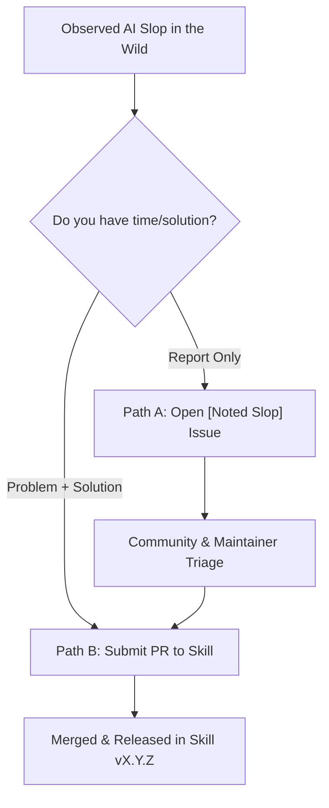

# Contributing to Anti-Slop Engineering

Thank you for your interest in improving **Anti-Slop Engineering**! We welcome contributions from developers, AI engineers, researchers, and practitioners who want to eliminate code bloat, hallucinated passes, test-oracle tampering, and undisciplined agent workflows.

---

## 🧭 How to Contribute: The "Noted Slop" Protocol

The most impactful way to contribute is by reporting and codifying **"Noted Slop"**—pathological code generation patterns, prompt leaks, UI clutter, or test tampering observed in AI coding agents (Claude Code, Cursor, Copilot, Codex, Gemini CLI, Antigravity, etc.) during real-world engineering.

You can contribute in one of two ways:



---

### Path A: Report "Noted Slop" (via GitHub Issue)

If you observed a recurring slop pattern in an AI coding assistant but don't have time or code ready to integrate it into the repository:

1. **Check Existing Patterns:** Search [`references/anti-pattern-catalog.md`](references/anti-pattern-catalog.md) and [open GitHub issues](https://github.com/imMamdouhaboammar/anti-slop-engineering/issues) to ensure it isn't already covered.
2. **Open a Noted Slop Issue:** Use our dedicated [🚨 Report Noted Slop Issue Template](https://github.com/imMamdouhaboammar/anti-slop-engineering/issues/new?template=noted_slop.yml).
3. **Provide Concrete Evidence:**
   - **Observed snippet or diff:** Real code, JSX, terminal log, or prompt output showing the exact slop.
   - **Agent / Model context:** (e.g., Claude 3.7 Sonnet, GPT-4o, Cursor, Copilot).
   - **Negative impact:** What breaks? (e.g., test suite erosion, client UI leakage, security vulnerability, maintainability tax).
   - **Suggested remediation:** What disciplined behavior should the agent have followed instead?

Our maintainers and community will triage the report, assign an official catalog ID, and schedule it for inclusion.

---

### Path B: Submit a PR (Problem + Solution Integrated)

If you have both the observed slop pattern AND the concrete engineering solution, you can submit a Pull Request to integrate it directly into the skill:

#### 1. Allocate a Pattern ID
Consult [`references/anti-pattern-catalog.md`](references/anti-pattern-catalog.md) under the relevant category and pick the next sequential ID:

| Prefix | Domain |
|---|---|
| `REQ-xx` | Requirements & Scope Speculation |
| `ARC-xx` | Architecture, Abstractions & Scaffolding |
| `DUP-xx` | Duplication & Code Organization |
| `DAT-xx` | Data, State & Persistence |
| `SEC-xx` | Security, Auth & Trust Boundaries |
| `CON-xx` | Concurrency, Async & Distributed Jobs |
| `API-xx` | APIs, RPCs & Public Contracts |
| `TST-xx` | Testing, Test Oracles & Snapshots |
| `UI-xx`  | Frontend, UI Clutter & Microcopy |
| `OPS-xx` | Operations, Resiliency & Shutdowns |
| `CI-xx`  | CI, Builds & Dependency Versioning |
| `WRK-xx` | Workflow, Review & Git Hygiene |
| `AUT-xx` | Agent Autonomy & Prompt Injection |
| `SIM-xx` | Code Simplicity, Logorrhea & Verbosity |

#### 2. Add Catalog Entry
Add your pattern to [`references/anti-pattern-catalog.md`](references/anti-pattern-catalog.md) following our standard 5-part schema:
```markdown
### `PREFIX-NN` | Title of the Anti-Pattern
- **Diagnostic symptom / smell:** What observable code, diff, or file pattern indicates this slop?
- **Root cause / why agents do it:** Why does the model default to this bad habit?
- **Correct engineering remediation:** What is the minimal, correct engineering practice?
- **Legitimate exceptions & context caveats:** When is this pattern justifiable or intentional?
```

#### 3. Update Skill & Agent Directives
- **[`SKILL.md`](SKILL.md):** If this requires a proactive agent directive, add a concise rule to **Operating Priorities** (lines 16–28) or under the appropriate Gate (**Gate 0 through Gate 6**).
- **[`AGENTS.md`](AGENTS.md):** Add an explicit numbered directive for AI coding agents operating on repositories.
- **[`references/engineering-judgment.md`](references/engineering-judgment.md):** Note any trade-offs or contextual caveats.

#### 4. Add Diff Guard Heuristic (Optional but Encouraged)
If the pattern can be detected in Git diffs via regex/heuristics without requiring an AST compiler:
1. Add the pattern to `scripts/diff_guard.py` (e.g., as `BLOCKER_PATTERNS` or `CANDIDATE_PATTERNS`).
2. Keep the script **pure Python 3 standard library** (no pip dependencies).
3. Scope the pattern to relevant file extensions (e.g. `UI_PATH` for frontend files, `CODE_EXTENSIONS` for source files) and exclude documentation via `DOC_PATH`.
4. Add a unit test to `tests/test_diff_guard.py` verifying both:
   - Positive detection (triggers warning or blocker).
   - Negative exclusion (documentation or valid code is not falsely flagged).

#### 5. Verification & PR Checklist
Run the test suite locally before pushing:

```bash
# Run unit tests:
make test

# Run syntax and check pass:
make check

# Test via Bun CLI wrapper:
bun ./bin/cli.js test

# Run self-diff guard check:
python3 scripts/diff_guard.py --base HEAD
```

Update the pattern count in `README.md` and add an entry under `[Unreleased]` or the next patch version in `CHANGELOG.md`.

---

## ⚖️ Principles for Accepted Contributions

1. **Evidence Over Vibes:** We do not accept vague complaints about "bad style." Every pattern must demonstrate observable harm to software correctness, maintainability, security, or human reviewability.
2. **Protect the Test Oracle:** Any modification to existing test suites must be accompanied by an explicit contract change justification. Never weaken assertions to make CI pass.
3. **No External Dependencies for Core Guards:** `scripts/diff_guard.py` must run anywhere Python 3.9+ exists without `pip install`.
4. **Legitimate Exceptions Must Be Acknowledged:** Every rule has edge cases. Always document when a pattern is legitimate (e.g., standard framework boilerplate, backward-compatibility shims).

---

## 🛠️ CLI Development Commands

| Command | Action |
|---|---|
| `make test` | Runs the Python unit test suite (`tests/test_diff_guard.py`) |
| `make guard` | Runs `scripts/diff_guard.py --base HEAD` on current changes |
| `make check` | Runs compilation syntax checks, test suite, and self-guard |
| `bun ./bin/cli.js test` | Runs test suite through the multi-agent CLI wrapper |
| `bun ./bin/cli.js --help` | Validates CLI options and banner output |

---

## 📜 Pull Request Guidelines

- Branch names should be descriptive: `feat/noted-slop-ui-clutter` or `fix/diff-guard-regex`.
- Use conventional commits: `feat: add UI-17 pattern for unescaped template tags`.
- Include links to relevant issues or real-world example URLs in your PR description.
- Use the pull request template provided in [`.github/PULL_REQUEST_TEMPLATE.md`](.github/PULL_REQUEST_TEMPLATE.md).
