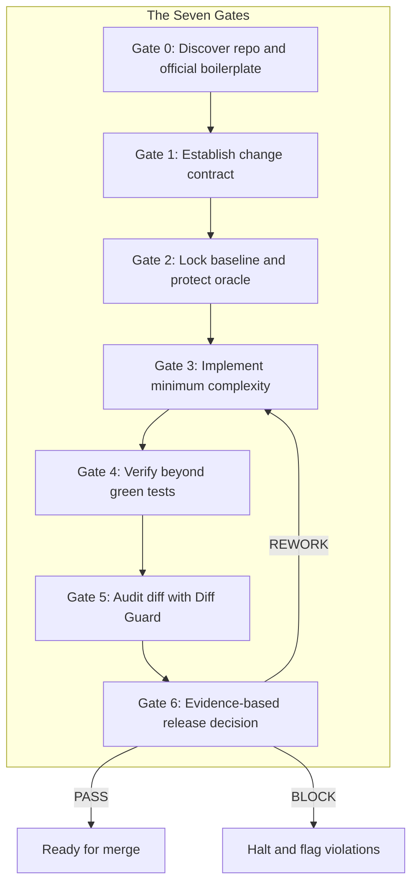

<div align="center">

# Anti-Slop Engineering

**A static guard, agent skill, and engineering playbook that catches the failure modes AI coding agents produce most — before they reach review.**

[](https://github.com/imMamdouhaboammar/anti-slop-engineering/actions)
[](https://www.npmjs.com/package/anti-slop-engineering)
[](LICENSE)
[](https://bun.sh)
[](https://www.python.org/)
[](https://skills.sh/imMamdouhaboammar/anti-slop-engineering)
[](https://claude.ai)

[Install](#install) · [What it catches](#what-it-catches) · [Engines](#engines) · [Decision Guard](#decision-guard) · [Root-Fix Gate](#root-fix-gate) · [Future-Scale Gate](#future-scale-gate) · [Paranoid Architect](#the-paranoid-principal-architect) · [Forensic Bug Hunter](#forensic-bug-hunter-scanner) · [Execution Guard](#in-flight-execution-guard) · [AST Slop Gate](#type-level--ast-slop-gate) · [Install Anti-Slop](#install-anti-slop-oxlint--skill) · [Agent skill](#agent-skill) · [Anti-pattern catalog](#anti-pattern-catalog-217-patterns)

</div>

---

AI coding agents ship at speed. They also systematically produce the same failure modes: skipped tests, dead code branches, flat retry loops, silent exception swallows, UI copy that reads like internal notes, and code structures that look correct but drift from the original intent. Anti-Slop Engineering is a multi-layer guard system that intercepts those patterns across your diff, your codebase, and your agent's decision loop — with zero dependencies on external services or proprietary APIs.

It runs as a zero-install CLI, a native Rust/Go microservice pair, and a portable agent skill that drops into Claude Code, Gemini CLI, Cursor, Codex, and Windsurf. It enforces Google SRE principles (KISS, DRY, YAGNI, Fix Issues at Scale) through static analysis, not style preference.

---

## Install

**Zero-install — run directly on any diff:**

```bash
bunx anti-slop-engineering --base HEAD
bunx anti-slop-engineering sre --base HEAD --strict
```

**Agent skill — wires into Claude Code, Gemini CLI, Codex, and others:**

```bash
npx skills add imMamdouhaboammar/anti-slop-engineering
```

**npm / Bun (auto-installs the agent skill on postinstall):**

```bash
bun add anti-slop-engineering
# or
npm install anti-slop-engineering
```

**Universal multi-agent installer:**

```bash
curl -fsSL https://raw.githubusercontent.com/imMamdouhaboammar/anti-slop-engineering/main/install.sh | bash
```

**Python CLI (pipx / uv):**

```bash
uv tool install git+https://github.com/imMamdouhaboammar/anti-slop-engineering.git
pipx install git+https://github.com/imMamdouhaboammar/anti-slop-engineering.git
```

---

## What it catches

### Diff Guard — pre-commit and PR triage

Runs on any git diff in under a second. No network access. No config files required.

| Code | Severity | Pattern detected |
|---|---|---|
| `SKIPPED_TEST` | **blocker** | `@pytest.mark.skip`, `it.skip(`, `@Disabled`, `xit(` — test oracle tampered |
| `WEAK_ASSERTION` | review | `assert True`, `expect(true).toBe(true)` — assertion theater |
| `SECURITY_BYPASS_CANDIDATE` | review | `verify=False`, `rejectUnauthorized: false`, `--no-verify` |
| `ERROR_SWALLOW_CANDIDATE` | review | `except Exception: pass`, empty `catch {}` blocks |
| `TYPE_CHECK_SUPPRESSION` | review | `@ts-ignore`, `@ts-nocheck`, `type: ignore` |
| `SRE_YAGNI_DEAD_FLAG` | **blocker** | `if False:`, `if (false)` — speculative dead branches |
| `SRE_SCALE_FLAT_RETRY` | review | Retry loop with fixed `sleep(N)` — thundering herd risk |
| `SRE_SCALE_SLEEP_BAND_AID` | review | `time.sleep()` used as async synchronization |
| `SRE_SCALE_UNBOUNDED_CONCURRENCY` | review | `Promise.all(items.map(...))`, `asyncio.gather(*tasks)` without semaphore |
| `DEV_NOTE_IN_UI` | **blocker** | Agent/dev notes inside `<p>`, `<span>`, `<div>` — leaking into user-facing surfaces |
| `PATRONIZING_UI_COPY` | review | "Please enter your email", "Click here to submit" under self-evident controls |
| `TRIVIAL_COMMENT_NARRATION` | review | `// return result`, `// increment count` — syntax play-by-play |
| `SPECULATIVE_SUBMISSION_DOSSIER` | review | `docs/*submission*.md`, `docs/*dossier*.md` — unrequested platform guides |
| `AFFORDANCE_NARRATION` | review | "The following table shows", "Click to expand" — meta-preamble in docs |
| `LARGE_DIFF_SCOPE` | review | Added lines exceed 400 — prompts scope review |

```bash
# Standard pre-commit triage:
bunx anti-slop-engineering --base HEAD

# Compare PR branch against main merge-base:
BASE="$(git merge-base HEAD origin/main)"
bunx anti-slop-engineering --base "$BASE"

# Machine-readable JSON for CI pipelines:
bunx anti-slop-engineering --base HEAD --json

# Exit code 2 on any blocker (CI gate):
bunx anti-slop-engineering --base HEAD --fail-on-blocker
```

### SRE Guard — Google SRE principles enforced statically

Implements the four Google SRE engineering mandates (KISS, DRY, YAGNI, Fix Issues at Scale) as a static analysis pass over your diff or source files. Zero external dependencies — pure Python 3.9+ stdlib.

| Pillar | Diagnostic code | What it flags |
|---|---|---|
| **KISS** | `KISS_DEEP_NESTING` | Control flow nested beyond 4 levels — flatten with guard clauses |
| **KISS** | `KISS_FUNCTION_BLOAT` | Functions exceeding 80 lines — split into single-responsibility units |
| **DRY** | `DRY_CODE_DUPLICATION` | Logic blocks of 4+ normalized lines duplicated across files |
| **YAGNI** | `YAGNI_SPECULATIVE_COMMENT` | `TODO(future)`, `reserved for future use`, `placeholder for v2` |
| **YAGNI** | `YAGNI_DEAD_SPECULATIVE_FLAG` | `if False:`, `if (false)` dead branches |
| **YAGNI** | `YAGNI_SPECULATIVE_PARAMETER` | `_unused_param`, `future_kwargs` — phantom interface surface |
| **Scale** | `SCALE_UNBOUNDED_OR_FLAT_RETRY` | Retry with `sleep(N)` — no exponential backoff, no full jitter |
| **Scale** | `SCALE_SLEEP_BAND_AID` | Arbitrary `sleep()` as async synchronization |
| **Scale** | `SCALE_UNBOUNDED_CONCURRENCY` | Unbound `Promise.all(map(...))`, `asyncio.gather(*tasks)` |
| **Scale** | `SCALE_TOIL_ERROR_SWALLOW` | Silent exception swallowing — untracked fleet-wide failures |
| **Scale** | `SCALE_MISLEADING_HEALTH_CHECK` | Static `200 OK` health endpoints — no dependency probing |

```bash
# Audit working-tree diff:
bunx anti-slop-engineering sre --base HEAD

# Audit specific files or directories:
bunx anti-slop-engineering sre --files src/ lib/

# CI strict gate — exits 2 on blockers:
bunx anti-slop-engineering sre --base HEAD --strict

# Custom thresholds:
bunx anti-slop-engineering sre --max-nesting 4 --min-dup-lines 4 --max-function-lines 80
```

---

## Engines

### Rust SHIT Interceptor (`services/anti-slop-rust`)

A high-performance Axum HTTP microservice that audits diffs and source for Scope creep (`S`), Hypothetical hardening (`H`), and Intent violation (`I`) in diffs, plus regex-based Senior Dev Ladder checks for hand-rolled alternatives to common platform primitives. Task-thrashing detection is not implemented.

```bash
# Triage git changes through Rust engine:
bunx anti-slop-engineering rust triage

# Check a specific diff for SHIT violations:
bunx anti-slop-engineering rust shit-check --diff patch.diff

# Run as background microservice:
bunx anti-slop-engineering serve-rust --port 9091
```

### Go SRE Toil Engine (`services/toil-guard-go`)

A concurrent Go microservice for high-throughput SRE metric verification. Runs KISS nesting depth checks, multi-file DRY sliding-window token hashing, toil detection, and SLI/SLO error budget scoring in parallel. Exposes standard `/healthz`, `/metrics`, and `/v1/audit` endpoints with Prometheus metrics.

```bash
# SRE audit across repository:
bunx anti-slop-engineering toil audit .

# Live git diff statistics (not a live error-budget calculation):
bunx anti-slop-engineering toil stream

# Start Go microservice daemon:
bunx anti-slop-engineering serve-go --port 9092
```

---

## The Seven Gates

A structured workflow that governs how AI agents and human engineers plan, implement, verify, and review changes. Each gate is a named enforcement checkpoint, not a style preference.



| Gate | Phase | Contract |
|---|---|---|
| **0** | Discover | Inspect root configs, lockfiles, conventions. Identify official CLI installers. Never improvise repo habits. |
| **1** | Contract | Define what changes, what must not change, invariants, and rollback requirements. |
| **2** | Lock Oracle | Baseline existing tests. Protect assertions. Write red-state repro before modifying production code. |
| **3** | Implement | Minimum justified complexity. Official scaffolding only. Pin latest stable dependencies. No duplicate layers. |
| **4** | Verify | Execute real tests beyond green badges. Test negative boundaries, concurrency, and contract seams. |
| **5** | Audit Diff | Run `diff_guard.py` as a skeptical reviewer. Flag scope expansions, test modifications, and hidden leaks. |
| **6** | Evidence | Issue structured report: `BLOCK`, `REWORK`, `REVIEW`, or `PASS` with exact `file:line` citations. |

---

## Decision Guard

The [Decision Guard module](skills/decision-guard/SKILL.md) addresses two decisions the code diff cannot catch: deriving an answer that already exists directly, and choosing a familiar technology stack without testing the product's actual requirements and future operating costs.

| Situation | Agent behavior |
| --- | --- |
| Seven metrics infer a value present in a source field | Verify the field's semantics and propose using the direct answer |
| A logged-in app triggers an automatic Next.js/Vercel/database bundle | Separate rendering, jobs, hosting, persistence and operations choices |
| VPS appears cheaper than managed infrastructure | Compare recovery, maintenance, on-call, migration and actual workload |
| New evidence invalidates days of prior work | Interrupt, explain the change and offer the smallest corrected path |

The module is loaded selectively during Gate 0/1 for consequential decisions. It includes a portable skill, two focused workflows, decision references, nine evaluation scenarios and a standard-library JSON record checker.

```bash
node bin/cli.js decision audit skills/decision-guard/examples/architecture-record.json --json
# Or, using the package CLI:
npx anti-slop-engineering decision audit path/to/decision.json --json
```

Exit `0` means the record is structurally complete, `2` means required decision evidence is missing, and `1` means unreadable or malformed input. These are **not** claims that the chosen architecture is correct or that sources were verified. A complete record can intentionally recommend `pause` or `stop`.

---

## Root-Fix Gate

The [Root-Fix Gate module](skills/root-fix-gate/SKILL.md) interrupts scattered symptom patches before they harden into permanent architecture. It traces the source-of-truth owner, compares a coherent boundary correction against repeated consumer workarounds, and checks whether the eventual change surface matches the causal plan.

| Situation | Agent action |
| --- | --- |
| Email hidden separately in twenty profile controllers | Inspect the identity, checkout and serialization contracts before editing consumers |
| A proposed `User.email = null` fix could affect account recovery | Test auth and data boundaries, and pause destructive changes without authority |
| A valid migration touches many consumers and tests | Keep necessary changes; explain each path instead of enforcing a file-count limit |
| A narrow, reversible change already has a verified owner | Skip the extra protocol and resume BUILD/FIX |

```bash
node bin/cli.js root-fix audit skills/root-fix-gate/examples/email-checkout-record.json --json
# Against an actual project diff, using a prepared root-fix record:
node bin/cli.js root-fix audit path/to/root-fix.json --json --repo . --base HEAD
```

The JSON checker uses only Python standard library and Git when diff inspection is requested. It checks record completeness, flags undeclared paths for review, and never certifies a root-cause hypothesis or grants permission to delete user data. The package CLI equivalent becomes available when a release containing this module is published.

---

## Future-Scale Gate

The [Future-Scale Gate](skills/future-scale-gate/SKILL.md) protects long-lived systems against two opposite failures: locking a core contract to today's workload, and implementing expensive infrastructure for an unverified hypothetical future.

| Question | Required evidence |
| --- | --- |
| What changes over the product's lifetime? | Credible scenarios with sources, stress axes and failure consequences |
| Which foundation would be costly to change later? | Reversal cost, alternative designs and migration/exit path |
| What must be established now? | Small stable boundary and a representative evolution test |
| What should wait? | Deferred capacity with a concrete revisit trigger |

Examples include a simulation language keeping its semantics portable across runtimes, a versioned public data format, or a future tenant-isolation constraint. The Gate does not require microservices, Rust, distributed systems or a provider bundle by default.

```bash
node bin/cli.js future-scale audit skills/future-scale-gate/examples/runtime-envelope-record.json --json
```

The bundled example intentionally recommends `pause` because its alternate-engine experiment has not been run. The zero-dependency checker validates record completeness, not forecast accuracy or actual scalability. The ten semantic evaluation scenarios are proposed tests, not measured model effectiveness.

---

## The Paranoid Principal Architect

The [Paranoid Principal Architect](skills/paranoid-principal-architect/SKILL.md) skill enforces an uncompromising, zero-trust engineering posture designed for day-one 10,000,000 concurrent user scale. It rejects optimistic "happy-path" code generation, unparsed inputs, unbounded async loops, hot-key lock contention, and client authority.

| Pillar | Strict Enforcement |
| --- | --- |
| **10M Concurrent Users Axiom** | Little's Law capacity budgeting, 16-shard counters, keyset cursor pagination (`LIMIT <= 100`), semaphore worker pools |
| **The Internet is a Battlefield** | Parse don't validate (Zod/Valibot `.strict()`), data-layer ownership checks in queries, constant-time `crypto.timingSafeEqual` |
| **Murphy's Law by Default** | Mandatory `Idempotency-Key` headers on mutations, `AbortSignal.timeout(ms)` on all outbound I/O, exponential backoff with full jitter |
| **Modern Web Standards** | Native platform primitives (`structuredClone`, Web Streams, `URLSearchParams`), native `<dialog>` modals, strict branded types |

Audit architectural threat records:

```bash
bunx anti-slop-engineering paranoid audit skills/paranoid-principal-architect/examples/paranoid-architecture-record.json --json
```

---

## Observability & SLO Architect (Google Monarch & Dapper)

The [Observability & SLO Architect](skills/observability-and-slo-architect/SKILL.md) skill transforms observability from passive `logger.error` statements into a proactive telemetry architecture following Google Monarch & Dapper specifications:

1. **OpenTelemetry by Default:** Binds every network I/O, database query, cache fetch, and queue operation to standard Spans with unbroken W3C `traceparent` (`00-<traceId>-<spanId>-<flags>`) and `correlation_id` context propagation.
2. **Google Monarch Low-Cardinality Discipline:** Strictly separates low-cardinality time-series metrics ($\prod |L_i| \le 1,000$) from high-cardinality traces and logs. Collapses unmatched 404 paths to `"__unmatched__"` to neutralize TSDB cardinality denial-of-service attacks.
3. **Automated RED & USE Metrics:** Automatically emits Rate, Errors, and Duration (Histograms with P50/P95/P99 quantiles and Trace Exemplars) for endpoints, and Utilization, Saturation, and Errors for resources (CPU, Memory, DB Connection Pools, Worker Queues).
4. **SLI/SLO-Driven Alerts:** Bans non-impact threshold alerts (e.g. CPU > 80%). Production alerts are gated strictly on Google SRE Multi-Window Multi-Burn-Rate Error Budget policies (14.4x 1h/5m for paging; 6.0x 6h/30m for ticketing).

```bash
# Audit an Observability & SLO record and scan source files for cardinality or tracing hazards:
bunx anti-slop-engineering observability audit skills/observability-and-slo-architect/examples/observability-slo-record.json --source skills/observability-and-slo-architect/examples/dapper-monarch-telemetry-pipeline.ts --json
```

---

## Forensic Bug Hunter Scanner

Zero-trust static analysis scanner across 9 application stacks detecting booby traps, concurrency leaks, race conditions, memory leaks, and EDoS vulnerabilities:

```bash
# Scan git diff against base:
bunx anti-slop-engineering hunter --base HEAD
# Scan specific file or directory:
bunx anti-slop-engineering hunter --path src/
# Output machine-readable JSON:
bunx anti-slop-engineering hunter --json
```

Modular playbooks and architectural checklists are located in [`skills/paranoid-principal-architect/playbooks/`](skills/paranoid-principal-architect/playbooks/).

---

## Apple Craft & Interaction Physics

The [Apple Craft & Interaction Physics module](skills/apple-craft-and-interaction-physics/SKILL.md) elevates client user interfaces from baseline hygiene to Apple HIG design engineering excellence. It enforces four physical pillars:

1. **Exhaustive UI State Matrix:** Eliminates boolean soup in favor of typed Discriminated Union state machines handling all 8 operational states (`loading_skeleton`, `empty`, `partial_error`, `offline`, `optimistic_rollback`, `loaded_fresh`, `revalidating_stale`, and `terminal_error`) with compile-time exhaustiveness.
2. **Zero Layout Shift (CLS = 0.000):** Strictly pre-reserves dynamic element geometry, skeleton dimensions, media aspect ratios, and stable scrollbar gutters.
3. **Interruptible Physics & Velocity Continuity:** Mandates mass-spring-damper motion ($F = -kx - cv$) with immediate gesture interruption, momentum handover ($v_0$), compositor-only execution, and epsilon termination ($\epsilon \le 10^{-4}$).
4. **Keyboard & Focus Mastery:** Guarantees full keyboard operability, high-contrast `:focus-visible` rings with offset (bans naked `outline: none`), modal focus trapping with return restoration, and polite ARIA live regions.

```bash
# Audit an assessment record and scan component for layout thrashing, transition:all, or bare outline:none:
node bin/cli.js apple-craft audit skills/apple-craft-and-interaction-physics/examples/apple-craft-record.json --source skills/apple-craft-and-interaction-physics/examples/interactive-craft-component.ts --json

# Package CLI invocation:
bunx anti-slop-engineering apple-craft audit path/to/record.json --json
```

---

## Type-Level & AST Slop Gate

Prevents evidence fabrication, quadratic reductions, eager array allocations, and test-oracle erosion in TypeScript and JavaScript. Runs across two complementary tiers:

```bash
# Tier 1: Zero-dependency pre-commit diff scan (<100ms):
bunx anti-slop-engineering ast --base HEAD

# Direct file or directory sweep:
bunx anti-slop-engineering ast src/ --json

# Strict gate (exit code 2 on blockers):
bunx anti-slop-engineering ast --base origin/main --strict
```

---

## Install Anti-Slop (Oxlint & Skill)

Opinionated anti-slop Oxlint lint rules and agent skill for TypeScript and JavaScript codebases. Catches runtime type assertion risks, unconstrained object parameters, type widening, and module mocking leaks at lint-time:

### Agent Skill & Slash Command

Invoke `/install-anti-slop` in any supported AI coding agent (Claude Code, Antigravity, Gemini CLI, Cursor, Windsurf) to automatically inspect the target repository, detect package managers, vendor the AST plugins, and configure `oxlint.config.ts` or `.oxlintrc.json`.

### Install & Update Vendored Oxlint Plugin

```bash
# Install Oxlint plugin directly into target repository (creates tools/oxlint/anti-slop/):
bunx anti-slop-engineering install-oxlint

# Reconcile and update vendored rules while preserving local custom modifications:
bunx anti-slop-engineering update-oxlint tools/oxlint/anti-slop --apply
```

Register the generic and optional Effect plugins in `oxlint.config.ts` or `.oxlintrc.json`:

```ts
// oxlint.config.ts or .oxlintrc.json
export default {
  ignorePatterns: [
    ".agent/**",
    ".agents/**",
    ".claude/**",
    ".gemini/**",
    "tools/oxlint/anti-slop/**"
  ],
  jsPlugins: [
    { name: "anti-slop", specifier: "./tools/oxlint/anti-slop/index.ts" },
    { name: "anti-slop-effect", specifier: "./tools/oxlint/anti-slop/effect/index.ts" }
  ],
  rules: {
    "oxc/no-accumulating-spread": "error",
    "anti-slop/no-array-filter-map": "error",
    "anti-slop/no-reduce-accumulator-copy": "error",
    "anti-slop/no-chained-type-assertions": "error",
    "anti-slop/no-conditional-empty-object-spread": "error",
    "anti-slop/no-known-value-widening": "error",
    "anti-slop/no-module-mocking": "error",
    "anti-slop/no-object-parameters": "error",
    "anti-slop/no-reflect-apply": "error",
    "anti-slop/no-reflect-get": "error",
    "anti-slop/no-runtime-typeof": "error",
    "anti-slop/no-shape-in-symbol-names": "error",
    "anti-slop/no-unknown-parameters": "error",
    "anti-slop/no-unknown-returns": "error",
    "anti-slop/no-unknown-type-aliases": "error",
    "anti-slop/no-unsafe-dictionary-type": "error",
    "anti-slop/no-widen-then-assert": "error",
    "anti-slop/require-readable-spacing": "error",
    "anti-slop/require-safety-comment-for-type-assertion": "error",
    "anti-slop-effect/no-manual-effect-error-tag": "error",
    "anti-slop-effect/no-manual-tag-comparison": "error",
    "anti-slop-effect/no-manual-tagged-construction": "error",
    "anti-slop-effect/no-service-constructor-imports": "error",
    "anti-slop-effect/prefer-effect-match": "error"
  }
};
```

---

## In-Flight Execution Guard

The real-time execution guard interceptor enforces boundaries before agent actions run. Inspired by Stop-That-Shit boundary control, it intercepts PreToolUse actions, parses active directives, gates unauthorized file mutations, blocks unverified dependency creep, caps concurrent subagent fanout, and evaluates declarative pairwise test cases:

| Feature | Enforcement |
| --- | --- |
| **Directive Parser** | `$anti-slop [mode] [level] [files=...] [hash=...] [deps=...] [agents=N] -- [task]` |
| **File Boundary Lock** | Rejects edits outside declared contract paths (`PATH_OUTSIDE_CONTRACT`) |
| **Read-Only Mode Gate** | Blocks mutating tools (`write_file`, `edit_file`, mutating shell commands) in `review`/`answer`/`monitor` modes |
| **Dependency Gate** | Flags unapproved package installations; issues single-use runner tickets when `deps=ask` |
| **Subagent Concurrency** | Halts subagent invocations when `active_subagents >= agents` budget |
| **Pairwise Case Runner** | 16 declarative Good/Bad test cases verifying SHIT boundary invariants |

```bash
# Check guard status & active directives:
bunx anti-slop-engineering exec status

# Evaluate an action against active contract:
bunx anti-slop-engineering exec check-action --tool edit_file --args '{"Path": "unauthorized.ts"}'

# Run declarative pairwise evaluation cases (16 cases across H, I, S, T):
bunx anti-slop-engineering cases
```

---

## Cognitive Bandwidth & Attention Economy Governor

Inspired by human attention scarcity, scannability science, and executive cognitive load reduction (attention-span & i-have-adhd), the Attention Governor statically audits agent responses, PR descriptions, standup briefs, and multi-agent TOON handoffs against 5 deterministic cognitive invariants:

| Metric | Target | Failure / Blocker |
| --- | --- | --- |
| **Terminal Blocking Placement ($\mathcal{B}_{pos}$)** | Last block | Question buried mid-reply before trailing status prose |
| **Line-1 Skimmer Flag** | Explicit flag on line 1 | Asks in long replies ($\ge 40$ words) without a line-1 prompt |
| **Deliverable Purity ($\mathcal{P}_{deliv}$)** | 100% clean payload | Opener wrappers (`Here is...`), closer offers (`Hope this helps!`), and lead-ins |
| **Time-to-Point ($TTP$)** | $\le 20$ words | Answers buried behind conversational preamble |
| **Max Wall Words ($W_{max}$)** | $\le 60$ words | Dense, anchor-free prose paragraphs causing cognitive bounce |
| **Working Memory Cap ($\mathcal{M}_{cap}$)** | $\le 5$ items | Unchunked flat lists exceeding working memory capacity |
| **Non-Regression Gate** | 100% preservation | Dropped numeric thresholds, scoped conditions, or safety caveats |

```bash
# Audit markdown documentation for cognitive scannability:
bunx anti-slop-engineering attention --file docs/rfc.md --json

# Verify 100% deliverable purity on generated commit message or PR body:
bunx anti-slop-engineering attention --text "$COMMIT_MSG" --check-deliverable

# Audit git diff additions across documentation:
bunx anti-slop-engineering attention --base HEAD
```

---

## Tagore Engineering Discourse & Substance Guard

Inspired by Rabindranath Tagore's literary philosophy of restraint, empirical specificity, and authentic human voice over statistical predictability and mechanical puffery, Tagore Guard audits PR descriptions, commit messages, ADRs, documentation, and agent reasoning traces against a dual-direction attack:

1. **Scrub the Tells:** Eliminates 29 cataloged AI tells (significance inflation, copula avoidance, superficial -ing chains, rule-of-three, em-dash addiction, and marketing hype).
2. **Inject the Substance:** Mandates active engineering agency, empirical measurements, and explicit operational trade-offs/failure modes.

### 8-Dimension Scoring Rubric

$$\text{Total Score} \ge 56/80 \quad \land \quad \text{Mechanics} \ge 35/50 \quad \land \quad \text{Substance} \ge 21/30$$

| Category | Dimension | Max | Floor | Focus |
| --- | --- | :---: | :---: | --- |
| **Mechanics** | Directness | 10 | — | Immediate technical statements; zero announcements or throat-clearing |
| | Rhythm | 10 | — | Varied sentence length cadence ($\text{stddev} \ge 5.0$); no em-dash crutches |
| | Trust | 10 | — | Zero affordance narration, zero hand-holding, zero servile hedging |
| | Authenticity | 10 | — | Free of AI buzzwords (`delve`, `tapestry`, `testament`), copula avoidance, and triads |
| | Density | 10 | — | Free of filler phrases (`in order to`), bolding abuse, and passive voice ($< 35\%$) |
| *Subtotal* | **Mechanics Floor** | **50** | **35** | *Substance cannot mask slop-shaped mechanics* |
| **Substance** | Specificity | 10 | — | Empirical numbers, benchmark percentages, latencies, and exact file paths |
| | Restraint | 10 | — | Achievements sized at actual technical magnitude; zero promotional puffery |
| | Technical Voice | 10 | — | Explicit trade-offs, concurrency race conditions, and failure modes |
| *Subtotal* | **Substance Floor** | **30** | **21** | *Mechanics cannot mask sterile, soulless wire-copy* |
| **Total** | **Pass Gate** | **80** | **56** | *Both floors + $\ge 56$ required for `PROCEED`* |

```bash
# Audit inline text with suggested deslopping rewrites:
bunx anti-slop-engineering tagore --text "$PR_BODY" --suggest

# Audit markdown documentation or ADR file:
bunx anti-slop-engineering tagore --file docs/adr/ADR-007.md --json

# Calibrate repository voice profile against maintainer ground truth:
bunx anti-slop-engineering tagore --calibrate README.md

# Inspect active repository voice profile:
bunx anti-slop-engineering tagore --profile
```

---

## Agent skill

The agent skill wires Anti-Slop Engineering into your AI coding agent's context. Once installed, code changes are guided by the Seven Gates, the 217-pattern anti-pattern catalog, and the Google SRE enforcement rules.

**Supported environments:**

| Environment | Skill directory |
|---|---|
| Claude Code and Desktop | `~/.claude/skills/anti-slop-engineering` |
| Antigravity / Gemini CLI | `~/.gemini/config/skills/anti-slop-engineering` |
| Codex / OpenCode | `~/.codex/skills/anti-slop-engineering` |
| Universal Agent Kernel | `~/.agents/skills/anti-slop-engineering` |
| Cursor / Windsurf | `.cursor/rules/anti-slop.mdc` or `.cursor/skills/` |

```bash
npx skills add imMamdouhaboammar/anti-slop-engineering
```

When installed via `npm install anti-slop-engineering` or `bun add anti-slop-engineering`, the postinstall hook runs `npx skills add` automatically.

---

## Anti-pattern catalog (217 patterns)

The catalog in [`references/anti-pattern-catalog.md`](references/anti-pattern-catalog.md) documents 217 diagnostic patterns across 14 engineering domains, each with a canonical ID, symptom, root cause, and remediation.

**Domains covered:**

Requirements and scope · Architecture and abstractions · Duplication and code organization · Data, state, and persistence · Security and trust boundaries · Concurrency and async · APIs and contracts · Testing and oracles · Frontend and UI · Operations and reliability · CI, builds, and release · Workflow and review hygiene · Agent autonomy · Google SRE invariants

Notable catalog entries: `ARC-15` (manual scaffolding improvisation), `ARC-17` (wrong-layer symptom fan-out), `TST-12` (snapshot overwrite without review), `UI-13` (dev-notes leaked in UI), `SRE-08` (retry storms), `CI-15` (stale dependency pinning), `REV-19` (affordance narration in docs).

---

## Contributing

Spotted a recurring failure mode from an AI agent — test tampering, scope creep, hallucinated output, UI leakage? Report it as a [Noted Slop issue](https://github.com/imMamdouhaboammar/anti-slop-engineering/issues/new?template=noted_slop.yml) or submit a pull request:

1. Allocate the next pattern ID in [`references/anti-pattern-catalog.md`](references/anti-pattern-catalog.md).
2. Document symptom, root cause, and remediation using the 5-part catalog schema.
3. Update [`SKILL.md`](SKILL.md) with explicit agent rules.
4. Add heuristics to `scripts/diff_guard.py` with unit tests.
5. Run `make check-all` — all unit and polyglot tests (458 Python, 21 Rust, 14 Go, 49 Node/Bun) and linters must stay green.

```bash
npx anti-slop-engineering contribute
```

See [CONTRIBUTING.md](CONTRIBUTING.md) for the full guide.

---

## Citation

```bibtex
@software{aboammar2026antislop,
  author    = {Aboammar, Mamdouh},
  title     = {Anti-Slop Engineering: An Engineering Discipline Playbook and Guard System for AI Coding Agents},
  year      = {2026},
  publisher = {GitHub},
  url       = {https://github.com/imMamdouhaboammar/anti-slop-engineering}
}
```

See [`CITATION.cff`](CITATION.cff) for CFF format.

---

## License

- **Author:** [Mamdouh Aboammar](https://github.com/imMamdouhaboammar)
- **License:** [MIT](LICENSE)
- **Notice:** [NOTICE](NOTICE)

Copyright (c) 2026 Mamdouh Aboammar and contributors.
