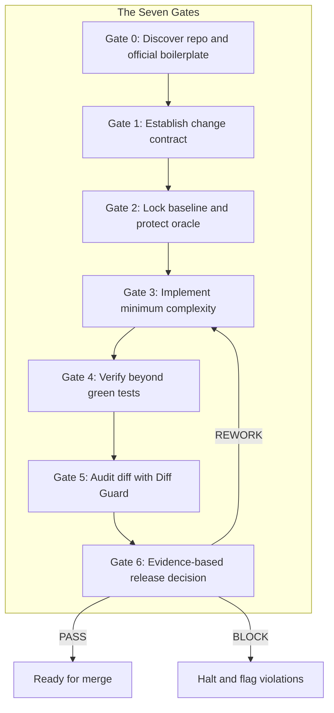

<div align="center">

# Anti-Slop Engineering

**A static guard, agent skill, and engineering playbook that catches the failure modes AI coding agents produce most — before they reach review.**

[](https://github.com/imMamdouhaboammar/anti-slop-engineering/actions)
[](https://www.npmjs.com/package/anti-slop-engineering)
[](LICENSE)
[](https://bun.sh)
[](https://www.python.org/)
[](https://skills.sh)
[](https://claude.ai)

[Install](#install) · [What it catches](#what-it-catches) · [Engines](#engines) · [Decision Guard](#decision-guard) · [Agent skill](#agent-skill) · [Anti-pattern catalog](#anti-pattern-catalog-215-patterns)

</div>

---

AI coding agents ship at speed. They also systematically produce the same failure modes: skipped tests, dead code branches, flat retry loops, silent exception swallows, UI copy that reads like internal notes, and code structures that look correct but drift from the original intent. Anti-Slop Engineering is a multi-layer guard system that intercepts those patterns across your diff, your codebase, and your agent's decision loop — with zero dependencies on external services or proprietary APIs.

It runs as a zero-install CLI, a native Rust/Go microservice pair, and a portable agent skill that drops into Claude Code, Gemini CLI, Cursor, Codex, and Windsurf. It enforces Google SRE principles (KISS, DRY, YAGNI, Fix Issues at Scale) through static analysis, not style preference.

---

## Install

**Zero-install — run directly on any diff:**

```bash
bunx anti-slop-engineering --base HEAD
bunx anti-slop-engineering sre --base HEAD --strict
```

**Agent skill — wires into Claude Code, Gemini CLI, Codex, and others:**

```bash
npx skills add imMamdouhaboammar/anti-slop-engineering
```

**npm / Bun (auto-installs the agent skill on postinstall):**

```bash
bun add anti-slop-engineering
# or
npm install anti-slop-engineering
```

**Universal multi-agent installer:**

```bash
curl -fsSL https://raw.githubusercontent.com/imMamdouhaboammar/anti-slop-engineering/main/install.sh | bash
```

**Python CLI (pipx / uv):**

```bash
uv tool install git+https://github.com/imMamdouhaboammar/anti-slop-engineering.git
pipx install git+https://github.com/imMamdouhaboammar/anti-slop-engineering.git
```

---

## What it catches

### Diff Guard — pre-commit and PR triage

Runs on any git diff in under a second. No network access. No config files required.

| Code | Severity | Pattern detected |
|---|---|---|
| `SKIPPED_TEST` | **blocker** | `@pytest.mark.skip`, `it.skip(`, `@Disabled`, `xit(` — test oracle tampered |
| `WEAK_ASSERTION` | review | `assert True`, `expect(true).toBe(true)` — assertion theater |
| `SECURITY_BYPASS_CANDIDATE` | review | `verify=False`, `rejectUnauthorized: false`, `--no-verify` |
| `ERROR_SWALLOW_CANDIDATE` | review | `except Exception: pass`, empty `catch {}` blocks |
| `TYPE_CHECK_SUPPRESSION` | review | `@ts-ignore`, `@ts-nocheck`, `type: ignore` |
| `SRE_YAGNI_DEAD_FLAG` | **blocker** | `if False:`, `if (false)` — speculative dead branches |
| `SRE_SCALE_FLAT_RETRY` | review | Retry loop with fixed `sleep(N)` — thundering herd risk |
| `SRE_SCALE_SLEEP_BAND_AID` | review | `time.sleep()` used as async synchronization |
| `SRE_SCALE_UNBOUNDED_CONCURRENCY` | review | `Promise.all(items.map(...))`, `asyncio.gather(*tasks)` without semaphore |
| `DEV_NOTE_IN_UI` | **blocker** | Agent/dev notes inside `<p>`, `<span>`, `<div>` — leaking into user-facing surfaces |
| `PATRONIZING_UI_COPY` | review | "Please enter your email", "Click here to submit" under self-evident controls |
| `TRIVIAL_COMMENT_NARRATION` | review | `// return result`, `// increment count` — syntax play-by-play |
| `SPECULATIVE_SUBMISSION_DOSSIER` | review | `docs/*submission*.md`, `docs/*dossier*.md` — unrequested platform guides |
| `AFFORDANCE_NARRATION` | review | "The following table shows", "Click to expand" — meta-preamble in docs |
| `LARGE_DIFF_SCOPE` | review | Added lines exceed 400 — prompts scope review |

```bash
# Standard pre-commit triage:
bunx anti-slop-engineering --base HEAD

# Compare PR branch against main merge-base:
BASE="$(git merge-base HEAD origin/main)"
bunx anti-slop-engineering --base "$BASE"

# Machine-readable JSON for CI pipelines:
bunx anti-slop-engineering --base HEAD --json

# Exit code 2 on any blocker (CI gate):
bunx anti-slop-engineering --base HEAD --fail-on-blocker
```

### SRE Guard — Google SRE principles enforced statically

Implements the four Google SRE engineering mandates (KISS, DRY, YAGNI, Fix Issues at Scale) as a static analysis pass over your diff or source files. Zero external dependencies — pure Python 3.9+ stdlib.

| Pillar | Diagnostic code | What it flags |
|---|---|---|
| **KISS** | `KISS_DEEP_NESTING` | Control flow nested beyond 4 levels — flatten with guard clauses |
| **KISS** | `KISS_FUNCTION_BLOAT` | Functions exceeding 80 lines — split into single-responsibility units |
| **DRY** | `DRY_CODE_DUPLICATION` | Logic blocks of 4+ normalized lines duplicated across files |
| **YAGNI** | `YAGNI_SPECULATIVE_COMMENT` | `TODO(future)`, `reserved for future use`, `placeholder for v2` |
| **YAGNI** | `YAGNI_DEAD_SPECULATIVE_FLAG` | `if False:`, `if (false)` dead branches |
| **YAGNI** | `YAGNI_SPECULATIVE_PARAMETER` | `_unused_param`, `future_kwargs` — phantom interface surface |
| **Scale** | `SCALE_UNBOUNDED_OR_FLAT_RETRY` | Retry with `sleep(N)` — no exponential backoff, no full jitter |
| **Scale** | `SCALE_SLEEP_BAND_AID` | Arbitrary `sleep()` as async synchronization |
| **Scale** | `SCALE_UNBOUNDED_CONCURRENCY` | Unbound `Promise.all(map(...))`, `asyncio.gather(*tasks)` |
| **Scale** | `SCALE_TOIL_ERROR_SWALLOW` | Silent exception swallowing — untracked fleet-wide failures |
| **Scale** | `SCALE_MISLEADING_HEALTH_CHECK` | Static `200 OK` health endpoints — no dependency probing |

```bash
# Audit working-tree diff:
bunx anti-slop-engineering sre --base HEAD

# Audit specific files or directories:
bunx anti-slop-engineering sre --files src/ lib/

# CI strict gate — exits 2 on blockers:
bunx anti-slop-engineering sre --base HEAD --strict

# Custom thresholds:
bunx anti-slop-engineering sre --max-nesting 4 --min-dup-lines 4 --max-function-lines 80
```

---

## Engines

### Rust SHIT Interceptor (`services/anti-slop-rust`)

A high-performance Axum HTTP microservice that audits diffs and source for Scope creep (`S`), Hypothetical hardening (`H`), and Intent violation (`I`) in diffs, plus regex-based Senior Dev Ladder checks for hand-rolled alternatives to common platform primitives. Task-thrashing detection is not implemented.

```bash
# Triage git changes through Rust engine:
bunx anti-slop-engineering rust triage

# Check a specific diff for SHIT violations:
bunx anti-slop-engineering rust shit-check --diff patch.diff

# Run as background microservice:
bunx anti-slop-engineering serve-rust --port 9091
```

### Go SRE Toil Engine (`services/toil-guard-go`)

A concurrent Go microservice for high-throughput SRE metric verification. Runs KISS nesting depth checks, multi-file DRY sliding-window token hashing, toil detection, and SLI/SLO error budget scoring in parallel. Exposes standard `/healthz`, `/metrics`, and `/v1/audit` endpoints with Prometheus metrics.

```bash
# SRE audit across repository:
bunx anti-slop-engineering toil audit .

# Live git diff statistics (not a live error-budget calculation):
bunx anti-slop-engineering toil stream

# Start Go microservice daemon:
bunx anti-slop-engineering serve-go --port 9092
```

---

## The Seven Gates

A structured workflow that governs how AI agents and human engineers plan, implement, verify, and review changes. Each gate is a named enforcement checkpoint, not a style preference.



| Gate | Phase | Contract |
|---|---|---|
| **0** | Discover | Inspect root configs, lockfiles, conventions. Identify official CLI installers. Never improvise repo habits. |
| **1** | Contract | Define what changes, what must not change, invariants, and rollback requirements. |
| **2** | Lock Oracle | Baseline existing tests. Protect assertions. Write red-state repro before modifying production code. |
| **3** | Implement | Minimum justified complexity. Official scaffolding only. Pin latest stable dependencies. No duplicate layers. |
| **4** | Verify | Execute real tests beyond green badges. Test negative boundaries, concurrency, and contract seams. |
| **5** | Audit Diff | Run `diff_guard.py` as a skeptical reviewer. Flag scope expansions, test modifications, and hidden leaks. |
| **6** | Evidence | Issue structured report: `BLOCK`, `REWORK`, `REVIEW`, or `PASS` with exact `file:line` citations. |

---

## Decision Guard

The [Decision Guard module](skills/decision-guard/SKILL.md) addresses two decisions the code diff cannot catch: deriving an answer that already exists directly, and choosing a familiar technology stack without testing the product's actual requirements and future operating costs.

| Situation | Agent behavior |
| --- | --- |
| Seven metrics infer a value present in a source field | Verify the field's semantics and propose using the direct answer |
| A logged-in app triggers an automatic Next.js/Vercel/database bundle | Separate rendering, jobs, hosting, persistence and operations choices |
| VPS appears cheaper than managed infrastructure | Compare recovery, maintenance, on-call, migration and actual workload |
| New evidence invalidates days of prior work | Interrupt, explain the change and offer the smallest corrected path |

The module is loaded selectively during Gate 0/1 for consequential decisions. It includes a portable skill, two focused workflows, decision references, nine evaluation scenarios and a standard-library JSON record checker.

```bash
node bin/cli.js decision audit skills/decision-guard/examples/architecture-record.json --json
# Or, using the package CLI:
anti-slop-engineering decision audit path/to/decision.json --json
```

Exit `0` means the record is structurally complete, `2` means required decision evidence is missing, and `1` means unreadable or malformed input. These are **not** claims that the chosen architecture is correct or that sources were verified. A complete record can intentionally recommend `pause` or `stop`.

---

## Agent skill

The agent skill wires Anti-Slop Engineering into your AI coding agent's context. Once installed, every code change the agent generates is governed by the Seven Gates, the 213-pattern anti-pattern catalog, and the Google SRE enforcement rules.

**Supported environments:**

| Environment | Skill directory |
|---|---|
| Claude Code and Desktop | `~/.claude/skills/anti-slop-engineering` |
| Antigravity / Gemini CLI | `~/.gemini/config/skills/anti-slop-engineering` |
| Codex / OpenCode | `~/.codex/skills/anti-slop-engineering` |
| Universal Agent Kernel | `~/.agents/skills/anti-slop-engineering` |
| Cursor / Windsurf | `.cursor/rules/anti-slop.mdc` or `.cursor/skills/` |

```bash
npx skills add imMamdouhaboammar/anti-slop-engineering
```

When installed via `npm install anti-slop-engineering` or `bun add anti-slop-engineering`, the postinstall hook runs `npx skills add` automatically.

---

## Anti-pattern catalog (215 patterns)

The catalog in [`references/anti-pattern-catalog.md`](references/anti-pattern-catalog.md) documents 215 diagnostic patterns across 14 engineering domains, each with a canonical ID, symptom, root cause, and remediation.

**Domains covered:**

Requirements and scope · Architecture and abstractions · Duplication and code organization · Data, state, and persistence · Security and trust boundaries · Concurrency and async · APIs and contracts · Testing and oracles · Frontend and UI · Operations and reliability · CI, builds, and release · Workflow and review hygiene · Agent autonomy · Google SRE invariants

Notable catalog entries: `ARC-15` (manual scaffolding improvisation), `TST-12` (snapshot overwrite without review), `UI-13` (dev-notes leaked in UI), `SRE-08` (retry storms), `CI-15` (stale dependency pinning), `REV-19` (affordance narration in docs).

---

## Contributing

Spotted a recurring failure mode from an AI agent — test tampering, scope creep, hallucinated output, UI leakage? Report it as a [Noted Slop issue](https://github.com/imMamdouhaboammar/anti-slop-engineering/issues/new?template=noted_slop.yml) or submit a pull request:

1. Allocate the next pattern ID in [`references/anti-pattern-catalog.md`](references/anti-pattern-catalog.md).
2. Document symptom, root cause, and remediation using the 5-part catalog schema.
3. Update [`SKILL.md`](SKILL.md) with explicit agent rules.
4. Add heuristics to `scripts/diff_guard.py` with unit tests.
5. Run `make check` — all 44 tests must stay green.

```bash
npx anti-slop-engineering contribute
```

See [CONTRIBUTING.md](CONTRIBUTING.md) for the full guide.

---

## Citation

```bibtex
@software{aboammar2026antislop,
  author    = {Aboammar, Mamdouh},
  title     = {Anti-Slop Engineering: An Engineering Discipline Playbook and Guard System for AI Coding Agents},
  year      = {2026},
  publisher = {GitHub},
  url       = {https://github.com/imMamdouhaboammar/anti-slop-engineering}
}
```

See [`CITATION.cff`](CITATION.cff) for CFF format.

---

## License

- **Author:** [Mamdouh Aboammar](https://github.com/imMamdouhaboammar)
- **License:** [MIT](LICENSE)
- **Notice:** [NOTICE](NOTICE)

Copyright (c) 2026 Mamdouh Aboammar and contributors.
