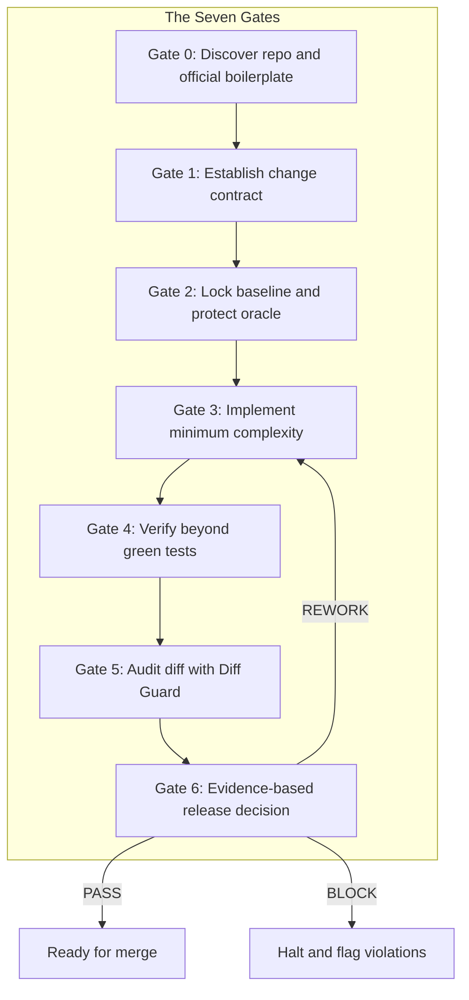

<div align="center">

# Anti-Slop Engineering

**A static guard, agent skill, and engineering playbook that catches the failure modes AI coding agents produce most — before they reach review.**

[](https://github.com/imMamdouhaboammar/anti-slop-engineering/actions)
[](https://www.npmjs.com/package/anti-slop-engineering)
[](LICENSE)
[](https://bun.sh)
[](https://www.python.org/)
[](https://skills.sh/imMamdouhaboammar/anti-slop-engineering)
[](https://claude.ai)

[Install](#install) · [Antigravity plugin and MCP](#antigravity-agentic-plugin-and-mcp-architecture) · [Multi-Agent Portability](#multi-agent-portability--host-adapters) · [What it catches](#what-it-catches) · [Engines](#engines) · [Decision Guard](#decision-guard) · [Root-Fix Gate](#root-fix-gate) · [Future-Scale Gate](#future-scale-gate) · [Paranoid Architect](#the-paranoid-principal-architect) · [Forensic Bug Hunter](#forensic-bug-hunter-scanner) · [Execution Guard](#in-flight-execution-guard) · [AST Slop Gate](#type-level--ast-slop-gate) · [Agent skill](#agent-skill) · [Anti-pattern catalog](#anti-pattern-catalog-217-patterns)

</div>

---

AI coding agents ship at speed. They also systematically produce the same failure modes: skipped tests, dead code branches, flat retry loops, silent exception swallows, UI copy that reads like internal notes, and code structures that look correct but drift from the original intent. Anti-Slop Engineering is a multi-layer guard system that intercepts those patterns across your diff, your codebase, and your agent's decision loop — with zero dependencies on external services or proprietary APIs.

It runs as a zero-install CLI, a native Rust/Go microservice pair, an Antigravity Agentic Plugin with 15 native MCP tools and 7 specialized subagents, and a portable agent skill across 15 AI coding environments. It enforces Google SRE principles (KISS, DRY, YAGNI, Fix Issues at Scale) through static analysis, not style preference.

---

## Install

**Zero-install — run directly on any diff:**

```bash
bunx anti-slop-engineering --base HEAD
bunx anti-slop-engineering sre --base HEAD --strict
```

**Agent skill — wires into Claude Code, Gemini CLI, Codex, and others:**

```bash
npx skills add imMamdouhaboammar/anti-slop-engineering
```

**npm / Bun (package installation, followed by optional setup):**

```bash
bun add anti-slop-engineering
# or
npm install anti-slop-engineering

# Interactive terminal setup (core required, plugins optional)
bunx anti-slop-engineering setup

# Reproducible non-interactive installation
bunx anti-slop-engineering install --agent=codex --skills=core --scope=project --json
```

**Universal multi-agent installer:**

```bash
curl -fsSL https://raw.githubusercontent.com/imMamdouhaboammar/anti-slop-engineering/main/install.sh | bash

# When using a local checkout, explicitly select optional skills:
bash install.sh --skills=decision-guard,root-fix-gate
```

Piped Bash installation interactively prompts for plugin selection when a terminal (`/dev/tty`) is present and Node.js is installed, or defaults cleanly to core in headless/CI environments. Running the local Bash installer from a terminal uses the same plugin catalog and selection prompt when Node.js is available; its historical agent destinations and CLI links stay intact. To change agent targets or project/global scope interactively, use `bunx anti-slop-engineering setup`. Without Node.js, Bash installs the bundled core and requires Node.js to select optional modules.

Installers running from a Git checkout copy tracked files from the working tree. Local agent settings, credentials and audit notes stay in the checkout.

Hook previews (`--codex-hooks`, `--claude-hooks`, `--gemini-hooks`) require a durable POSIX checkout of this repository: the preview runs the hook adapters from the checkout, so an npm/Bun package install cannot preview hooks. From a package install, the skills install normally — add `--enforcement=skills-only` to install them without hooks — or clone the repository and run the same command from the checkout. Hook previews are not supported on Windows (the adapters are POSIX-only).

**Python CLI (pipx / uv):**

```bash
uv tool install git+https://github.com/imMamdouhaboammar/anti-slop-engineering.git
pipx install git+https://github.com/imMamdouhaboammar/anti-slop-engineering.git
```

### Design integrity guard

An opt-in owner-signed design contract gates structured UI mutations before approval and checks signed artifacts, design tokens, approved classes and components, and declared browser scenarios against signed visual baselines. See [Design Integrity Guard](references/design-integrity-guard.md) for setup, trust boundaries, commands, and enforcement limits.

### Repo Fortress guard & scaffolder

Audits and scaffolds a 3-tier repository quality shield (`lefthook` pre-commit hooks, `commitlint`, CI lint-gate, `release-please`, and polyglot Docker templates) while blocking suppression bypasses (`@ts-ignore`, `eslint-disable`, `# noqa`, `as unknown as`). Run `bunx anti-slop-engineering fortress` (or `init-fortress`) to audit or scaffold. See [Repo Fortress](skills/repo-fortress/SKILL.md).

### Verification Contracts

| Command | Scope & Checks | When to Use |
| --- | --- | --- |
| `bunx anti-slop-engineering diff --base HEAD` | **Single Diff Guard**: Inspects git diff only for scope creep, unverified additions, ungrounded comments, and banned tokens. Exits 0 if no blocker patterns are identified. | Quick pre-commit diff triage. |
| `bunx anti-slop-engineering check --base HEAD` | **Backwards-Compatible Diff Check**: Retains narrow Diff Guard triage scope (alias for `diff`). Does not run SRE Guard, linters, or test suites. | Preserved for existing script compatibility. |
| `bunx anti-slop-engineering audit --base HEAD` | **Unified Multi-Guard Audit**: Runs all applicable active guards (Diff, SRE, AST, Contrast, Comment Budget, PR Boundary, Invariant Steward, etc.) and compiles a structured dossier in `anti-slop/audit-NNN.md`. Exits with code 1 if any blocker is found. | Comprehensive verification before PR creation or completion. |
| `bunx anti-slop-engineering audit --base HEAD --restricted-env` | Restricts the audit guards to inherited executable, home, locale, temp, Windows startup, and CI branch variables. Ordinary audits inherit the caller environment. | Audit without inheriting unrelated environment variables. |
| `bunx anti-slop-engineering check-all` | **Full Repository Quality Suite**: Runs `make check-all` (linting, Python unit tests, Bun security tests, Rust cargo test & clippy, and Go SRE tests). | Full CI-level verification across all polyglot targets. |

> **Note on Makefile vs CLI:** In `Makefile`, `make check` runs developer checks (`lint + test-verbose + guard + sre`), while CLI `anti-slop-engineering check` is the narrow git diff triage. For repository-wide verification, use `make check-all` or `bunx anti-slop-engineering check-all`.

---

## Antigravity agentic plugin and MCP architecture

Anti-Slop Engineering operates as a native agentic plugin within the Antigravity ecosystem (`plugin.json`, `mcp_config.json`, `hooks.json`, `.agents/hooks.json`). It exposes 15 dedicated MCP tools via `bin/mcp-server.js`, 7 domain-specialized subagents in `agents/`, and verified runtime hook adapters in `scripts/antigravity_hooks.py`.

### Verified Antigravity Hook Adapter

Antigravity 2.35.1+ loads `.agents/hooks.json` at session startup. Anti-Slop provides a zero-dependency POSIX hook adapter (`scripts/antigravity_hooks.py`) managing the `anti-slop` key:

- **PreToolUse gate**: Intercepts `write_file` and `edit_file` invocations before execution, evaluating diff safety and returning `{ "decision": "deny" }` with an actionable invariant reason if the target violates policy.
- **PostToolUse telemetry**: Emits post-mutation observations (`{}`) to record file modification events without side effects.
- **Containment & safety**: Rejects symlinks, preserves other configured project hooks, and verifies canonical path containment within the workspace.
- **CLI setup & preview**: Run `bunx anti-slop-engineering setup --antigravity-hooks` (or `--dry-run --json`) to preview and apply configuration.

### Native MCP Tools

| Tool | Purpose | Key Inputs |
|---|---|---|
| `anti_slop_audit` | Unified multi-guard triage runner compiling Markdown audit dossiers | `base`, `strict`, `restricted_env` |
| `anti_slop_diff_guard` | Pre-commit git diff analyzer detecting scope creep, unverified additions, and token leakage | `base`, `staged`, `path` |
| `anti_slop_sre_guard` | Google SRE engine enforcing KISS nesting ($\le 4$), DRY deduplication, and YAGNI pruning | `base`, `strict`, `path` |
| `anti_slop_ast_guard` | Oxlint AST engine eliminating type-widening, chained assertions, and empty spreads | `base`, `path` |
| `anti_slop_comment_guard` | Comment budget validator enforcing CCR $\le 0.35$ and banning syntax narration | `base`, `path` |
| `anti_slop_contrast_guard` | WCAG 2.2 color contrast calculator and CSS color scanner | `foreground`, `background`, `scan_path` |
| `anti_slop_demock_guard` | Runtime verification guard catching test mocks on production paths and phantom fallbacks | `base`, `path` |
| `anti_slop_mandela_guard` | Test-oracle auditor eliminating self-grading assertions, circular mocks, and swallowed errors | `test_path`, `json` |
| `anti_slop_reduction_guard` | Musk 5-step reduction analyzer maintaining `.anti-slop/add-back-ledger.jsonl` | `action`, `file` |
| `anti_slop_re0_handoff` | NVIDIA Re0 context reset auditor verifying $\le 1,500$ token state notes and Shower Test | `action`, `state_note_path` |
| `anti_slop_invariant_steward` | Architectural memory ledger maintaining `.anti-slop/invariant-ledger.json` | `action`, `base`, `file` |
| `anti_slop_attention_guard` | Cognitive load auditor enforcing terminal blocking placement and deliverable purity | `file`, `text` |
| `anti_slop_neural_route` | Graph router directing tasks to optimal specialist subagents and guards | `task_description` |
| `anti_slop_backprop` | Rule backpropagation engine translating downstream test failures into upstream invariants | `finding` |
| `anti_slop_forensic_hunter` | Heuristic vulnerability and bug scanner inspecting security boundaries | `target_dir` |

### Specialized Subagents

| Subagent | Role | Specialty |
|---|---|---|
| `anti-slop-orchestrator` | Lead autonomous coordinator | Multi-pass audits, topological blast radius, and backpropagation |
| `apple-craft-physicist` | Apple HIG and interaction physicist | 120Hz compositor physics, CLS $= 0.000$, and WCAG 2.2 contrast |
| `ast-slop-sentinel` | AST and type-level slop slayer | Chained type assertions, empty spreads, and quadratic reducers |
| `mandela-leakage-hunter` | Test oracle integrity specialist | Eliminates self-grading tests, circular mocks, and swallowed assertions |
| `paranoid-principal-architect` | Zero-trust & 10M concurrent user architect | Boundary schema parsing, distributed idempotency, and constant-time crypto |
| `re0-context-architect` | NVIDIA Re0 context economics architect | Bounded state notes ($\le 1,500$ tokens) and Cold-Read Shower Test |
| `sre-invariant-guardian` | Google SRE & toil elimination guardian | KISS nesting $\le 4$, function length $\le 80$ lines, and jittered backoff |

---

## Multi-Agent Portability & Host Adapters

Anti-Slop Engineering maintains canonical skills in `skills/` and rules in `rules/AGENTS.md`, while thin adapters provide native integration across 15 AI agent environments:

| Host Environment | Configuration & Manifest Files | Integration Tier |
|---|---|---|
| **Antigravity** | `plugin.json`, `mcp_config.json`, `hooks.json`, `agents/` | Native Agentic Plugin & MCP Server |
| **Claude Code & Desktop** | `.claude-plugin/plugin.json`, `.claude-plugin/marketplace.json`, `commands/` | Full Plugin with Session Hooks |
| **OpenAI Codex** | `.codex-plugin/plugin.json`, `hooks/claude-codex-hooks.json`, `skills/` | Full Plugin with Lifecycle Hooks |
| **OpenCode & Kilo Code** | `opencode.json`, `.opencode/plugins/anti-slop.mjs`, `.opencode/command/` | Dual V1/V2 Server Plugin |
| **Gemini CLI & Qwen Code** | `gemini-extension.json`, `rules/AGENTS.md`, `commands/*.toml` | Context Extension & Commands |
| **Cursor IDE** | `.cursor/rules/anti-slop.mdc`, `hooks/cursor-hooks.json`, `scripts/cursor-hooks.js` | MDC Rules & Merged Hooks |
| **Windsurf** | `.windsurf/rules/anti-slop.md` | Cascade Instruction Tier |
| **Cline** | `.clinerules/anti-slop.md` | Instruction Tier |
| **Kimi Code** | `.kimi-plugin/plugin.json`, `rules/AGENTS.md` | Native Plugin |
| **Devin CLI** | `.devin-plugin/plugin.json`, `skills/` | Native Plugin |
| **Qoder** | `.qoder-plugin/plugin.json`, `.qoder/rules/anti-slop.md`, `hooks/qoder-hooks.json` | Full Plugin with Event Hooks |
| **Pi & Oh My Pi (omp)** | `pi-extension/index.js`, `hooks/` | Runtime Extension (`before_agent_start`) |
| **Hermes Agent** | `plugin.yaml`, `__init__.py` | Native Plugin (`pre_llm_call`) |
| **OpenClaw (ClawHub)** | `.openclaw/skills/`, `scripts/build-openclaw-skills.js` | Skill Distribution Package |
| **GitHub Copilot CLI** | `.github/copilot-instructions.md`, `hooks/copilot-hooks.json` | Repository Instructions & Hooks |

### Universal slash commands

| Command | Action |
|---|---|
| `/anti-slop` | Run fast pre-commit diff triage across current branch changes |
| `/anti-slop-audit` | Run full multi-guard audit across Diff, SRE, AST, Contrast, and Invariant guards |
| `/anti-slop-sre` | Run Google SRE checks for KISS nesting, DRY deduplication, and YAGNI compliance |
| `/anti-slop-ast` | Run AST-level type checks for ungrounded casts and chained type assertions |
| `/anti-slop-contrast` | Verify WCAG 2.2 AA contrast ratios on UI colors and CSS tokens |
| `/anti-slop-steward` | Inspect and sync architectural invariants against `.anti-slop/invariant-ledger.json` |

See [`INSTALL.md`](INSTALL.md) for step-by-step setup instructions for each environment, and [`docs/agent-portability.md`](docs/agent-portability.md) for architectural details.

---

## What it catches

### Diff Guard — pre-commit and PR triage

Scans the Git diff locally without network access or a config file.

Run `python3 scripts/benchmark_static_guards.py --samples 3` from a source checkout to measure Diff Guard and SRE Guard on generated Git fixtures. At revision `4876dae` on macOS arm64 with Python 3.14.6 and Git 2.55.0, Diff Guard's median was 110 ms for 3 files and 9 added lines, and 321 ms for 100 files and 10,000 added lines. The command reports timing and scanned-file counts for each workload.

| Code | Severity | Pattern detected |
|---|---|---|
| `SKIPPED_TEST` | **blocker** | `@pytest.mark.skip`, `it.skip(`, `@Disabled`, `xit(` — test oracle tampered |
| `WEAK_ASSERTION` | review | `assert True`, `expect(true).toBe(true)` — assertion theater |
| `SECURITY_BYPASS_CANDIDATE` | review | `verify=False`, `rejectUnauthorized: false`, `--no-verify` |
| `ERROR_SWALLOW_CANDIDATE` | review | `except Exception: pass`, empty `catch {}` blocks |
| `TYPE_CHECK_SUPPRESSION` | review | `@ts-ignore`, `@ts-nocheck`, `type: ignore` |
| `SRE_YAGNI_DEAD_FLAG` | **blocker** | `if False:`, `if (false)` — speculative dead branches |
| `SRE_SCALE_FLAT_RETRY` | review | Retry loop with fixed `sleep(N)` — thundering herd risk |
| `SRE_SCALE_SLEEP_BAND_AID` | review | `time.sleep()` used as async synchronization |
| `SRE_SCALE_UNBOUNDED_CONCURRENCY` | review | `Promise.all(items.map(...))`, `asyncio.gather(*tasks)` without semaphore |
| `DEV_NOTE_IN_UI` | **blocker** | Agent/dev notes inside `<p>`, `<span>`, `<div>` — leaking into user-facing surfaces |
| `PATRONIZING_UI_COPY` | review | "Please enter your email", "Click here to submit" under self-evident controls |
| `TRIVIAL_COMMENT_NARRATION` | review | `// return result`, `// increment count` — syntax play-by-play |
| `SPECULATIVE_SUBMISSION_DOSSIER` | review | `docs/*submission*.md`, `docs/*dossier*.md` — unrequested platform guides |
| `AFFORDANCE_NARRATION` | review | "The following table shows", "Click to expand" — meta-preamble in docs |
| `LARGE_DIFF_SCOPE` | review | Added lines exceed 400 — prompts scope review |

```bash
# Standard pre-commit triage:
bunx anti-slop-engineering --base HEAD

# Compare PR branch against main merge-base:
BASE="$(git merge-base HEAD origin/main)"
bunx anti-slop-engineering --base "$BASE"

# Machine-readable JSON for CI pipelines:
bunx anti-slop-engineering --base HEAD --json

# Exit code 2 on any blocker (CI gate):
bunx anti-slop-engineering --base HEAD --fail-on-blocker
```

### Optional diff lifecycle hooks

```bash
bunx anti-slop-engineering diff --base HEAD --hooks-dir /absolute/path/to/trusted-hooks
```

Supply a caller-owned, canonical directory outside the scanned checkout. Its optional `pre_scan.py` and
`post_scan.py` each receive a JSON event on stdin. Both receive `event_type`,
`repo`, `base`, and `payload`. The pre-scan payload contains `review_lines` and
the post-scan payload contains the report `summary`. A hook runs from its trusted
directory with user permissions. The scan waits up to 5 seconds for each hook
process and returns exit code 1 on timeout or a nonzero exit. Plain diff and
unified audit invocations run without hooks.

### SRE Guard — Google SRE principles enforced statically

Implements the four Google SRE engineering mandates (KISS, DRY, YAGNI, Fix Issues at Scale) as a static analysis pass over your diff or source files. Zero external dependencies — pure Python 3.9+ stdlib.

| Pillar | Diagnostic code | What it flags |
|---|---|---|
| **KISS** | `KISS_DEEP_NESTING` | Control flow nested beyond 4 levels — flatten with guard clauses |
| **KISS** | `KISS_FUNCTION_BLOAT` | Functions exceeding 80 lines — split into single-responsibility units |
| **DRY** | `DRY_CODE_DUPLICATION` | Logic blocks of 4+ normalized lines duplicated across files |
| **YAGNI** | `YAGNI_SPECULATIVE_COMMENT` | `TODO(future)`, `reserved for future use`, `placeholder for v2` |
| **YAGNI** | `YAGNI_DEAD_SPECULATIVE_FLAG` | `if False:`, `if (false)` dead branches |
| **YAGNI** | `YAGNI_SPECULATIVE_PARAMETER` | `_unused_param`, `future_kwargs` — phantom interface surface |
| **Scale** | `SCALE_UNBOUNDED_OR_FLAT_RETRY` | Retry with `sleep(N)` — no exponential backoff, no full jitter |
| **Scale** | `SCALE_SLEEP_BAND_AID` | Arbitrary `sleep()` as async synchronization |
| **Scale** | `SCALE_UNBOUNDED_CONCURRENCY` | Unbound `Promise.all(map(...))`, `asyncio.gather(*tasks)` |
| **Scale** | `SCALE_TOIL_ERROR_SWALLOW` | Silent exception swallowing — untracked fleet-wide failures |
| **Scale** | `SCALE_MISLEADING_HEALTH_CHECK` | Static `200 OK` health endpoints — no dependency probing |

```bash
# Audit working-tree diff:
bunx anti-slop-engineering sre --base HEAD

# Audit specific files or directories:
bunx anti-slop-engineering sre --files src/ lib/

# CI strict gate — exits 2 on active-diff blockers (all blockers with --files):
bunx anti-slop-engineering sre --base HEAD --strict

# Custom thresholds:
bunx anti-slop-engineering sre --max-nesting 4 --min-dup-lines 4 --max-function-lines 80
```

---

## Engines

### Rust SHIT Interceptor (`services/anti-slop-rust`)

A high-performance Axum HTTP microservice that audits diffs and source for Scope creep (`S`), Hypothetical hardening (`H`), and Intent violation (`I`) in diffs, plus regex-based Senior Dev Ladder checks for hand-rolled alternatives to common platform primitives. Task-thrashing detection is not implemented.

```bash
# Triage git changes through Rust engine:
bunx anti-slop-engineering rust triage

# Check a specific diff for SHIT violations:
bunx anti-slop-engineering rust shit-check --diff patch.diff

# Use verified Git context for JavaScript and TypeScript catches:
git diff --full-index HEAD | bunx anti-slop-engineering rust shit-check --git-context

# Start the optional HTTP service:
bunx anti-slop-engineering serve-rust --port 9091
```

Run the Git-context form from a repository with the patch's base blobs. It uses the full object IDs to verify reconstructed source. Files without verifiable source use the raw patch checks.

### Go SRE Toil Engine (`services/toil-guard-go`)

A concurrent Go microservice for high-throughput SRE metric verification. Runs KISS nesting depth checks, multi-file DRY sliding-window token hashing, toil detection, and SLI/SLO error budget scoring in parallel. Exposes standard `/healthz`, `/metrics`, and `/v1/audit` endpoints with Prometheus metrics.

```bash
# SRE audit across repository:
bunx anti-slop-engineering toil audit .

# Live git diff statistics (not a live error-budget calculation):
bunx anti-slop-engineering toil stream

# Start the optional HTTP service:
bunx anti-slop-engineering serve-go --port 9092

# Opt-in runtime fixture, with the native Go binary built:
bunx anti-slop-engineering toil runtime-check --fixture=go-lookup
```

The built-in Go lookup fixture measures single-item and batched dependency calls,
checks result equality, and records recovery from one injected local failure.
A two-worker scenario records observed overlap and cancels while both workers
are in flight. It reports completed, canceled and unstarted operations for six
local lookups. Elapsed times describe the fixture run.

On macOS, the worker uses a disposable directory and verifies denial of a read
canary, file creation, local TCP connection and listening, and child execution
before measuring. The profile blocks reads from the caller's working directory
and account home. Other system reads remain available for runtime startup. A
five-second timeout, two CPU seconds, an output ceiling, and a fixed workload
bound the worker. The Go memory target is 32 MiB.

The JSON status is `passed` (exit 0) or `failed` (exit 1) for an executed
fixture. If containment checks fail or the host lacks the supported macOS
sandbox, it reports `inconclusive` with `executed: false` (exit 2).
Static `toil audit` works independently.

The native audit can consume v1 Git evidence from a worktree snapshot and an
index snapshot. In a checkout with `scripts/git_changeset.py` available, write
the evidence outside the audited checkout. Use the same base and checkout for
both snapshots and the audit:

```bash
python3 scripts/git_changeset.py --base HEAD --snapshot worktree > /path/to/worktree.json
python3 scripts/git_changeset.py --base HEAD --snapshot index > /path/to/index.json
bunx anti-slop-engineering toil audit --base HEAD --changeset /path/to/worktree.json --index-changeset /path/to/index.json
```

Both snapshots supply candidate paths. The audit reads current regular source
files and checks candidate membership against tracked and non-ignored untracked
paths. Snapshot data does not attest that the listed candidates are complete or
that the worktree is unchanged. Use evidence generated for this audit and keep
that checkout stable. Each snapshot can contain up to 10,000 entries and 8 MiB,
the Git membership listing is capped at 8 MiB, and source reads are limited to
2 MiB per file and 32 MiB in total. Direct path and default Git audits retain
their existing inputs and limits.

### Package Installation and Native Builds

The package ships the CLI, Python guards, skills, and Rust and Go source. Installation only prints a setup hint. Run `anti-slop-engineering setup` to copy bundled skills into an agent's skill directory. Use Node.js 22.23.4 or later, or Bun with Node.js available on PATH for setup. Skill setup and Python-backed commands require Python 3.9 or later.

Run `bunx anti-slop-engineering build` for an installed package, or `bun run build` in a checkout. Native builds require Rust 1.97 or later with Cargo and a host linker, plus Go 1.26.5 or later. Cargo can download locked dependencies on a cold cache. The CLI uses the resulting local binaries for one-shot `rust` and `toil` commands. Without a binary, `rust triage` and `toil audit` use the Python fallback for supported arguments. Other native-only operations print build instructions. Start `serve-rust` or `serve-go` explicitly to use HTTP on `127.0.0.1`.

On an Apple M4 Mac, a local tarball installed offline in about 1 second with compiler commands present or absent on PATH. The offline smoke test checks that package installation invokes neither compiler nor a remote skills installer. Before the JavaScript and TypeScript parser was added, a release build with empty build caches and cached Rust dependencies took 22.4 seconds for Rust and 9.1 seconds for Go. Those two binaries occupied 12.8 MiB, excluding build caches.

| Distribution choice | Source builds | Optional prebuilt binaries |
|---|---|---|
| Platforms | Build for the host with its Rust and Go toolchains | Publish and test an artifact for each supported OS and architecture |
| Integrity and source | Build from the shipped source and Cargo lockfile | Ship versioned checksums and provenance linking artifacts to source |
| Upgrades and rollback | Install the desired version and rebuild | Match the binary to the CLI version and retain previous verified artifacts |

---

## The Seven Gates

A structured workflow that governs how AI agents and human engineers plan, implement, verify, and review changes. Each gate is a named enforcement checkpoint, not a style preference.



| Gate | Phase | Contract |
|---|---|---|
| **0** | Discover | Inspect root configs, lockfiles, conventions. Identify official CLI installers. Never improvise repo habits. |
| **1** | Contract | Define what changes, what must not change, invariants, and rollback requirements. |
| **2** | Lock Oracle | Baseline existing tests. Protect assertions. Write red-state repro before modifying production code. |
| **3** | Implement | Minimum justified complexity. Official scaffolding only. Pin latest stable dependencies. No duplicate layers. |
| **4** | Verify | Execute real tests beyond green badges. Test negative boundaries, concurrency, and contract seams. |
| **5** | Audit Diff | Run `diff_guard.py` as a skeptical reviewer. Flag scope expansions, test modifications, and hidden leaks. |
| **6** | Evidence | Issue structured report: `BLOCK`, `REWORK`, `REVIEW`, or `PASS` with exact `file:line` citations. |

---

## Decision Guard

The [Decision Guard module](skills/decision-guard/SKILL.md) addresses two decisions the code diff cannot catch: deriving an answer that already exists directly, and choosing a familiar technology stack without testing the product's actual requirements and future operating costs.

| Situation | Agent behavior |
| --- | --- |
| Seven metrics infer a value present in a source field | Verify the field's semantics and propose using the direct answer |
| A logged-in app triggers an automatic Next.js/Vercel/database bundle | Separate rendering, jobs, hosting, persistence and operations choices |
| VPS appears cheaper than managed infrastructure | Compare recovery, maintenance, on-call, migration and actual workload |
| New evidence invalidates days of prior work | Interrupt, explain the change and offer the smallest corrected path |

The module is loaded selectively during Gate 0/1 for consequential decisions. It includes a portable skill, two focused workflows, decision references, nine evaluation scenarios and a standard-library JSON record checker.

```bash
node bin/cli.js decision audit skills/decision-guard/examples/architecture-record.json --json
# Or, using the package CLI:
npx anti-slop-engineering decision audit path/to/decision.json --json
```

Exit `0` means the record is structurally complete, `2` means required decision evidence is missing, and `1` means unreadable or malformed input. These are **not** claims that the chosen architecture is correct or that sources were verified. A complete record can intentionally recommend `pause` or `stop`.

---

## Root-Fix Gate

The [Root-Fix Gate module](skills/root-fix-gate/SKILL.md) interrupts scattered symptom patches before they harden into permanent architecture. It traces the source-of-truth owner, compares a coherent boundary correction against repeated consumer workarounds, and checks whether the eventual change surface matches the causal plan.

| Situation | Agent action |
| --- | --- |
| Email hidden separately in twenty profile controllers | Inspect the identity, checkout and serialization contracts before editing consumers |
| A proposed `User.email = null` fix could affect account recovery | Test auth and data boundaries, and pause destructive changes without authority |
| A valid migration touches many consumers and tests | Keep necessary changes; explain each path instead of enforcing a file-count limit |
| A narrow, reversible change already has a verified owner | Skip the extra protocol and resume BUILD/FIX |

```bash
node bin/cli.js root-fix audit skills/root-fix-gate/examples/email-checkout-record.json --json
# Against an actual project diff, using a prepared root-fix record:
node bin/cli.js root-fix audit path/to/root-fix.json --json --repo . --base HEAD
```

The JSON checker uses only Python standard library and Git when diff inspection is requested. It checks record completeness, flags undeclared paths for review, and never certifies a root-cause hypothesis or grants permission to delete user data. The package CLI equivalent becomes available when a release containing this module is published.

---

## Future-Scale Gate

The [Future-Scale Gate](skills/future-scale-gate/SKILL.md) protects long-lived systems against two opposite failures: locking a core contract to today's workload, and implementing expensive infrastructure for an unverified hypothetical future.

| Question | Required evidence |
| --- | --- |
| What changes over the product's lifetime? | Credible scenarios with sources, stress axes and failure consequences |
| Which foundation would be costly to change later? | Reversal cost, alternative designs and migration/exit path |
| What must be established now? | Small stable boundary and a representative evolution test |
| What should wait? | Deferred capacity with a concrete revisit trigger |

Examples include a simulation language keeping its semantics portable across runtimes, a versioned public data format, or a future tenant-isolation constraint. The Gate does not require microservices, Rust, distributed systems or a provider bundle by default.

```bash
node bin/cli.js future-scale audit skills/future-scale-gate/examples/runtime-envelope-record.json --json
```

The bundled example intentionally recommends `pause` because its alternate-engine experiment has not been run. The zero-dependency checker validates record completeness, not forecast accuracy or actual scalability. The ten semantic evaluation scenarios are proposed tests, not measured model effectiveness.

---

## The Paranoid Principal Architect

The [Paranoid Principal Architect](skills/paranoid-principal-architect/SKILL.md) skill enforces an uncompromising, zero-trust engineering posture designed for day-one 10,000,000 concurrent user scale. It rejects optimistic "happy-path" code generation, unparsed inputs, unbounded async loops, hot-key lock contention, and client authority.

| Pillar | Strict Enforcement |
| --- | --- |
| **10M Concurrent Users Axiom** | Little's Law capacity budgeting, 16-shard counters, keyset cursor pagination (`LIMIT <= 100`), semaphore worker pools |
| **The Internet is a Battlefield** | Parse don't validate (Zod/Valibot `.strict()`), data-layer ownership checks in queries, constant-time `crypto.timingSafeEqual` |
| **Murphy's Law by Default** | Mandatory `Idempotency-Key` headers on mutations, `AbortSignal.timeout(ms)` on all outbound I/O, exponential backoff with full jitter |
| **Modern Web Standards** | Native platform primitives (`structuredClone`, Web Streams, `URLSearchParams`), native `<dialog>` modals, strict branded types |

Audit architectural threat records:

```bash
bunx anti-slop-engineering paranoid audit skills/paranoid-principal-architect/examples/paranoid-architecture-record.json --json
```

---

## Observability & SLO Architect (Google Monarch & Dapper)

The [Observability & SLO Architect](skills/observability-and-slo-architect/SKILL.md) skill transforms observability from passive `logger.error` statements into a proactive telemetry architecture following Google Monarch & Dapper specifications:

1. **OpenTelemetry by Default:** Binds every network I/O, database query, cache fetch, and queue operation to standard Spans with unbroken W3C `traceparent` (`00-<traceId>-<spanId>-<flags>`) and `correlation_id` context propagation.
2. **Google Monarch Low-Cardinality Discipline:** Strictly separates low-cardinality time-series metrics ($\prod |L_i| \le 1,000$) from high-cardinality traces and logs. Collapses unmatched 404 paths to `"__unmatched__"` to neutralize TSDB cardinality denial-of-service attacks.
3. **Automated RED & USE Metrics:** Automatically emits Rate, Errors, and Duration (Histograms with P50/P95/P99 quantiles and Trace Exemplars) for endpoints, and Utilization, Saturation, and Errors for resources (CPU, Memory, DB Connection Pools, Worker Queues).
4. **SLI/SLO-Driven Alerts:** Bans non-impact threshold alerts (e.g. CPU > 80%). Production alerts are gated strictly on Google SRE Multi-Window Multi-Burn-Rate Error Budget policies (14.4x 1h/5m for paging; 6.0x 6h/30m for ticketing).

```bash
# Audit an Observability & SLO record and scan source files for cardinality or tracing hazards:
bunx anti-slop-engineering observability audit skills/observability-and-slo-architect/examples/observability-slo-record.json --source skills/observability-and-slo-architect/examples/dapper-monarch-telemetry-pipeline.ts --json
```

---

## Forensic Bug Hunter Scanner

Zero-trust static analysis scanner across 9 application stacks detecting booby traps, concurrency leaks, race conditions, memory leaks, and EDoS vulnerabilities:

```bash
# Scan git diff against base:
bunx anti-slop-engineering hunter --base HEAD
# Scan specific file or directory:
bunx anti-slop-engineering hunter --path src/
# Output machine-readable JSON:
bunx anti-slop-engineering hunter --json
```

Modular playbooks and architectural checklists are located in [`skills/paranoid-principal-architect/playbooks/`](skills/paranoid-principal-architect/playbooks/).

---

## Apple Craft & Interaction Physics

The [Apple Craft & Interaction Physics module](skills/apple-craft-and-interaction-physics/SKILL.md) elevates client user interfaces from baseline hygiene to Apple HIG design engineering excellence. It enforces four physical pillars:

1. **Exhaustive UI State Matrix:** Eliminates boolean soup in favor of typed Discriminated Union state machines handling all 8 operational states (`loading_skeleton`, `empty`, `partial_error`, `offline`, `optimistic_rollback`, `loaded_fresh`, `revalidating_stale`, and `terminal_error`) with compile-time exhaustiveness.
2. **Zero Layout Shift (CLS = 0.000):** Strictly pre-reserves dynamic element geometry, skeleton dimensions, media aspect ratios, and stable scrollbar gutters.
3. **Interruptible Physics & Velocity Continuity:** Mandates mass-spring-damper motion ($F = -kx - cv$) with immediate gesture interruption, momentum handover ($v_0$), compositor-only execution, and epsilon termination ($\epsilon \le 10^{-4}$).
4. **Keyboard & Focus Mastery:** Guarantees full keyboard operability, high-contrast `:focus-visible` rings with offset (bans naked `outline: none`), modal focus trapping with return restoration, and polite ARIA live regions.

```bash
# Audit an assessment record and scan component for layout thrashing, transition:all, or bare outline:none:
node bin/cli.js apple-craft audit skills/apple-craft-and-interaction-physics/examples/apple-craft-record.json --source skills/apple-craft-and-interaction-physics/examples/interactive-craft-component.ts --json

# Package CLI invocation:
bunx anti-slop-engineering apple-craft audit path/to/record.json --json
```

---

## Type-Level & AST Slop Gate

Prevents evidence fabrication, quadratic reductions, eager array allocations, and test-oracle erosion in TypeScript and JavaScript. Runs across two complementary tiers:

```bash
# Pre-commit diff scan:
bunx anti-slop-engineering ast --base HEAD

# Direct file or directory sweep:
bunx anti-slop-engineering ast src/ --json

# Strict gate (exit code 2 on blockers):
bunx anti-slop-engineering ast --base origin/main --strict
```

---

## Install Anti-Slop (Oxlint & Skill)

Opinionated anti-slop Oxlint lint rules and agent skill for TypeScript and JavaScript codebases. Catches runtime type assertion risks, unconstrained object parameters, type widening, and module mocking leaks at lint-time:

### Agent Skill & Slash Command

Invoke `/install-anti-slop` in any supported AI coding agent (Claude Code, Antigravity, Gemini CLI, Cursor, Windsurf) to automatically inspect the target repository, detect package managers, vendor the AST plugins, and configure `oxlint.config.ts` or `.oxlintrc.json`.

The `/install-anti-slop` workflow manages the full five-phase vendoring lifecycle:
1. **Target Discovery & Scoping:** Detects existing package managers (`bun`, `pnpm`, `npm`), existing Oxlint configuration, and installed skill entrypoints.
2. **Deterministic Vendoring:** Copies the bundled AST plugin to `tools/oxlint/anti-slop/` (or user-chosen relative destination) while strictly preserving upstream licenses and `UPSTREAM.md` provenance.
3. **Exact Dependency Pinning:** Pins matching compatible `@oxlint/plugins` and `oxlint` versions into `devDependencies`.
4. **Configuration Fusion:** Merges project-local agent ignore patterns, registers `anti-slop` (and optional `anti-slop-effect`) `jsPlugins`, and enables the 18 AST lint rules.
5. **Quality Verification:** Executes `oxlint` checks, validates whitespace/formatting stability, and verifies provenance.

### Install & Update Vendored Oxlint Plugin

```bash
# Install Oxlint plugin directly into target repository (creates tools/oxlint/anti-slop/ by default, or custom destination):
bunx anti-slop-engineering install-oxlint [destination]

# Reconcile and update vendored rules while preserving local custom modifications:
bunx anti-slop-engineering update-oxlint tools/oxlint/anti-slop --apply
```

Register the generic and optional Effect plugins in `oxlint.config.ts` or `.oxlintrc.json`:

```ts
// oxlint.config.ts or .oxlintrc.json
export default {
  ignorePatterns: [
    ".agent/**",
    ".agents/**",
    ".claude/**",
    ".gemini/**",
    "tools/oxlint/anti-slop/**"
  ],
  jsPlugins: [
    { name: "anti-slop", specifier: "./tools/oxlint/anti-slop/index.ts" },
    { name: "anti-slop-effect", specifier: "./tools/oxlint/anti-slop/effect/index.ts" }
  ],
  rules: {
    "oxc/no-accumulating-spread": "error",
    "anti-slop/no-array-filter-map": "error",
    "anti-slop/no-reduce-accumulator-copy": "error",
    "anti-slop/no-chained-type-assertions": "error",
    "anti-slop/no-conditional-empty-object-spread": "error",
    "anti-slop/no-known-value-widening": "error",
    "anti-slop/no-module-mocking": "error",
    "anti-slop/no-object-parameters": "error",
    "anti-slop/no-reflect-apply": "error",
    "anti-slop/no-reflect-get": "error",
    "anti-slop/no-runtime-typeof": "error",
    "anti-slop/no-shape-in-symbol-names": "error",
    "anti-slop/no-unknown-parameters": "error",
    "anti-slop/no-unknown-returns": "error",
    "anti-slop/no-unknown-type-aliases": "error",
    "anti-slop/no-unsafe-dictionary-type": "error",
    "anti-slop/no-widen-then-assert": "error",
    "anti-slop/require-readable-spacing": "error",
    "anti-slop/require-safety-comment-for-type-assertion": "error",
    "anti-slop-effect/no-manual-effect-error-tag": "error",
    "anti-slop-effect/no-manual-tag-comparison": "error",
    "anti-slop-effect/no-manual-tagged-construction": "error",
    "anti-slop-effect/no-service-constructor-imports": "error",
    "anti-slop-effect/prefer-effect-match": "error"
  }
};
```

---

## In-Flight Execution Guard

The real-time execution guard interceptor enforces boundaries before agent actions run. Inspired by Stop-That-Shit boundary control, it intercepts PreToolUse actions, parses active directives, gates unauthorized file mutations, blocks unverified dependency creep, caps concurrent subagent fanout, and evaluates declarative pairwise test cases:

| Feature | Enforcement |
| --- | --- |
| **Directive Parser** | `$anti-slop [mode] [level] [files=...] [hash=...] [deps=...] [agents=N] -- [task]` |
| **File Boundary Lock** | Rejects edits outside declared contract paths (`PATH_OUTSIDE_CONTRACT`) |
| **Read-Only Mode Gate** | Blocks mutating tools (`write_file`, `edit_file`, mutating shell commands) in `review`/`answer`/`monitor` modes |
| **Dependency Gate** | Flags unapproved package installations; issues single-use runner tickets when `deps=ask` |
| **Environment Inspection** | Requests approval for direct environment inspection and unsupported `env` wrapper options in guard mode. Literal `env NAME=value command` follows the wrapped command’s policy. |
| **Subagent Concurrency** | Halts subagent invocations when `active_subagents >= agents` budget |
| **Pairwise Case Runner** | 16 declarative Good/Bad test cases verifying SHIT boundary invariants |

```bash
# Check guard status & active directives:
bunx anti-slop-engineering exec status

# Evaluate an action against active contract:
bunx anti-slop-engineering exec check-action --tool edit_file --args '{"Path": "unauthorized.ts"}'

# Run declarative pairwise evaluation cases (16 cases across H, I, S, T):
bunx anti-slop-engineering cases
```

---

## Cognitive Bandwidth & Attention Economy Governor

Inspired by human attention scarcity, scannability science, and executive cognitive load reduction (attention-span & i-have-adhd), the Attention Governor statically audits agent responses, PR descriptions, standup briefs, and multi-agent TOON handoffs against 5 deterministic cognitive invariants:

| Metric | Target | Failure / Blocker |
| --- | --- | --- |
| **Terminal Blocking Placement ($\mathcal{B}_{pos}$)** | Last block | Question buried mid-reply before trailing status prose |
| **Line-1 Skimmer Flag** | Explicit flag on line 1 | Asks in long replies ($\ge 40$ words) without a line-1 prompt |
| **Deliverable Purity ($\mathcal{P}_{deliv}$)** | 100% clean payload | Opener wrappers (`Here is...`), closer offers (`Hope this helps!`), and lead-ins |
| **Time-to-Point ($TTP$)** | $\le 20$ words | Answers buried behind conversational preamble |
| **Max Wall Words ($W_{max}$)** | $\le 60$ words | Dense, anchor-free prose paragraphs causing cognitive bounce |
| **Working Memory Cap ($\mathcal{M}_{cap}$)** | $\le 5$ items | Unchunked flat lists exceeding working memory capacity |
| **Non-Regression Gate** | 100% preservation | Dropped numeric thresholds, scoped conditions, or safety caveats |

```bash
# Audit markdown documentation for cognitive scannability:
bunx anti-slop-engineering attention --file docs/rfc.md --json

# Verify 100% deliverable purity on generated commit message or PR body:
bunx anti-slop-engineering attention --text "$COMMIT_MSG" --check-deliverable

# Audit git diff additions across documentation:
bunx anti-slop-engineering attention --base HEAD
```

---

## Tagore Engineering Discourse & Substance Guard

Inspired by Rabindranath Tagore's literary philosophy of restraint, empirical specificity, and authentic human voice over statistical predictability and mechanical puffery, Tagore Guard audits PR descriptions, commit messages, ADRs, documentation, and agent reasoning traces against a dual-direction attack:

1. **Scrub the Tells:** Eliminates 29 cataloged AI tells (significance inflation, copula avoidance, superficial -ing chains, rule-of-three, em-dash addiction, and marketing hype).
2. **Inject the Substance:** Mandates active engineering agency, empirical measurements, and explicit operational trade-offs/failure modes.

### 8-Dimension Scoring Rubric

$$\text{Total Score} \ge 56/80 \quad \land \quad \text{Mechanics} \ge 35/50 \quad \land \quad \text{Substance} \ge 21/30$$

| Category | Dimension | Max | Floor | Focus |
| --- | --- | :---: | :---: | --- |
| **Mechanics** | Directness | 10 | — | Immediate technical statements; zero announcements or throat-clearing |
| | Rhythm | 10 | — | Varied sentence length cadence ($\text{stddev} \ge 5.0$); no em-dash crutches |
| | Trust | 10 | — | Zero affordance narration, zero hand-holding, zero servile hedging |
| | Authenticity | 10 | — | Free of AI buzzwords (`delve`, `tapestry`, `testament`), copula avoidance, and triads |
| | Density | 10 | — | Free of filler phrases (`in order to`), bolding abuse, and passive voice ($< 35\%$) |
| *Subtotal* | **Mechanics Floor** | **50** | **35** | *Substance cannot mask slop-shaped mechanics* |
| **Substance** | Specificity | 10 | — | Empirical numbers, benchmark percentages, latencies, and exact file paths |
| | Restraint | 10 | — | Achievements sized at actual technical magnitude; zero promotional puffery |
| | Technical Voice | 10 | — | Explicit trade-offs, concurrency race conditions, and failure modes |
| *Subtotal* | **Substance Floor** | **30** | **21** | *Mechanics cannot mask sterile, soulless wire-copy* |
| **Total** | **Pass Gate** | **80** | **56** | *Both floors + $\ge 56$ required for `PROCEED`* |

```bash
# Audit inline text with suggested deslopping rewrites:
bunx anti-slop-engineering tagore --text "$PR_BODY" --suggest

# Audit markdown documentation or ADR file:
bunx anti-slop-engineering tagore --file docs/adr/ADR-007.md --json

# Calibrate repository voice profile against maintainer ground truth:
bunx anti-slop-engineering tagore --calibrate README.md

# Inspect active repository voice profile:
bunx anti-slop-engineering tagore --profile
```

---

## Agent skill

The agent skill wires Anti-Slop Engineering into your AI coding agent's context. Once installed, code changes are guided by the Seven Gates, the 217-pattern anti-pattern catalog, and the Google SRE enforcement rules.

**Supported environments (see [INSTALL.md](INSTALL.md) for full guide):**

| Environment | Skill & Configuration Paths |
|---|---|
| Antigravity | `plugin.json`, `mcp_config.json`, `agents/`, `hooks.json` |
| Claude Code & Desktop | `~/.claude/skills/anti-slop-engineering`, `.claude-plugin/plugin.json` |
| OpenAI Codex | `~/.codex/skills/anti-slop-engineering`, `.codex-plugin/plugin.json` |
| OpenCode & Kilo Code | `opencode.json`, `.opencode/plugins/anti-slop.mjs` |
| Gemini CLI & Qwen Code | `~/.gemini/config/skills/anti-slop-engineering`, `gemini-extension.json` |
| Cursor IDE & Windsurf | `.cursor/rules/anti-slop.mdc`, `.windsurf/rules/anti-slop.md` |
| Cline & Devin CLI | `.clinerules/anti-slop.md`, `.devin-plugin/plugin.json` |
| Kimi & Qoder | `.kimi-plugin/plugin.json`, `.qoder-plugin/plugin.json` |
| Pi, Hermes & Copilot | `pi-extension/index.js`, `plugin.yaml`, `.github/copilot-instructions.md` |
| Universal Agent Kernel & OpenClaw | `~/.agents/skills/anti-slop-engineering`, `.openclaw/skills/` |

```bash
npx skills add imMamdouhaboammar/anti-slop-engineering
```

Package installation does not automatically download skills or build native executables. Run `bunx anti-slop-engineering setup` in a terminal to choose **Core only**, **Select plugins**, or **Install everything** before confirming. The core skill is always included; optional selections are the skill directories in this distribution, not separately loaded guard executables. In CI or piped input, setup defaults to core only; use `--skills=all` or `--plugins=decision-guard,root-fix-gate` to choose explicitly, and pass `--update-instructions` to allow updating tracked instruction files (`AGENTS.md`, `CLAUDE.md`, `GEMINI.md`). Existing managed files are updated without overwriting local modifications, and `update` keeps your previously installed skill selection. To remove an installed optional skill, use `--remove <skill>` with `--dry-run` to preview. Removal keeps a recovery copy outside the active skills directory and reports its path.

To use the installed skill selection for optional review checks, pass the manifest from the actual agent destination:

```bash
bunx anti-slop-engineering audit --base HEAD --installed-selection .codex/skills/.anti-slop-selection.json --json
```

This option applies to the Tagore prose review, Re0 handoff review, and reduction review. The audit reports absent skills as `SKIPPED` with `skip_type: not-selected`. Mandatory and security checks retain their normal behavior. An ordinary audit runs the full applicable set. An invalid explicit manifest produces an error and the audit still runs the full applicable set.

---

## Anti-pattern catalog (217 patterns)

The catalog in [`references/anti-pattern-catalog.md`](references/anti-pattern-catalog.md) documents 217 diagnostic patterns across 14 engineering domains, each with a canonical ID, symptom, root cause, and remediation.

Use `bunx anti-slop-engineering explain OPS-01` for catalog guidance or `bunx anti-slop-engineering explain STS-H02 --json` for a raw engine rule. Exact lookup returns the entry, related mapped rules, remediation and the evidence rubric. An unmapped catalog entry still returns its guidance. An unknown ID exits 1. Invalid input exits 2.

The `catalog-coverage` CI artifact measures selected Rust, Go and Python detectors against positive and negative fixtures. `automatic` means at least one mapped detector observed the expected positive case and ran a negative control. `manual-review` means fixtures were observed for a mapped detector but did not establish automated coverage. `unobserved` means no fixture observations were recorded for the entry, which is not evidence about the detector. `out-of-scope` and `planned` are listed as categories without evidence and are not counted until evidence exists. Fixture precision is reported with its denominator (true positives plus false positives) per detector. The counts describe the reviewed mapping and fixture set. Other detectors may exist, and fixture precision cannot estimate production precision. Use the [severity and evidence rubric](references/engineering-judgment.md#how-to-classify-a-suspected-smell) to assess impact. Existing engine severity and exit behavior are preserved.


**Domains covered:**

Requirements and scope · Architecture and abstractions · Duplication and code organization · Data, state, and persistence · Security and trust boundaries · Concurrency and async · APIs and contracts · Testing and oracles · Frontend and UI · Operations and reliability · CI, builds, and release · Workflow and review hygiene · Agent autonomy · Google SRE invariants

Notable catalog entries: `ARC-15` (manual scaffolding improvisation), `ARC-17` (wrong-layer symptom fan-out), `TST-12` (snapshot overwrite without review), `UI-13` (dev-notes leaked in UI), `SRE-08` (retry storms), `CI-15` (stale dependency pinning), `REV-19` (affordance narration in docs).

---

## Contributing

Spotted a recurring failure mode from an AI agent — test tampering, scope creep, hallucinated output, UI leakage? Report it as a [Noted Slop issue](https://github.com/imMamdouhaboammar/anti-slop-engineering/issues/new?template=noted_slop.yml) or submit a pull request:

1. Allocate the next pattern ID in [`references/anti-pattern-catalog.md`](references/anti-pattern-catalog.md).
2. Document symptom, root cause, and remediation using the 5-part catalog schema.
3. Update [`SKILL.md`](SKILL.md) with explicit agent rules.
4. Add heuristics to `scripts/diff_guard.py` with unit tests.
5. Run `make check-all` — all unit and polyglot tests and linters must stay green.

```bash
npx anti-slop-engineering contribute
```

See [CONTRIBUTING.md](CONTRIBUTING.md) for the full guide.

---

## Citation

```bibtex
@software{aboammar2026antislop,
  author    = {Aboammar, Mamdouh},
  title     = {Anti-Slop Engineering: An Engineering Discipline Playbook and Guard System for AI Coding Agents},
  year      = {2026},
  publisher = {GitHub},
  url       = {https://github.com/imMamdouhaboammar/anti-slop-engineering}
}
```

See [`CITATION.cff`](CITATION.cff) for CFF format.

---

## License

- **Author:** [Mamdouh Aboammar](https://github.com/imMamdouhaboammar)
- **License:** [MIT](LICENSE)
- **Notice:** [NOTICE](NOTICE)

Copyright (c) 2026 Mamdouh Aboammar and contributors.
