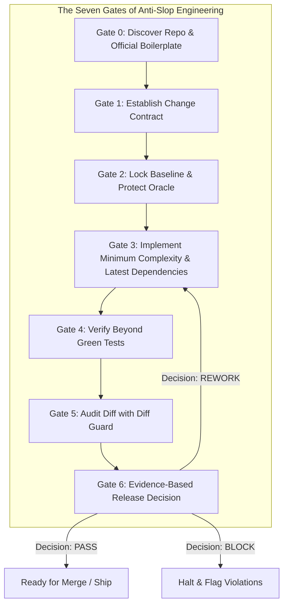

<div align="center">

# 🛡️ Anti-Slop Engineering

### An Engineering Discipline Playbook, Agent Skill & Triage Guard for AI Coding Agents
**Write less unnecessary code • Preserve intended behavior • Protect the test oracle • Prove correctness**

[](https://github.com/imMamdouhaboammar/anti-slop-engineering/actions)
[](LICENSE)
[](https://bun.sh)
[](https://www.python.org/)
[](https://skills.sh)
[](https://claude.ai)
[](https://agentskills.io)
[](https://github.com/imMamdouhaboammar)

<p align="center">
  <a href="#-quickstart--installation">Quickstart</a> •
  <a href="#-the-seven-gates">The Seven Gates</a> •
  <a href="#-heuristic-diff-guard">Diff Guard CLI</a> •
  <a href="#-google-site-reliability-engineering-sre-guard">Google SRE Guard</a> •
  <a href="#-anti-pattern-catalog-213-diagnostic-patterns">Anti-Pattern Catalog</a> •
  <a href="#-contributing-noted-slop">Contribute Slop</a> •
  <a href="#-multi-agent-distribution-channels">Distribution Channels</a> •
  <a href="#-license--copyright">License</a>
</p>

</div>

---

A portable, provider-neutral **Agent Skill** and lightweight verification guard for planning changes, implementing features, reviewing pull requests, and auditing agent-generated code. It systematically eliminates code bloat, architectural drift, superficial tests, test-oracle tampering, false confidence, security shortcuts, uncontrolled operational behavior, and manual scaffolding slop.

This is **not** an "AI detection" tool or aesthetic style linter. It critiques concrete engineering decisions using source evidence and behavioral contracts regardless of who wrote the code.

---

## ⚡ Quickstart & Installation

### Option 1: Universal Multi-Agent One-Liner (Recommended)

Automatically detects and installs Anti-Slop across **Claude Code**, **Antigravity / Gemini CLI**, **Codex / OpenCode**, and **Universal Agent Kernel**:

```bash
curl -fsSL https://raw.githubusercontent.com/imMamdouhaboammar/anti-slop-engineering/main/install.sh | bash
```

### Option 2: Skills.sh Registry (Vercel Ecosystem)

```bash
npx skills add imMamdouhaboammar/anti-slop-engineering
```

### Option 3: Instant Zero-Install CLI (npm / Bun)

Run diff guard triage or Google SRE enforcement instantly without cloning:

```bash
# General diff hygiene triage:
bunx anti-slop-engineering --base HEAD

# Google SRE enforcement (KISS, DRY, YAGNI, Scale Invariants & Toil):
bunx anti-slop-engineering sre --base HEAD --strict

# Or via npx:
npx anti-slop-engineering sre --base HEAD --strict
```

### Option 4: Python CLI (pipx / uv)

```bash
# Install tool globally via uv:
uv tool install git+https://github.com/imMamdouhaboammar/anti-slop-engineering.git

# Or via pipx:
pipx install git+https://github.com/imMamdouhaboammar/anti-slop-engineering.git
```

---

## 🧭 Multi-Agent Distribution Channels

| Environment | Target Skill Directory | Method |
|---|---|---|
| **Claude Code & Desktop** | `~/.claude/skills/anti-slop-engineering` | `./install.sh` or `marketplace.json` |
| **Antigravity / Gemini CLI** | `~/.gemini/config/skills/anti-slop-engineering` | `./install.sh` or clone |
| **Skills.sh (Vercel)** | `.skills.json` at root | `npx skills add <repo>` |
| **Codex / OpenCode** | `~/.codex/skills/anti-slop-engineering` | `./install.sh` |
| **Universal Agent Kernel** | `~/.agents/skills/anti-slop-engineering` | `./install.sh` |
| **Cursor / Windsurf** | `.cursor/rules/anti-slop.mdc` or `.cursor/skills/` | Project rule linking `SKILL.md` |

---

## 🛑 The Core Problem: AI Slop & Test Tampering

As AI coding agents take on complex multi-step tasks, common pathological failure modes emerge:

1. **Test-Oracle Tampering:** Changing existing test assertions, adding `@pytest.mark.skip`, or modifying golden snapshots merely to make a broken implementation look green.
2. **Needless Architecture & Layer Creep:** Introducing unnecessary micro-files, speculative interfaces, redundant wrappers, and complex factory patterns for simple one-line changes.
3. **Manual Scaffolding Slop:** Hand-rolling directory structures, build configs, and boilerplate files (`tsconfig.json`, `package.json`, `pyproject.toml`) from memory instead of using the official framework CLI installer or starter template.
4. **Stale/Guessed Dependency Pinning:** Guessing outdated or deprecated dependency versions from pre-cutoff training memory instead of querying the official registry for the latest stable release.
5. **Duplicate Business Rules:** Improvised helper functions scattered across the codebase that replicate existing domain logic with subtle discrepancies.
6. **Error Swallowing & Security Shortcuts:** Adding broad `except: pass`, `verify=False`, `@ts-ignore`, or disabling authentication gates to avoid errors.
7. **False Confidence & Hallucinated Passes:** Reporting tests or builds as successful without running or verifying the actual commands against source truth.
8. **Dev-Notes & Agent Instructions Leaked in UI:** Leaving developer notes, TODOs, agent reminders, or "mock data displayed" banners inside user-facing components.
9. **UI Clutter, Overcrowding & Logorrhea:** Overloading navigation bars, jamming layouts with gratuitous icons/widgets, and burying users under walls of text and code narration.
10. **Speculative Docs & Submission Dossier Slop:** Inventing unrequested platform submission dossiers, fake marketplace reviewer packets (e.g. "Publish to OpenAI ChatGPT Plugins", `docs/OPENAI_SUBMISSION.md`), citing dead/deprecated URLs, and sprawling directories with ceremonial markdown files.
11. **Obviousness, Tautology & Truism Slop:** Narrating syntax in code comments (`// increment count`, `// return result`), tautological docstrings that merely rephrase symbol names, patronizing UI microcopy under obvious inputs, and ceremonial documentation truisms.

---

## 🔄 The Seven Gates Workflow



| Gate | Phase | Objective |
|---|---|---|
| **Gate 0** | **Discover** | Inspect root configs, lockfiles, conventions, and nearby implementations. Identify official CLI installers/boilerplates; never improvise repo habits. |
| **Gate 1** | **Contract** | Define explicitly: *what changes, what must not change, invariants, and rollback requirements*. |
| **Gate 2** | **Lock Oracle** | Baseline existing tests. Protect assertions. On fixes, write red-state repro before modifying production code. |
| **Gate 3** | **Implement** | Minimum justified complexity. Use official scaffolding; strictly resolve and pin latest stable dependencies; no duplicate layers. |
| **Gate 4** | **Verify** | Execute real tests beyond green badges. Test negative boundaries, concurrency, and contract seams. |
| **Gate 5** | **Audit Diff** | Run `diff_guard.py` as a skeptical reviewer. Scrutinize scope expansions, test modifications, and hidden leaks. |
| **Gate 6** | **Evidence** | Issue structured report: `BLOCK`, `REWORK`, `REVIEW`, or `PASS` with exact `file:line` citations and proof. |

---

## 🛡️ Heuristic Diff Guard

A zero-dependency, read-only tool (Node/Bun wrapper + stdlib Python 3 engine) for fast pre-commit and PR diff triage:

```bash
# Compare staged + tracked changes against HEAD:
npx anti-slop-engineering --base HEAD

# Compare PR branch against merge-base with main:
BASE="$(git merge-base HEAD origin/main)"
npx anti-slop-engineering --base "$BASE"

# Output machine-readable JSON:
npx anti-slop-engineering --base HEAD --json

# Strict gate: Exit code 2 if blocker patterns (e.g. skipped tests) are found:
npx anti-slop-engineering --base HEAD --fail-on-blocker
```

### What `diff_guard.py` Checks
- **Modified Existing Tests:** Flags commits modifying existing test files (`TEST_CHANGE_REVIEW`) to enforce test-oracle review.
- **Skipped & Disabled Tests:** Catches `@pytest.mark.skip`, `it.skip`, `test.skip`, `@Disabled`, etc.
- **Weak Assertions:** Catches `assert True`, `expect(true).toBe(true)`, and empty assertion patterns.
- **Security Bypass Candidates:** Detects `verify=False`, `rejectUnauthorized: false`, `--no-verify`.
- **Error Swallowing:** Detects `except: pass`, empty `catch {}` blocks.
- **Type Suppression:** Detects `@ts-ignore`, `@ts-nocheck`, `type: ignore`.
- **Dev-Notes Leaked in UI:** Detects developer notes, agent reminders, and mock-data disclaimers inside UI components (`<p>`, `<span>`, `<div>`, `<Alert>`).
- **Patronizing UI Copy:** Detects obvious, condescending instructions under UI controls (e.g. `<small>Please enter your email</small>`, `Click here to submit`).
- **Trivial Comment Narration:** Detects syntax play-by-play comments (e.g. `// return result`, `// increment count`, `// check null`, `// import react`).
- **Meta-Preambles & Affordance Narration:** Detects violations of the Direct Payload Invariant in markdown and documentation (such as transitional phrases explaining what a table shows, narrating how to play or expand media, instructing the reader to copy snippets, or stacking bilingual translations in titles).
- **Speculative Submission Dossiers:** Detects unrequested submission guides or reviewer packets in docs/ (`docs/*submission*.md`, `docs/*dossier*.md`).
- **Hallucinated Platform URLs:** Catches deprecated or hallucinated plugin submission portals (e.g. `platform.openai.com/plugins`).
- **Large Diff Scope:** Prompts review when added lines exceed threshold (default 400 lines).

---

## ⚙️ Google Site Reliability Engineering (SRE) Guard

A static analysis and diff triage engine (`scripts/sre_guard.py` & CLI subcommand `sre`) implementing Google Site Reliability Engineering principles: **KISS**, **DRY**, **YAGNI**, and **Fix Issues at Scale (Eliminating Toil)**. Zero external dependencies (stdlib Python 3.9+).

```bash
# Analyze working tree diff against HEAD:
bunx anti-slop-engineering sre --base HEAD

# Scan arbitrary files or directories:
bunx anti-slop-engineering sre --files src/ lib/

# Strict CI quality gate (exit code 2 on SRE blockers):
bunx anti-slop-engineering sre --base HEAD --strict

# Machine-readable JSON output:
bunx anti-slop-engineering sre --base HEAD --json

# Custom complexity thresholds:
bunx anti-slop-engineering sre --max-nesting 4 --min-dup-lines 4 --max-function-lines 80
```

### Google SRE Principles Enforced

| Pillar | Diagnostic Rule | SRE Invariant & Remediation |
| :--- | :--- | :--- |
| **KISS (Simplicity)** | `KISS_DEEP_NESTING` | Flag code nested >4 levels deep (`if`/`for`/`while`/`try`). Software simplicity is a prerequisite to reliability (Google SRE Book Ch. 9); flatten with early-return guard clauses. |
| **KISS (Simplicity)** | `KISS_FUNCTION_BLOAT` | Flag monolithic functions exceeding 80 lines. Split into single-responsibility, cohesive subroutines. |
| **DRY (Single Source of Truth)** | `DRY_CODE_DUPLICATION` | Detect duplicated logic blocks (>=4 normalized lines) across files via sliding-window hashing. Duplication causes divergent bug fixes in production; extract canonical helpers. |
| **YAGNI (Anti-Speculation)** | `YAGNI_SPECULATIVE_COMMENT` | Flag comments like `TODO(future)`, `placeholder for v2`, `reserved for future use`. Reject speculative future-proofing. |
| **YAGNI (Anti-Speculation)** | `YAGNI_DEAD_SPECULATIVE_FLAG` | Blocker on dead branches (`if False:`, `if (false)`). Remove speculative dead code; Git is the historical archive. |
| **YAGNI (Anti-Speculation)** | `YAGNI_SPECULATIVE_PARAMETER` | Flag unreferenced parameters (`_unused_param`, `future_kwargs`). Keep interface contracts lean and concrete. |
| **Fix Issues at Scale** | `SCALE_UNBOUNDED_OR_FLAT_RETRY` | Blocker on retries with flat `sleep(N)` or no backoff. Under degraded backends, flat retries cause catastrophic retry storms and thundering herds. Enforce exponential backoff with full jitter. |
| **Fix Issues at Scale** | `SCALE_SLEEP_BAND_AID` | Flag `sleep()` used as an asynchronous synchronization band-aid. Replace arbitrary delays with condition variables, latches, or bounded event polling. |
| **Fix Issues at Scale** | `SCALE_UNBOUNDED_CONCURRENCY` | Flag unbounded parallel mapping (`Promise.all(items.map(...))`, `asyncio.gather(*tasks)`). Prevent OOM and thread starvation via worker pools, chunking, or semaphores. |
| **Fix Issues at Scale** | `SCALE_TOIL_ERROR_SWALLOW` | Blocker on silent exception swallowing (`except Exception: pass`, empty `catch {}`). Silent failures create untracked fleet-wide failures and manual operational toil. Emit structured logs with correlation IDs. |
| **Fix Issues at Scale** | `SCALE_MISLEADING_HEALTH_CHECK` | Flag static health endpoints returning unconditional `200 OK`. Distinguish liveness from readiness, and probe critical backing dependencies before routing traffic. |

See [`references/google-sre-discipline.md`](references/google-sre-discipline.md) for full engineering guidelines and distributed systems invariants.

---

## 📚 Anti-Pattern Catalog (213 Diagnostic Patterns)

The repository includes a detailed diagnostic catalog in [`references/anti-pattern-catalog.md`](references/anti-pattern-catalog.md) covering:

1. **Requirements & Scope:** Speculation, scope creep, imaginary requirements, incomplete migrations.
2. **Architecture & Abstractions:** Premature microservices, over-abstraction, god objects, wrapper explosion, **manual scaffolding improvisation (`ARC-15`)**, **code logorrhea (`SIM-15`)**, **tautological docstrings (`SIM-16`)**, and **syntax narration (`SIM-17`)**.
3. **Duplication & Code Organization:** Copy-paste business logic, shotgun surgery, shadow utility modules.
4. **Data, State & Persistence:** N+1 queries, unindexed queries, silent transaction rollbacks, leaky caches.
5. **Security & Boundaries:** Hardcoded credentials, prompt injection vulnerabilities, unsanitized inputs, SSRF, permissive CORS.
6. **Concurrency & Async:** Race conditions, thread leaks, unhandled task cancellation, un-fenced distributed jobs.
7. **APIs & Contracts:** Breaking public contracts, missing status codes, untyped responses, lack of pagination.
8. **Testing & Oracles:** Assert True theater, snapshot overwrite without review, mocking the unit under test, missing failure-path tests.
9. **Frontend & UI:** Scroll hijacking, accessibility violations, layout thrashing, **dev-notes leaked in UI (`UI-13`)**, **wall-of-text microcopy (`UI-14`)**, **navbar overcrowding (`UI-15`)**, **compulsive decoration (`UI-16`)**, and **patronizing microcopy (`UI-17`)**.
10. **Operations & Reliability:** Missing graceful shutdown, unbounded retry storms, blind migrations, unmonitored queues.
11. **CI, Builds & Release:** Disabling lint rules, flaky test workarounds, missing build locks, **stale or guessed dependency versions (`CI-15`)**.
12. **Workflow & Review Hygiene:** Mega-PRs, unreviewable diffs, lack of test proof in review notes, **speculative submission guides (`REV-15`)**, **documentation file sprawl (`REV-16`)**, **doc logorrhea & filler (`REV-17`)**, **ceremonial documentation truisms (`REV-18`)**, and **affordance narration & meta-preambles (`REV-19`)**.
13. **Agent Autonomy:** Self-modifying safety boundaries, hallucinated test outputs, speculative code deletions.
14. **Google SRE Invariants:** Deep nesting (`SRE-01`), trivial wrapper chains (`SRE-02`), duplicated invariants (`SRE-03`), fragmented schemas (`SRE-04`), speculative knobs (`SRE-05`), premature generalization (`SRE-06`), sleep band-aids (`SRE-07`), retry storms (`SRE-08`), unbounded concurrency (`SRE-09`), operational toil (`SRE-10`), missing idempotency (`SRE-11`), and misleading health checks (`SRE-12`).

---

## 🛠️ Repository Contents

```text
anti-slop-engineering/
├── SKILL.md                          # Compact, actionable 7-gate agent skill instructions
├── package.json                      # npm & Bun distribution manifest (zero-install CLI)
├── marketplace.json                  # Claude Plugin Marketplace manifest
├── .skills.json                      # Skills.sh registry manifest
├── install.sh                        # Universal multi-agent one-liner installer
├── bin/
│   └── cli.js                        # Node/Bun executable CLI entrypoint
├── scripts/
│   ├── diff_guard.py                 # Pure stdlib Python 3 read-only diff triage guard
│   └── sre_guard.py                  # Google SRE enforcement engine (KISS, DRY, YAGNI, Scale)
├── tests/
│   ├── test_diff_guard.py            # Unit tests for the heuristic diff guard
│   └── test_sre_guard.py             # Unit tests for Google SRE Guard
├── references/
│   ├── anti-pattern-catalog.md       # 213 diagnostic anti-patterns across 14 engineering domains
│   ├── google-sre-discipline.md      # Google SRE playbook: KISS, DRY, YAGNI, Scale Invariants & Toil
│   ├── test-integrity.md             # The Test Integrity Protocol: protecting test oracles
│   ├── pr-review.md                  # Evidence-first PR review protocol with severity scales
│   ├── security-and-operations.md    # Trust boundaries, injection resistance & operational safety
│   ├── engineering-judgment.md       # Legitimate exceptions vs checklist cargo-culting
│   ├── evidence-and-sources.md       # Empirical papers, research basis & methodology limitations
│   └── evaluation-cases.md           # 12 blinded evaluation benchmarks and scoring rubric
├── assets/
│   ├── PR_REVIEW_TEMPLATE.md         # Template for human & agent PR descriptions
│   └── RUN_REPORT_TEMPLATE.md        # Structured evidence report template for agent executions
├── .github/
│   ├── workflows/ci.yml              # CI testing across Python 3.9-3.13, Bun & Node.js
│   ├── ISSUE_TEMPLATE/               # Bug reports & Anti-Pattern community proposals
│   └── PULL_REQUEST_TEMPLATE.md      # Pull request template enforcing gate verification
├── pyproject.toml                    # Standard Python packaging configuration
├── Makefile                          # Developer targets (make test, make guard, make check)
├── CITATION.cff                      # Machine-readable citation file
├── NOTICE                            # Copyright and author notice
├── AUTHORS.md                        # Author & contributor registry
├── CONTRIBUTING.md                   # Community contribution standards
└── LICENSE                           # MIT License
```

---

## 🧪 Development & Testing

```bash
# Run unit tests:
make test

# Run tests with verbose output:
make test-verbose

# Validate syntax across scripts and tests:
make lint

# Complete verification pass:
make check
```

---

## 🤝 Contributing "Noted Slop"

Spotted recurring AI coding slop, weird prompt leakages, test tampering, or UI clutter in the wild? We welcome community contributions to expand the diagnostic catalog and verification guards!

You can participate through two streamlined paths:

### 📝 Path 1: Report Observed Slop (No code required)
If you spotted a bad habit in an AI assistant (Claude Code, Cursor, Copilot, Codex, Gemini CLI, etc.):
- Open a **[🚨 Report Noted Slop Issue](https://github.com/imMamdouhaboammar/anti-slop-engineering/issues/new?template=noted_slop.yml)**.
- Share the real-world code snippet or diff, which model produced it, and why it degrades engineering quality.
- Our maintainers and community will triage, categorize, and schedule it for inclusion.

### 🛠️ Path 2: Submit a Pull Request (Problem + Solution Integrated)
If you have both the observed slop and the engineered fix:
1. Allocate the next pattern ID in [`references/anti-pattern-catalog.md`](references/anti-pattern-catalog.md) (e.g., `UI-17`, `TST-16`, `ARC-16`).
2. Document the diagnostic symptom, root cause, and remediation using the 5-part catalog schema.
3. Update [`SKILL.md`](SKILL.md) and [`AGENTS.md`](AGENTS.md) with explicit agent rules.
4. (Optional) Add automated diff guard heuristics to `scripts/diff_guard.py` with unit tests in `tests/test_diff_guard.py`.
5. Run `make check` and submit your PR!

```bash
# Print contribution cheat sheet right from your terminal:
npx anti-slop-engineering contribute
# Or via Bun:
bunx anti-slop-engineering contribute
```

See our comprehensive **[Contributing Guide (CONTRIBUTING.md)](CONTRIBUTING.md)** for full details.

---

## 📖 Citation

If you use Anti-Slop Engineering in academic research, agent evaluations, or software development benchmarks, please cite it using:

```bibtex
@software{aboammar2026antislop,
  author = {Aboammar, Mamdouh},
  title = {Anti-Slop Engineering: An Engineering Discipline Playbook and Guard System for AI Coding Agents},
  year = {2026},
  publisher = {GitHub},
  url = {https://github.com/imMamdouhaboammar/anti-slop-engineering}
}
```

See [`CITATION.cff`](CITATION.cff) for CFF format.

---

## ⚖️ License & Copyright

- **Author & Maintainer:** [Mamdouh Aboammar](https://github.com/imMamdouhaboammar) (`mamdouhfces1997@gmail.com`)
- **License:** [MIT License](LICENSE)
- **Notice:** [NOTICE](NOTICE)

Copyright (c) 2026 Mamdouh Aboammar and contributors. All rights reserved.
