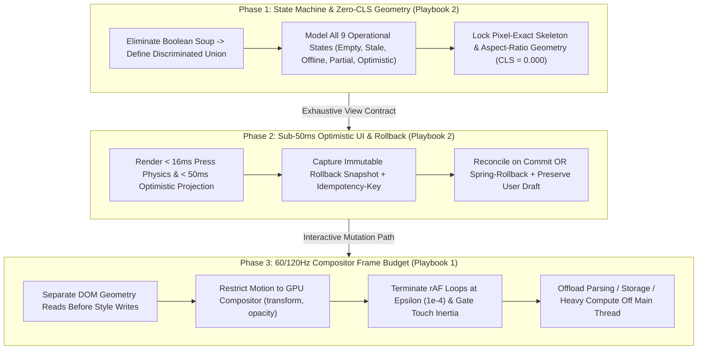

# Apple Craft & 60/120Hz Frame Budget Playbook Suite

The Apple Craft & Frame Budget Playbook Suite enforces Apple Human Interface Guidelines (HIG) interaction physics, 60Hz/120Hz ProMotion frame-budget discipline, sub-50ms Optimistic UI with deterministic rollback snapshots, Zero Cumulative Layout Shift (`CLS = 0.000`), and exhaustive Discriminated Union State Machines.

---

## 1. Playbook Directory Architecture

```
skills/apple-craft-and-frame-budget/playbooks/
├── README.md                                  # Central Map of Content & Orchestration Index
├── frame-budget-physics-playbook.md           # Playbook 1: 16.6ms/8.3ms Frame Budget, Compositor Motion & Main-Thread Offloading
└── optimistic-state-machine-playbook.md       # Playbook 2: Sub-50ms Optimistic UI, Zero CLS & Discriminated Union State Machines
```

Companion Guard Engine:
- `scripts/frame_budget_guard.py` / `npx anti-slop-engineering frame-budget audit`

---

## 2. Navigation Matrix

| Document | Primary Persona & Focus | Core Invariants | Canonical Artifact |
| --- | --- | --- | --- |
| **[60/120Hz Frame Budget & Compositor Physics Playbook](frame-budget-physics-playbook.md)** | Principal Apple UI Physics & Browser Rendering Architect: 8.3ms ProMotion budgets, FastDOM read/write separation, GPU compositor layers (`transform`/`opacity`), FLIP layout transitions, epsilon-terminated springs (`1e-4`), touch inertia preservation, and Web Worker offloading | Zero layout thrashing, zero `transition: all`, `< 4ms` main-thread script slice, epsilon `cancelAnimationFrame`, touch scroll gate | Frame Budget Record (`references/frame-budget-record-contract.md`) |
| **[Optimistic UI, Zero-CLS & Discriminated State Machines Playbook](optimistic-state-machine-playbook.md)** | Staff Client Architecture & Interaction Systems Engineer: Sub-50ms optimistic mutations, immutable rollback snapshots, draft preservation, pixel-matched skeletons (`CLS = 0.000`), and exhaustive Discriminated Union State Machines | Zero Boolean Soup, `< 50ms` optimistic projection, verified rollback path, `CLS = 0.000`, exhaustive `assertNever` reducer | Optimistic State Machine View (`examples/optimistic-state-machine-view.ts`) |

---

## 3. End-to-End Apple Craft & Runtime Physics Workflow



---

## 4. Automated Frame Budget Guard Integration

The suite includes a zero-dependency validator (`scripts/frame_budget_guard.py`) that audits both structured UI craft records and frontend source files (`--source`) for layout thrashing, non-compositor animations, Boolean Soup, infinite `requestAnimationFrame` loops, and main-thread storage stalls:

```bash
# Audit a frame-budget & UI craft record:
npx anti-slop-engineering frame-budget audit skills/apple-craft-and-frame-budget/examples/apple-craft-frame-budget-record.json --json

# Audit both the record AND scan a TypeScript/React component for runtime physics hazards:
python3 scripts/frame_budget_guard.py audit record.json --source src/components/InvoiceBoard.tsx --json
```

---

## 5. Non-Negotiable Standards of Engagement

1. **8.3ms / 16.6ms Frame Discipline:** Never interleave DOM writes and geometry reads; animate strictly `transform` and `opacity`; cancel `requestAnimationFrame` loops as soon as delta `< 1e-4`.
2. **Sub-50ms Optimistic Projection:** Every user mutation must project optimistically in `< 50ms` and roll back cleanly to a captured snapshot on server failure without losing user-typed input.
3. **Zero Cumulative Layout Shift (`CLS = 0.000`):** Every skeleton, image, font, and inline status banner must occupy pre-reserved pixel dimensions.
4. **Zero Boolean Soup:** Every view must use an explicit Discriminated Union State Machine covering `Empty`, `Stale`, `Offline`, `Optimistic`, and `Partial Failure`.
5. **Hardware & Accessibility Fidelity:** Preserve native touch inertia on coarse pointers, honor `prefers-reduced-motion`, enforce `44x44px` hit targets, and lock focus/scroll inside `role="dialog"` modals.
