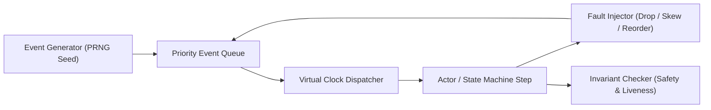

# Discrete Event Simulation & Seeded Fault Injection

Engineering principles inspired by Microsoft Research (Coyote, P, Project Orleans) and AWS/FoundationDB hermetic simulation testing.

## The Discrete Event Simulation (DES) Architecture

In a distributed system, network latency, asynchronous scheduling, timer expirations, and node crashes create non-deterministic race conditions. Traditional testing with real wall-clock sleeps (`setTimeout`, `time.sleep`) produces flaky tests, masks concurrency bugs, and runs orders of magnitude slower than simulated execution.

Discrete Event Simulation replaces real wall-clock time with an explicit, deterministic priority queue of events sorted by `(virtualTimeMs, eventPriority)`.

## Virtual Time vs Wall Clock Time

| Dimension | Wall-Clock Testing (`setTimeout`) | Discrete Event Simulation (DST) |
| --- | --- | --- |
| Execution Speed | Constrained by real physical seconds | Millions of virtual seconds in hundreds of milliseconds |
| Reproducibility | Non-deterministic; impossible to replay race conditions | 100% deterministic bit-for-bit replay from 64-bit seed |
| Clock Skew Control | Dependent on host OS clock | Programmable per-node virtual clocks with arbitrary skew |
| Network Simulation | Requires external network namespace tools | In-memory message routing with deterministic drops/reorders |
| Flakiness | High; vulnerable to CI CPU contention | Zero flakiness; identical seed yields identical event ordering |

## PRNG Algorithms for Deterministic Simulation

Unseeded randomness (`Math.random()`, `rand()`) is strictly prohibited in simulation harnesses. Use stateful, seedable 32-bit or 64-bit pseudo-random generators:

1. **Mulberry32:** 32-bit state, fast, excellent statistical properties for JavaScript/TypeScript environments.
2. **PCG32:** Minimal state, statistically sound, ideal for C/C++/Rust simulation loops.
3. **SplitMix64:** Fast 64-bit state generator, excellent for initializing random state arrays.
4. **ChaCha8:** Cryptographically sound, zero bias for adversarial multi-actor simulations.

## Canonical Fault Injection Matrix

| Fault Mode | Simulation Mechanism | System Defense / Invariant |
| --- | --- | --- |
| `network_packet_loss` | Drop packet with probability $p$ or burst drop window | Timeout retransmission, idempotency keys, quorum requirements |
| `clock_skew_drift` | Offset node virtual clock by $\Delta t \in [-T, +T]$ | Lamport logical clocks, hybrid logical clocks (HLC), lease epochs |
| `message_reordering` | Inject random delay $\delta \in [\delta_{min}, \delta_{max}]$ | Monotonic sequence numbers, TCP-like sliding windows, dedup buffers |
| `partition_split_brain` | Sever bi-directional connectivity between subsets $\{S_1, S_2\}$ | Majority quorum verification ($Q > N/2$), fencing tokens |
| `storage_write_corruption` | Truncate write or inject bit-flip on disk commit | Write-Ahead Log (WAL) checksums, CRC32 verification, fsync barriers |
| `node_crash_restart` | Terminate actor state; re-instantiate from persisted snapshot | Crash-recovery protocols, deterministic replay from WAL |

## Deterministic Replay Protocol

When an invariant violation occurs during simulation:
1. Capture the exact initial seed: `seed: 0xCAFE_BABE`.
2. Capture the failing simulation tick count: `tick: 412`.
3. Capture the minimal counterexample event trace: `[EventA@12ms, EventB@14ms, DropPacket@15ms]`.
4. Re-running the simulation runner with the identical seed must reproduce the exact violation at the exact tick.
