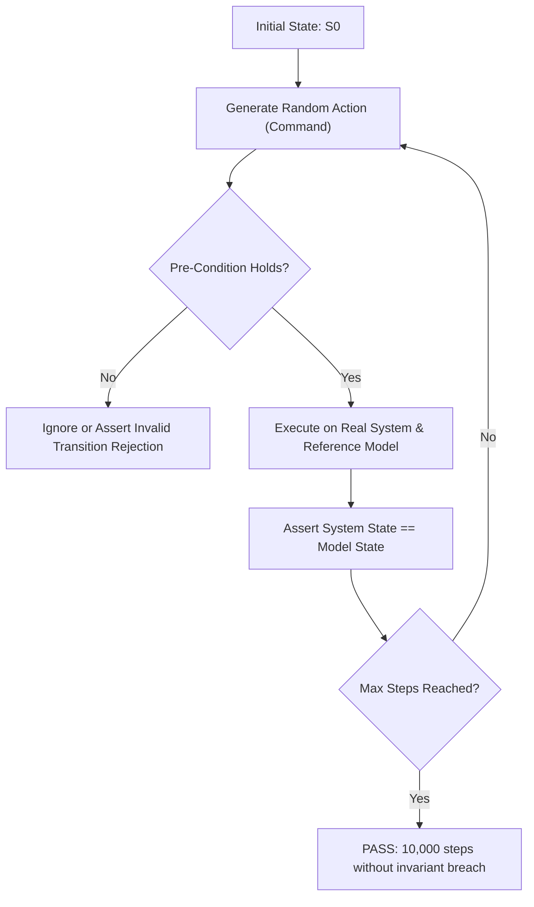

# State-Machine Modeling & Type Invariants

Formal modeling principles inspired by TLA+, Alloy, and Microsoft Research Coyote/P state machine verification.

## The Boolean Bag Anti-Pattern

Representing state with multiple loose boolean flags is a primary source of distributed state corruption:

```typescript
// ANTI-PATTERN: Boolean Bag (Permits 2^4 = 16 states, 11 of which are invalid)
interface OrderState {
  isPending: boolean;
  isPaid: boolean;
  isShipped: boolean;
  isCancelled: boolean;
  paymentId: string | null;
  trackingNumber: string | null;
}
```

In this anti-pattern, nothing prevents:
- `isPaid === true` and `isCancelled === true` simultaneously.
- `isShipped === true` when `paymentId === null`.
- `isPending === false`, `isPaid === false`, `isShipped === false`, `isCancelled === false` (undefined phantom state).

## Making Impossible States Unrepresentable

Enforce strict Tagged Unions (or Algebraic Data Types / Sealed Traits) where every valid state is explicitly distinct:

```typescript
// HARDENED: Tagged Union (Impossible states are unrepresentable at compile time)
export type OrderState =
  | { readonly kind: "Pending" }
  | { readonly kind: "Paid"; readonly paymentId: string; readonly paidAt: number }
  | { readonly kind: "Shipped"; readonly paymentId: string; readonly trackingNumber: string; readonly shippedAt: number }
  | { readonly kind: "Cancelled"; readonly reason: string; readonly cancelledAt: number };
```

## Explicit State Transition Table

State transitions must be pure, total functions mapping `(Current State, Event) -> (Next State, Side Effects)`:

| Current State | Event | Guard Condition | Next State | Side Effects |
| --- | --- | --- | --- | --- |
| `Pending` | `PaymentSucceeded` | `paymentId.isValid()` | `Paid` | `Emit(OrderPaidEvent)` |
| `Pending` | `CancelRequested` | None | `Cancelled` | `ReleaseInventoryReservation()` |
| `Paid` | `DispatchPackage` | `trackingNumber.isNotEmpty()` | `Shipped` | `NotifyCustomer(tracking)` |
| `Paid` | `RefundApproved` | None | `Cancelled` | `TriggerPaymentRefund()` |
| `Shipped` | `RefundApproved` | `returnReceived === true` | `Cancelled` | `TriggerPaymentRefund()` |
| `Cancelled` | `*` | Any event | `Cancelled` | `RejectWithTerminalStateError` |

## Model-Based Generative State Testing

Model-based testing tests the entire state space by generating arbitrary sequences of valid commands:



### Safety and Liveness Invariants
- **Safety Invariant:** Bad things never happen (e.g. no order is shipped without verified payment). Verified after every single command.
- **Liveness Invariant:** Good things eventually happen (e.g. all pending orders eventually reach a terminal state: `Shipped` or `Cancelled`). Verified at simulation completion.
