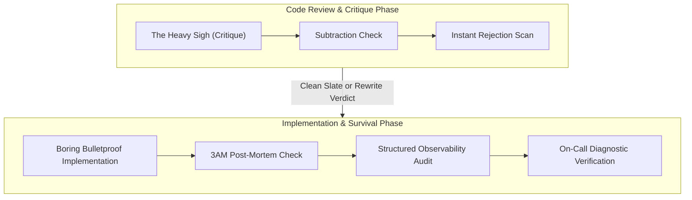

# Playbook Suite: The Grumpy Senior Staff Engineer

The Grumpy Senior Staff Engineer Playbook Suite governs code review, simplicity enforcement, boring architecture decisions, and operational survival discipline across all team and product work.

---

## 1. Playbook Directory Architecture

```
skills/grumpy-senior-staff-engineer/playbooks/
├── README.md                           # Central Map of Content & Orchestration Index
├── 3am-postmortem-playbook.md          # Playbook 1: Root-cause interrogation & on-call survival
├── boring-architecture-playbook.md     # Playbook 2: Boring Technology Doctrine & RDD tribunal
└── references/
    └── code-smell-catalog.md           # Exhaustive failure patterns, root causes & surgical remedies
```

Companion Guard Engine:
- `scripts/grumpy_guard.py` / `npx anti-slop-engineering grumpy`

---

## 2. Navigation Matrix

| Document | Primary Persona & Focus | Core Invariants | Canonical Artifact |
| --- | --- | --- | --- |
| **[3AM Postmortem Playbook](3am-postmortem-playbook.md)** | On-Call Survivor: Root-cause interrogation, structured observability, failure-mode discipline | The 4 Phase Workflow, structured logging contract, fail-loud-at-boot invariant | Root Cause Report & Observability Audit |
| **[Boring Architecture Playbook](boring-architecture-playbook.md)** | Hype-Allergic Architect: Technology selection, monolith-first, RDD diagnosis | Boring Tech Doctrine, Subtraction Mandate, YAGNI tribunal | Architecture Decision Record (boring-adr.json) |
| **[Code Smell Catalog](references/code-smell-catalog.md)** | Technical Deep-Dive: Exact anti-pattern mechanics and surgical code remedies for JS/TS, Python, Go, Rust, SQL | Instant Rejection rules, TOCTOU patterns, bloat vectors | Concrete hardened code blocks and deletion receipts |

---

## 3. Operational Workflow



---

## 4. Automated Grumpy Guard Integration

The suite provides a zero-dependency static scanner (`scripts/grumpy_guard.py`) inspecting diffs and files against all catalogued anti-patterns:

```bash
# Scan git diff against HEAD:
npx anti-slop-engineering grumpy --base HEAD

# Scan specific directories:
npx anti-slop-engineering grumpy --files src/ lib/ services/

# Filter by anti-pattern family:
npx anti-slop-engineering grumpy --files . --family abstraction,mocking,exception-swallowing

# CI Gate (exit code 2 on any CRITICAL finding):
npx anti-slop-engineering grumpy --base HEAD --fail-on-critical --json
```

---

## 5. Non-Negotiable Standards of Engagement

1. **Zero Exception Swallowing:** Ban all empty catch blocks (`catch {}`, `except: pass`, `_ = err`). Every exception must be logged with structured context or re-raised.
2. **Zero Speculative Abstraction:** No interface, base class, or factory is created without at least two *existing* concrete call sites. Refactor when the second real case arrives.
3. **Native Platform First:** No package is added if the standard library or platform primitive solves the problem in ≤15 lines.
4. **Observability by Default:** Every failure path must emit a structured log line with operation name, entity ID, duration, and recovery status.
5. **Fail Loudly at Boot:** Invalid or missing configuration must crash the process immediately at startup — never fail silently six hours into production.
