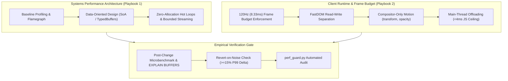

# Mechanical Sympathy & Performance Gate Playbook Suite

The Mechanical Sympathy & Performance Gate Playbook Suite enforces Apple and Google Systems hardware-level discipline across backend, compute, database, and client rendering architectures.

---

## 1. Playbook Directory Architecture

```
skills/mechanical-sympathy-and-perf-gate/playbooks/
├── README.md                                      # Central Map of Content & Orchestration Index
├── mechanical-sympathy-systems-playbook.md        # Playbook 1: Systems-Level DOD, Cache Locality & Zero-Copy Streaming
├── client-runtime-frame-budget-playbook.md        # Playbook 2: Client Runtime 120Hz/60Hz Frame Budgets & Compositor Physics
└── references/
    └── hardware-runtime-booby-traps.md            # Hardware & Runtime Failure Mechanics and Hardened Code Remedies
```

Companion Guard Engine:
- `scripts/perf_guard.py` / `npx anti-slop-engineering perf`

---

## 2. Navigation Matrix

| Document | Primary Persona & Focus | Core Invariants | Canonical Artifact |
| --- | --- | --- | --- |
| **[Mechanical Sympathy Systems](mechanical-sympathy-systems-playbook.md)** | Principal Systems Architect: High-throughput backend compute, DOD memory packing, zero-copy streams, database execution plans | Struct-of-Arrays (SoA), L1/L2 64-byte cache line alignment, zero-allocation hot loops, bounded streaming with backpressure | Mechanical Sympathy & Perf Record (`references/perf-record-contract.md`) |
| **[Client Runtime Frame Budget](client-runtime-frame-budget-playbook.md)** | Staff Frontend / Mobile Systems Engineer: 120Hz ProMotion & 60Hz display physics, layout thrashing, main-thread blocking | 8.33ms (120Hz) frame budget, <4ms JavaScript execution ceiling, zero layout thrashing (FastDOM reads-before-writes), compositor-only transitions | Frame Timing Trace & Zero-Jank Audit Report |
| **[Hardware & Runtime Booby-Traps](references/hardware-runtime-booby-traps.md)** | Forensic Performance Auditor: Exact failure mechanics, root causes, and hardened code remedies | `PERF-DOD-*`, `PERF-FRAME-*`, `PERF-STREAM-*`, `PERF-BENCH-*` rules | Concrete hardened code blocks and benchmark delta tables |

---

## 3. Operational Workflow



---

## 4. Automated Guard Integration

Verify records and source code using the zero-dependency Python guard or npm CLI:

```bash
# Audit performance assessment record:
npx anti-slop-engineering perf audit perf-record.json --json

# Audit record with source file hazard scanning:
npx anti-slop-engineering perf audit perf-record.json --source src/hot_path.ts --json

# Direct Python stdlib execution:
python3 scripts/perf_guard.py audit perf-record.json --source src/hot_path.ts --json
```

---

## 5. Non-Negotiable Standards of Engagement

1. **Zero Unmeasured Optimizations:** Never approve or commit a performance refactor without recorded baseline and post-change flamegraphs and P99 latency numbers.
2. **Data-Oriented Design Over Pointer Chasing:** Pack hot numeric attributes into contiguous TypedArrays to exploit 64-byte CPU cache lines.
3. **Zero Allocations in Hot Loops:** Mutate accumulators in-place; ban per-iteration closures, regexes, and intermediate array passes.
4. **120Hz (8.33ms) Frame Discipline:** Animate strictly GPU compositor properties (`transform`, `opacity`); ban `transition: all` and layout thrashing.
5. **Bounded O(1) Memory Streaming:** Prohibit whole-file RAM buffering (`readFileSync`, `response.text()`); stream payloads in bounded chunks with backpressure.
