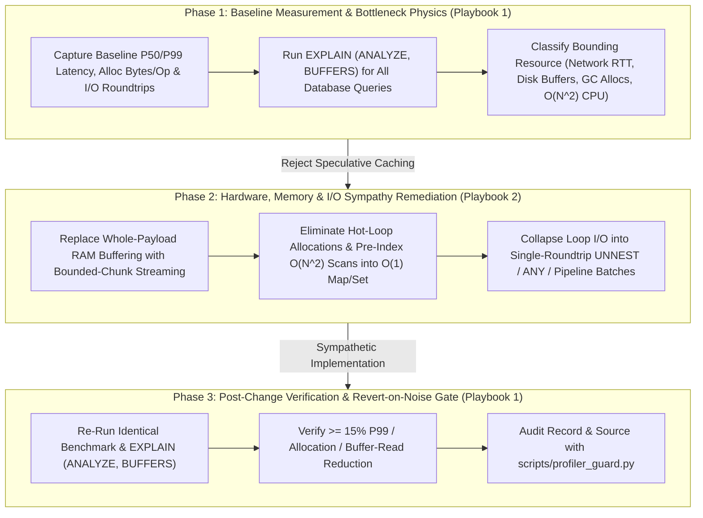

# Mechanical Sympathy & Empirical Profiler Playbook Suite

The Mechanical Sympathy & Empirical Profiler Playbook Suite enforces the Meta and Google Systems performance engineering canon: empirical pre-change and post-change measurement (`EXPLAIN (ANALYZE, BUFFERS)` and `P99` + heap allocation micro-benchmarks), hardware and memory hierarchy sympathy (bounded streaming over RAM buffering, zero-allocation hot paths), and bulk I/O coalescing (batching and pipelining over network-in-a-loop).

---

## 1. Playbook Directory Architecture

```
skills/mechanical-sympathy-profiler/playbooks/
├── README.md                                       # Central Map of Content & Orchestration Index
├── measurement-and-benchmarking-playbook.md        # Playbook 1: Empirical Measurement, EXPLAIN (ANALYZE, BUFFERS) & Micro-Benchmarks
└── hardware-memory-and-io-physics-playbook.md      # Playbook 2: Memory Streaming, Zero-Allocation Hot Paths & I/O Batching/Pipelining
```

Companion Guard Engine:
- `scripts/profiler_guard.py` / `npx anti-slop-engineering profiler audit`

---

## 2. Navigation Matrix

| Document | Primary Persona & Focus | Core Invariants | Canonical Artifact |
| --- | --- | --- | --- |
| **[Empirical Measurement, Benchmarking & EXPLAIN Playbook](measurement-and-benchmarking-playbook.md)** | Staff Systems Performance Engineer (Meta / Google Systems): Mandatory before/after telemetry, PostgreSQL `EXPLAIN (ANALYZE, BUFFERS)` physical buffer diagnostics, `P50`/`P99` latency + `alloc_bytes/op` micro-benchmarks, and the Revert-on-Noise discipline | Zero blind optimization, zero speculative caching over unmeasured paths, verified post-change delta (`>= 15%`), ESR index ordering | Profiler Record (`references/profiler-record-contract.md`) |
| **[Hardware, Memory Hierarchy & I/O Physics Playbook](hardware-memory-and-io-physics-playbook.md)** | Principal Runtime & Storage Systems Architect: Hardware latency hierarchy, `O(1)` bounded-chunk streaming with backpressure, zero-allocation hot loops, GC pause elimination, and single-roundtrip SQL/Redis/RPC batching & pipelining | Zero `await` I/O inside loops, zero `readFileSync` / whole-payload RAM buffering, zero $O(N^2)$ nested array scans, zero multi-pass `.map().filter()` churn in hot paths | Batched Streaming Hot Path (`examples/batched-streaming-hot-path.ts`) |

---

## 3. End-to-End Mechanical Sympathy Optimization Workflow



---

## 4. Automated Profiler Guard Integration

The suite includes a zero-dependency validator (`scripts/profiler_guard.py`) that audits both structured profiler records and backend/application source files (`--source`) for unmeasured optimizations, worsening post-change metrics, serial `await` I/O inside loops, whole-file synchronous RAM buffering, $O(N^2)$ nested array scans, and hot-path allocation churn:

```bash
# Audit a Mechanical Sympathy & Profiler record:
npx anti-slop-engineering profiler audit skills/mechanical-sympathy-profiler/examples/mechanical-sympathy-profiler-record.json --json

# Audit both the record AND scan a TypeScript/JavaScript module for mechanical sympathy hazards:
python3 scripts/profiler_guard.py audit record.json --source src/services/ledgerBatchProcessor.ts --json
```

---

## 5. Non-Negotiable Standards of Engagement

1. **Measure Before and After:** Never commit a performance change, index, or memoization wrapper without baseline and post-change `EXPLAIN (ANALYZE, BUFFERS)` or `P99` + allocation benchmark numbers.
2. **Stream, Never Buffer Whole Payloads:** Process files, exports, and large result sets via bounded-chunk streaming (`O(1)` RSS) with backpressure.
3. **Silence the Garbage Collector on Hot Paths:** Eliminate intermediate array chains, object-spread reducers, and per-iteration heap allocations inside tight loops.
4. **Batch & Pipeline All Wire I/O:** Collapse $N$ sequential loop queries or cache calls into $1$ bulk operation (`UNNEST`, `ANY($1)`, `MGET`, `pipeline()`).
5. **Fix Physics Before Caching:** Never wrap an $O(N^2)$ loop or unindexed sequential scan in a cache; fix the algorithm and physical access path first.
