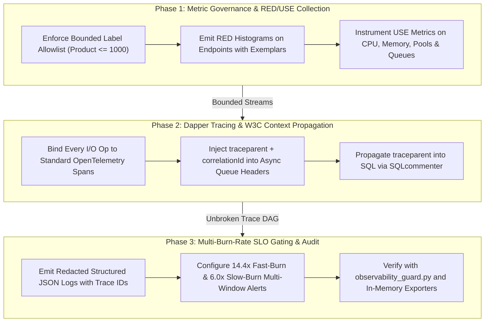

# Observability & SLO Architect Playbook Suite

The Observability & SLO Architect Playbook Suite codifies the Google Monarch & Dapper telemetry paradigm: proactive distributed tracing across all I/O boundaries, strict low-cardinality metric schemas, automated RED (Rate, Errors, Duration) metrics for endpoints, USE (Utilization, Saturation, Errors) metrics for resources, and Google SRE Multi-Window Multi-Burn-Rate SLO alerting.

---

## 1. Directory Structure

```
skills/observability-and-slo-architect/playbooks/
├── README.md                                                    # Central Map of Content & Orchestration Index
├── monarch-red-use-metrics-playbook.md                          # Playbook 1: Metric Cardinality, RED Endpoints & USE Resources
├── dapper-opentelemetry-context-propagation-playbook.md         # Playbook 2: OpenTelemetry I/O Spans & W3C TraceContext Propagation
└── slo-multi-burn-rate-alerting-playbook.md                     # Playbook 3: Google SRE Multi-Window Multi-Burn-Rate Alerts
```

Companion Guard Engine:
- `scripts/observability_guard.py` / `npx anti-slop-engineering observability audit`

---

## 2. Navigation Matrix

| Playbook | Focus & Scope | Core Invariants | Deliverable |
| --- | --- | --- | --- |
| **[Monarch, RED & USE Metrics Playbook](monarch-red-use-metrics-playbook.md)** | Eliminating metric cardinality explosions, enforcing $\prod \|L_i\| \le 1,000$, configuring P50/P95/P99 Histograms with Exemplars, and collecting USE metrics on resources | Banned dynamic IDs in labels, normalized 404 paths, explicit-bucket Histograms, active resource utilization/saturation tracking | Metric schema & instrumentation modules |
| **[Dapper Context Propagation Playbook](dapper-opentelemetry-context-propagation-playbook.md)** | Wrapping every I/O operation in standard OpenTelemetry spans, propagating W3C `traceparent` across RPC, queues, outbox, and SQLcommenter DB spans | Unbroken causal trace DAG, zero unpropagated queue boundaries, structured JSON logs correlated with `trace_id` | End-to-end tracing pipeline |
| **[SLO Multi-Burn-Rate Alerting Playbook](slo-multi-burn-rate-alerting-playbook.md)** | Defining user-centric SLIs, calculating 30-day Error Budgets, and creating 14.4x (1h/5m) and 6.0x (6h/30m) multi-window alerts | Zero threshold-only alerts, guaranteed rapid paging on true outages, immunity to transient blips | Production SLO Alerting Rule Definition |

---

## 3. End-to-End Orchestration Workflow


