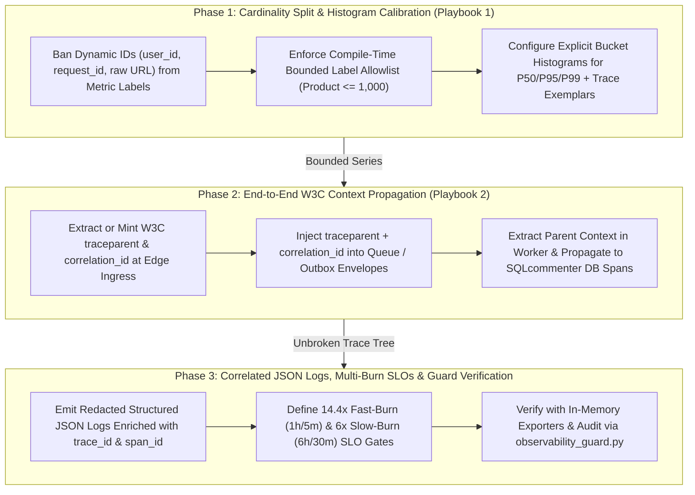

# Observability & SLO Gate Playbook Suite

The Observability & SLO Gate Playbook Suite enforces the Google Dapper, OpenTelemetry, and Google SRE Multi-Window Burn-Rate SLO canon across AI-assisted software engineering: preventing Metric Cardinality Explosions (`user_id` or raw URLs in Prometheus/Datadog labels), capturing latency distributions via P50/P95/P99 Histograms with Trace Exemplars, and guaranteeing unbroken end-to-end W3C `traceparent` + `correlation_id` context propagation across HTTP gateways, message queues, outbox workers, and database queries.

---

## 1. Playbook Directory Architecture

```
skills/observability-and-slo-gate/playbooks/
├── README.md                                                    # Central Map of Content & Orchestration Index
├── low-cardinality-metrics-and-slo-histograms-playbook.md       # Playbook 1: Metric Cardinality Governance, P50/P95/P99 Histograms & Burn-Rate SLOs
└── dapper-opentelemetry-context-propagation-playbook.md         # Playbook 2: End-to-End W3C traceparent, Async Queue/Outbox Context & Structured Logs
```

Companion Guard Engine:
- `scripts/observability_guard.py` / `npx anti-slop-engineering observability audit`

---

## 2. Navigation Matrix

| Document | Primary Persona & Focus | Core Invariants | Canonical Artifact |
| --- | --- | --- | --- |
| **[Low-Cardinality Metrics, Histograms & Burn-Rate SLOs Playbook](low-cardinality-metrics-and-slo-histograms-playbook.md)** | Principal SRE & Telemetry Economics Architect: Eliminating high-cardinality metric bombs (`user_id`, `request_id`, `req.url`), enforcing bounded attribute allowlists ($\prod |L_i| \le 1,000$), configuring calibrated P50/P95/P99 Histograms with Exemplars, and gating releases on Multi-Window Burn-Rate SLOs (`14.4x` / `6x`) | Zero dynamic IDs in metric labels, unmatched 404 routes collapsed to `"__unmatched__"`, zero gauge-averaged latencies, verified Multi-Window Burn-Rate error budget gates | Observability & SLO Record (`references/observability-slo-record-contract.md`) |
| **[Google Dapper & OpenTelemetry End-to-End Context Propagation Playbook](dapper-opentelemetry-context-propagation-playbook.md)** | Principal Distributed Tracing Architect (Google Dapper / W3C Trace Context School): Unbroken `traceparent` (`00-<traceId>-<spanId>-<flags>`) and `correlation_id` propagation from frontend UI through HTTP/gRPC, Kafka/SQS/BullMQ/Outbox workers, and SQLcommenter database spans, paired with redacted structured JSON logging | 100% trace continuity across async queues and worker threads, high-cardinality IDs attached exclusively to Spans and JSON logs, deterministic secret/PII redaction | Dapper OTel Low-Cardinality Telemetry (`examples/dapper-otel-low-cardinality-telemetry.ts`) |

---

## 3. End-to-End Observability & SLO Gate Workflow



---

## 4. Automated Observability & SLO Guard Integration

The suite includes a zero-dependency validator (`scripts/observability_guard.py`) that audits both structured observability records and instrumented source files (`--source`) for high-cardinality metric labels (`user_id`, `request_id`, `trace_id`, `order_id`, `email`, raw `req.url`), gauge-averaged latencies, raw `console.log` statements, and missing async `traceparent` propagation:

```bash
# Audit an Observability & SLO record:
npx anti-slop-engineering observability audit skills/observability-and-slo-gate/examples/observability-slo-record.json --json

# Audit both the record AND scan an instrumented module for cardinality/context hazards:
python3 scripts/observability_guard.py audit skills/observability-and-slo-gate/examples/observability-slo-record.json --source skills/observability-and-slo-gate/examples/dapper-otel-low-cardinality-telemetry.ts --json
```

---

## 5. Non-Negotiable Standards of Engagement

1. **Low-Cardinality Metrics Only:** Never attach `user_id`, `tenant_id`, `request_id`, `trace_id`, `order_id`, `email`, `ip`, or unparameterized URL paths to Metric labels.
2. **Histograms for Latency:** Measure all request, queue, and query durations with Histograms supporting P50, P95, and P99 quantiles—never averages or per-pod percentile gauges.
3. **Unbroken Async Context:** Every queue payload, outbox row, and background job must carry and extract W3C `traceparent` and `correlation_id`.
4. **Trace-Correlated Structured JSON Logs:** Ban raw `console.log`/`print`; enrich every structured JSON log with `trace_id`, `span_id`, and `correlation_id` while redacting secrets.
5. **Multi-Window Burn-Rate SLOs:** Alert on active error budget burn (`1h`/`5m` at `14.4x` and `6h`/`30m` at `6.0x`), not noisy instantaneous blips.
