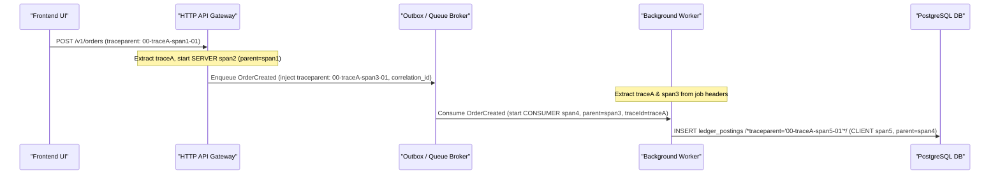

# W3C `traceparent` & End-to-End Async Context Propagation Reference

## 1. W3C Trace Context Wire Specification (`traceparent`)

Following the W3C Trace Context specification (`https://www.w3.org/TR/trace-context/`), every distributed hop propagates:

```text
traceparent: 00-4bf92f3577b34da6a3ce929d0e0e4736-00f067aa0ba902b7-01
             ^^ ^^^^^^^^^^^^^^^^^^^^^^^^^^^^^^^^ ^^^^^^^^^^^^^^^^ ^^
             |  |                                |                +-- trace-flags (01 = sampled)
             |  |                                +------------------- parent-span-id (16 lowercase hex chars, non-zero)
             |  +---------------------------------------------------- trace-id (32 lowercase hex chars, non-zero)
             +------------------------------------------------------- version (00)
```

Alongside `traceparent`, propagate:
- `tracestate`: Vendor/tenant routing state (`congo=t61rcWkgMzE`).
- `x-correlation-id` (or `correlation_id` in message envelopes): Deterministic business request correlation key preserved across synchronous and asynchronous boundaries.

---

## 2. Deterministic W3C `traceparent` Parser & Injector

```ts
const W3C_TRACEPARENT_RE =
  /^00-([0-9a-f]{32})-([0-9a-f]{16})-([0-9a-f]{2})$/;

export interface W3CTraceContext {
  readonly traceId: string;
  readonly spanId: string;
  readonly parentSpanId?: string;
  readonly traceFlags: string;
  readonly correlationId: string;
}

export function parseTraceparent(
  traceparentHeader: string | undefined,
  correlationIdHeader: string | undefined,
  mintIds: () => { traceId: string; spanId: string }
): W3CTraceContext {
  if (traceparentHeader) {
    const match = W3C_TRACEPARENT_RE.exec(traceparentHeader.trim().toLowerCase());
    if (
      match &&
      match[1] !== "00000000000000000000000000000000" &&
      match[2] !== "0000000000000000"
    ) {
      const minted = mintIds();
      return {
        traceId: match[1],
        parentSpanId: match[2],
        spanId: minted.spanId,
        traceFlags: match[3],
        correlationId:
          correlationIdHeader && correlationIdHeader.trim().length > 0
            ? correlationIdHeader.trim()
            : match[1],
      };
    }
  }

  const root = mintIds();
  return {
    traceId: root.traceId,
    spanId: root.spanId,
    traceFlags: "01",
    correlationId:
      correlationIdHeader && correlationIdHeader.trim().length > 0
        ? correlationIdHeader.trim()
        : root.traceId,
  };
}

export function formatTraceparent(ctx: W3CTraceContext): string {
  return `00-${ctx.traceId}-${ctx.spanId}-${ctx.traceFlags}`;
}
```

---

## 3. Propagating Context Across Queues, Workers & Transactional Outboxes

The #1 cause of broken production traces is enqueueing a background job or writing an outbox event without serializing the active span's `traceparent` and `correlation_id`.



### Mandatory Async Envelope Contract

```ts
export interface TracedAsyncEnvelope<TPayload> {
  readonly messageId: string;
  readonly topic: string;
  readonly traceparent: string;      // REQUIRED: W3C 00-<traceId>-<producerSpanId>-<flags>
  readonly tracestate?: string;
  readonly correlationId: string;    // REQUIRED: End-to-end correlation ID
  readonly enqueuedAtMs: number;
  readonly payload: TPayload;
}
```

### Producer Injection & Consumer Extraction Pattern

1. **Producer (`enqueueTracedJob`):**
   - Start a child span with `kind: "PRODUCER"`.
   - Set high-cardinality attributes (`app.user_id`, `app.order_id`, `messaging.message.id`) on the producer span—**never** on queue counter metrics.
   - Format `traceparent = formatTraceparent(producerSpanContext)` and store `traceparent` + `correlationId` directly on the envelope before writing to Kafka/SQS/BullMQ/Outbox.
2. **Consumer (`consumeTracedJob`):**
   - Verify `envelope.traceparent` and `envelope.correlationId` are non-empty.
   - Parse `envelope.traceparent` so the worker starts a `"CONSUMER"` span with `traceId === producer.traceId` and `parentSpanId === producer.spanId`.
   - Record queue dwell latency (`nowMs - envelope.enqueuedAtMs`) into a low-cardinality `messaging.receive.dwell_duration_ms` Histogram keyed only by `{ "queue.name": envelope.topic }`.

---

## 4. Database Query Context & SQLcommenter Correlation

When executing SQL queries inside a traced request or worker:
1. Start a `"CLIENT"` child span (`db.operation.name = "INSERT"`, `db.collection.name = "ledger_entries"`).
2. Append a sanitized W3C SQLcommenter tag (`/*traceparent='00-<traceId>-<dbSpanId>-01',correlation_id='<id>'*/`) to the parameterized SQL text so PostgreSQL `pg_stat_activity` and slow-query logs link directly to the distributed trace without exposing parameter values (`$1, $2`).
