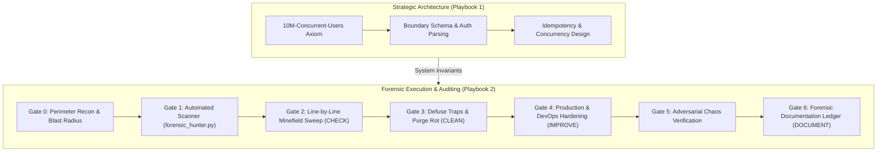

# Paranoid Architecture & Forensic Playbook Suite

The Paranoid Architecture & Forensic Playbook Suite governs high-concurrency systems design, zero-trust infrastructure, and line-by-line code auditing across polyglot cloud-native stacks.

---

## 1. Playbook Directory Architecture

```
skills/paranoid-principal-architect/playbooks/
├── README.md                           # Central Map of Content & Orchestration Index
├── architect-playbook.md               # Playbook 1: System-Level 10M Scale & Zero-Trust Architecture
├── devops-hunter-playbook.md           # Playbook 2: Zero-Trust DevOps & Forensic Line-by-Line Bug Hunter
└── references/
    └── stack-booby-traps.md            # Technical failure modes, root causes & hardened code remedies
```

Companion Guard Engine:
- `scripts/forensic_hunter.py` / `npx anti-slop-engineering hunter`

---

## 2. Navigation Matrix

| Document | Primary Persona & Focus | Core Invariants | Canonical Artifact |
| --- | --- | --- | --- |
| **[The Paranoid Principal Architect](architect-playbook.md)** | Principal Architect: System design, high-concurrency invariants, zero-trust API boundaries, database access | 10M-Concurrent-Users Axiom, parse-don't-validate, transactional outbox, sharded counters, constant-time crypto | Architectural Pre-Mortem & Threat Record (`references/threat-record-contract.md`) |
| **[Zero-Trust DevOps & Forensic Bug Hunter](devops-hunter-playbook.md)** | Senior DevOps & Forensic Auditor: Line-by-line code inspection, container security, CI/CD traps, runtime leaks | The 4 Pillars (Check, Clean, Improve, Document), The 6 Forensic Gates, PID 1 trap, weak-ref async GC | Forensic Report & Booby-Trap Ledger |
| **[Stack-Specific Booby-Trap Catalog](references/stack-booby-traps.md)** | Technical Deep-Dive: Exact failure mechanics and code remedies for K8s, Docker, Python, TS, Bun, Rust, Go, React, SQL | `K8S-*`, `DCK-*`, `PY-*`, `TS-*`, `BUN-*`, `RS-*`, `GO-*`, `RCT-*`, `ARC-*` rules | Concrete hardened code blocks and manifest patches |

---

## 3. Operational Workflow



---

## 4. Automated Forensic Scanner Integration

The suite provides a zero-dependency static scanner (`scripts/forensic_hunter.py`) inspecting diffs and files against all catalogued booby traps:

```bash
# Scan git diff against HEAD using npm CLI:
npx anti-slop-engineering hunter --base HEAD

# Scan specific directories or files across all supported stacks:
npx anti-slop-engineering hunter --files src/ infra/ k8s/ Dockerfile

# Filter by target stack:
npx anti-slop-engineering hunter --files . --stack k8s,docker,rust,go

# CI Gate (exit code 2 on any CRITICAL finding):
npx anti-slop-engineering hunter --base HEAD --fail-on-critical --json
```

---

## 5. Non-Negotiable Standards of Engagement

1. **Zero Unbounded State:** Every query must enforce cursor-based pagination; every HTTP call must declare an explicit `AbortSignal.timeout()`; every channel or queue must enforce backpressure.
2. **Zero Swallowed Exceptions:** Ban empty catch blocks (`catch {}`, `except: pass`, `_ = err`).
3. **Parse Don't Validate:** Strict boundary schema enforcement (Zod, Valibot, or native type guards) stripping unknown fields by default.
4. **Idempotency on Mutations:** Every state-mutating operation must support deduplication via an `Idempotency-Key`.
5. **No Speculative Abstractions:** Adhere to KISS, DRY, and YAGNI. Build strictly for verified requirements with zero dead code or hypothetical hardening.
