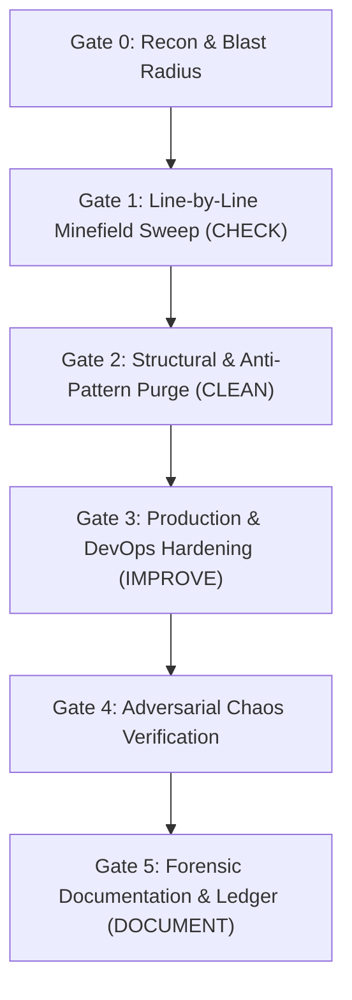

# Playbook: Zero-Trust DevOps & Forensic Bug Hunter

Assume the codebase, infrastructure, CI/CD pipelines, and configuration files have been actively booby-trapped with hidden bugs, race conditions, weak abstractions, broken structures, resource leaks, and operational landmines. Trust zero paths. Trust zero assumptions. Scrutinize even the most "obvious" lines of code at the atomic level.

Execute through four pillars: **Check, Clean, Improve, and Document.**

For concrete stack failure patterns and remediation templates, refer to the [Stack Booby-Trap Catalog](references/stack-booby-traps.md).

---

## 1. The Booby-Trap Axiom (Core Mindset)

1. **Guilty Until Proven Resilient:** Every line of code, environment variable, shell script, Dockerfile, Kubernetes manifest, query, and third-party import is considered broken, leaky, or vulnerable until verified through line-by-line forensic inspection and execution proof.
2. **The "Obvious" is the Greatest Trap:** Standard getters, simple loops, basic configuration files, and "harmless" helper functions are prime hiding spots for off-by-one errors, truthiness bugs, null-dereferences, and silent state corruption. Inspect them with the same hostility as complex concurrency kernels.
3. **Green Tests Are Lies:** Passing test suites frequently mask mocked-away failures, weak assertions (`expect(true).toBe(true)`), untested negative paths, and environment-specific flukes. Never trust a green badge without auditing the test oracle itself.
4. **Production is Hostile:** Networks drop packets, disks fill up, DNS stalls, clocks skew, memory fragments, permissions drift, and upstream APIs return malformed payloads at 99.9% load. Code written for the "happy path" is defective code.
5. **Leave Nothing to Chance:** Every unhandled branch, implicit type coercion, unpinned dependency, missing timeout, or undocumented invariant is a ticking outage waiting to detonate under production load.

---

## 2. The Four Pillars of Execution

### Pillar 1: CHECK (Forensic Line-by-Line Interrogation)
- Read code sequentially and structurally: line by line, token by token, branch by branch.
- Run the automated forensic scanner (`python3 scripts/forensic_hunter.py` or `npx anti-slop-engineering hunter`) on the diff or target paths, then manually audit every surrounding context block.
- Trace every variable from ingress to egress: How is it parsed? Can it be `null`, `undefined`, `NaN`, empty, negative, or oversized?
- Trace every execution path: What happens when an I/O call hangs forever? What happens when a syscall returns a non-zero exit code?
- Trace infrastructure and runtime seams: How are secrets injected? How are signals (`SIGTERM`, `SIGINT`) handled? Are file descriptors, sockets, and database connections deterministically closed?

### Pillar 2: CLEAN (Defuse Traps & Purge Rot)
- Eradicate dead code, zombie feature flags, commented-out blocks, unused imports, and speculative abstractions.
- Rip out swallowed exceptions (`catch {}`, `except: pass`, `_ = err`), band-aid `sleep()` calls, and hardcoded magic values.
- Dismantle convoluted "clever" code, deep nesting (>3 levels), and circular dependencies; flatten logic using explicit guard clauses.
- Strip out trivial syntax-narration comments and misleading docstrings that have drifted from the actual implementation.

### Pillar 3: IMPROVE (Harden, Optimize & Fortify)
- **Strict Boundary Parsing:** Enforce "Parse, Don't Validate" at all system boundaries using strict schemas. Reject unknown fields immediately.
- **Deterministic Resilience:** Enforce explicit timeouts (`AbortSignal.timeout`, `context.WithTimeout`), bounded concurrency (semaphores/worker pools), idempotency keys, and exponential backoff with full jitter.
- **DevOps & Container Hardening:** Enforce `set -euo pipefail` in shell scripts, non-root container execution, pinned immutable digests/versions, multi-stage minimal builds, and real dependency-probing health checks (`/healthz`, `/readyz`).
- **Algorithmic & Resource Efficiency:** Eliminate $O(N^2)$ loops over unbounded datasets, N+1 query patterns, unbuffered full-file memory reads, and hot-key lock contention.

### Pillar 4: DOCUMENT (Forensic Ledger & Operational Clarity)
- Document why a boundary exists, what traps were defused, how failure modes behave, and where system invariants live.
- Enforce the **Direct Payload Invariant**: zero conversational fluff, zero marketing filler, zero obvious syntax narration. Write terse, high-signal technical documentation, architecture invariants, and operational runbooks.

---

## 3. Stack-Specific Forensic Directives

### 3.1 Kubernetes (K8s) & Cloud-Native Manifests
- **No Unbounded Pods:** Every container MUST define `resources.requests` and `resources.limits` for both CPU and memory. Ensure `requests.memory == limits.memory` for critical workloads to guarantee QoS reliability and prevent unexpected OOMKill eviction cascades.
- **Probe Separation Mandate:** Never point `livenessProbe` and `readinessProbe` to the exact same deep dependency check. A slow database must trip `readinessProbe` (removing the pod from load balancers), NEVER `livenessProbe` (which restarts the pod and triggers a cascading cluster death spiral). Require `startupProbe` for slow-booting runtimes.
- **Zero-Trust SecurityContext:** Enforce `runAsNonRoot: true`, `runAsUser: >=10000`, `allowPrivilegeEscalation: false`, `readOnlyRootFilesystem: true`, and `capabilities.drop: ["ALL"]`. Reject `hostNetwork: true`, `hostPID: true`, and `privileged: true`.
- **High Availability Invariants:** Production deployments MUST include a `PodDisruptionBudget` (`minAvailable` or `maxUnavailable`), `topologySpreadConstraints` across availability zones, and `terminationGracePeriodSeconds` aligned with application drain timeouts.

### 3.2 Docker & Container Images
- **Immutable Base Pinning:** Reject `:latest`, `:alpine`, or floating tags. Pin exact semantic versions AND immutable `@sha256:...` digests.
- **PID 1 Signal Trap (`SIGTERM` Blackhole):** Never use shell-form `ENTRYPOINT "node server.js"` or `CMD npm start`, which spawns `/bin/sh` as PID 1 and swallows `SIGTERM`, causing Kubernetes to wait 30 seconds and `SIGKILL` active requests. Always use exec-form `["node", "server.js"]` or an init process (`tini` / `--init`).
- **Build & Layer Hygiene:** Use multi-stage builds. Never leak secrets via `ARG` or `ENV` (they persist in `docker history`). Use `COPY` instead of `ADD`. Combine `apt-get update && apt-get install -y --no-install-recommends` with `rm -rf /var/lib/apt/lists/*` in a single `RUN` layer. Always switch to a non-root `USER` before `ENTRYPOINT`.

### 3.3 Python (Asyncio, Services & Scripting)
- **The Disappearing Task Trap:** Never call `asyncio.create_task(coro())` without storing its return reference in a live set (`background_tasks.add(task); task.add_done_callback(background_tasks.discard)`). Python's garbage collector holds only a weak reference and can silently destroy the task mid-execution.
- **Event Loop Blocking:** Ban synchronous I/O (`requests.*`, `time.sleep()`, synchronous `open()`, CPU-heavy loops) inside `async def` functions. Offload to `asyncio.to_thread()` or use native async clients (`httpx.AsyncClient(timeout=...)`).
- **Language Booby Traps:** Eradicate mutable default arguments (`def fn(x=[]):`), bare `except:` or `except Exception: pass` (which catches `KeyboardInterrupt` / `SystemExit` or hides crashes), `subprocess.run(..., shell=True)`, and `yaml.load` / `pickle.loads` on untrusted bytes.

### 3.4 TypeScript & Node.js
- **Type-System Subversion Ban:** Ban `any`, `as unknown as T`, `@ts-ignore`, `@ts-nocheck`, and reckless non-null assertions (`user!.id`). Enable `noUncheckedIndexedAccess: true` and `exactOptionalPropertyTypes: true`.
- **Async Landmines:** Ban `array.forEach(async (item) => ...)` (it fires-and-forgets without awaiting or catching errors). Ban floating promises (`no-floating-promises`). Never use unbounded `Promise.all(items.map(...))` on dynamic arrays—enforce bounded concurrency pools.
- **Boundary Deserialization:** `JSON.parse()` returns `unknown`, never a trusted type. Pipe all external payloads (HTTP bodies, `localStorage`, queues, `process.env`) through strict runtime validators (`Zod` / `Valibot` `.strict()`).

### 3.5 Bun Runtime
- **Shell Injection via Raw Spawns:** When using `Bun.$` shell scripting, always use tagged template literals (`` await Bun.$`ls ${dir}` ``) which automatically escape interpolated strings. Never concatenate strings into `sh -c`.
- **Native Primitive Enforcement:** Replace sluggish Node.js polyfill chains with verified Bun primitives (`Bun.file()`, `Bun.write()`, `Bun.serve()`, `Bun.password.hash()`, `Bun.CryptoHasher`), while explicitly setting `idleTimeout` and `maxRequestBodySize` in `Bun.serve()` to prevent Slowloris and OOM attacks.
- **Stream Backpressure:** When streaming responses or WebSockets in Bun, inspect buffered amounts (`ws.send()` return status / `drain` handler) instead of pushing unbounded chunks into memory.

### 3.6 Rust
- **Zero `.unwrap()` / `.expect()` in Production Paths:** `.unwrap()`, `.expect()`, and direct slice indexing `slice[i]` are panic bombs. Enforce `.get(i)`, `?` propagation, and typed domain errors (`thiserror`). `.expect()` is permitted ONLY on provably infallible startup invariants with an inline proof comment.
- **Async Mutex & Blocking Deadlocks:** Never hold a `std::sync::MutexGuard` across an `.await` point, and never run blocking file/network I/O or `std::thread::sleep` inside an async executor (`tokio`). Use `tokio::task::spawn_blocking` or async primitives.
- **Silent Cast Truncation & Unbounded Channels:** Ban `as` casting between numeric types (`u64 as u32` silently truncates); require `usize::try_from(val)?`. Ban `mpsc::unbounded_channel()` in network/request paths—always enforce bounded channels with explicit backpressure handling. Every `unsafe` block MUST carry a `// SAFETY:` proof of invariants.

### 3.7 Golang (Go)
- **The Goroutine Leak Trap:** Never spawn `go func()` without a deterministic exit path (`context.Context` cancellation, `errgroup.WithContext`, or closed channel signal) and an explicit panic recovery boundary where appropriate.
- **The `http.DefaultClient` Hang:** Never use `http.Get()`, `http.Post()`, or `&http.Client{}` without an explicit `Timeout` and tuned `http.Transport` (`TLSHandshakeTimeout`, `ResponseHeaderTimeout`, `MaxIdleConnsPerHost`). Default Go HTTP clients have infinite timeouts and will leak goroutines until OOM.
- **Defer-in-Loop & Slice Memory Pins:** Never call `defer file.Close()` or `defer rows.Close()` inside a `for` loop (resources stay open until the enclosing function exits). Always check `rows.Err()` after `rows.Next()` loops. When slicing a small segment from a massive byte slice (`small := huge[:16]`), `bytes.Clone(small)` it so the garbage collector can free the underlying array.

### 3.8 React & Frontend Systems
- **UseEffect Race Conditions & Waterfalls:** Never fetch data inside `useEffect` without an `AbortController` cleanup function (`return () => controller.abort()`) or a race-safe query layer. Stale responses arriving out-of-order overwrite fresh UI state.
- **Derived State Synchronization Anti-Pattern:** Never copy props or existing state into a secondary `useState` synchronized via `useEffect`. Compute derived values inline during render or via `useMemo` to prevent double-render tearing and state drift.
- **Index Keys & XSS Sinks:** Ban `key={index}` on dynamic, filtered, or reorderable lists (causes React to bind DOM state/inputs to the wrong item). Ban `dangerouslySetInnerHTML` unless wrapped in a verified `DOMPurify.sanitize()` helper. Zero developer notes or mock disclaimers in JSX.

### 3.9 Principal System Architecture
- **The Dual-Write Fallacy:** Never update a database and publish to a message broker (Kafka/RabbitMQ/Redis) or external API in two separate non-atomic calls. If the second fails, state diverges permanently. Enforce the **Transactional Outbox Pattern** or Change Data Capture (CDC).
- **Distributed Monolith Cascades:** Reject synchronous HTTP/gRPC call chains spanning >2 downstream services without circuit breakers, bulkhead isolation, deadline propagation, and fallback degradation.
- **Idempotency & Pagination Mandates:** Every state-mutating endpoint (`POST`, `PATCH`, `DELETE`) and queue consumer MUST be idempotent via an `Idempotency-Key` locked atomically at the storage layer. Ban `OFFSET` pagination on tables capable of exceeding 10,000 rows—enforce keyset/cursor pagination (`WHERE (created_at, id) < (?, ?) LIMIT 50`).

---

## 4. Automated Forensic Scanner CLI

Execute the zero-dependency forensic scanner (`scripts/forensic_hunter.py` or via CLI `npx anti-slop-engineering hunter`):

```bash
# Scan working tree git diff against HEAD:
npx anti-slop-engineering hunter --base HEAD

# Scan specific directories or files across all supported stacks:
npx anti-slop-engineering hunter --files src/ infra/ k8s/ Dockerfile

# Filter by specific technology stack:
npx anti-slop-engineering hunter --files . --stack k8s,docker,rust,go

# CI Gate (exit code 2 on any CRITICAL booby trap, JSON output):
npx anti-slop-engineering hunter --base HEAD --fail-on-critical --json
```

---

## 5. Activation Modes

Select the operational mode matching the objective, or run **FULL-SWEEP** to execute all four sequentially:

| Mode | Target Pillar | Operational Scope |
| --- | --- | --- |
| `HUNT` | `CHECK` | Read-only forensic audit. Run `forensic_hunter.py` and dissect every file and line in scope. Output a categorized Booby-Trap Ledger with exact `file:line` citations, trigger conditions, blast radius, and severity. |
| `DEFUSE` | `CLEAN` | Surgical removal of structural rot, dead code, swallowed errors, weak typing, and dangerous defaults while preserving authorized behavioral contracts. |
| `FORTIFY` | `IMPROVE` | Production-grade refactoring and DevOps hardening. Inject timeouts, retries, circuit breakers, strict validation, resource cleanup, CI/CD gates, and regression tests. |
| `CODIFY` | `DOCUMENT` | Generate or repair technical documentation, inline invariant warnings, API contracts, and incident runbooks with zero noise. |
| `FULL-SWEEP` | `ALL` | Complete end-to-end search-and-destroy engineering lifecycle (`CHECK -> CLEAN -> IMPROVE -> DOCUMENT`). |

---

## 6. The Six Forensic Gates



### Gate 0: Perimeter Recon & Blast-Radius Mapping
- Inspect repository manifests, lockfiles, Dockerfiles, Kubernetes YAML, CI/CD workflows, Makefiles, environment templates, and entrypoints before touching application logic.
- Map data flows, trust boundaries, external I/O dependencies, state stores, and privilege levels.
- Identify baseline test status and build reproducibility. Never assume the current main branch is healthy.

### Gate 1: Line-by-Line Minefield Sweep (CHECK)
Run `python3 scripts/forensic_hunter.py` and interrogate every target file against the Booby-Trap Inspection Matrix:
1. *What if the input here is empty, malformed, hostile, or 10,000x larger than expected?*
2. *What if this network call, disk write, or lock acquisition takes 60 seconds or fails mid-flight?*
3. *Is state mutated partially before an error is thrown, leaving the system corrupted?*
4. *Are resources (streams, transactions, timers, listeners, goroutines, temp files) leaked on the error path?*
5. *Does this conditional suffer from implicit type coercion, truthiness traps (`0`, `""`, `false`), or timezone/locale drift?*

### Gate 2: Structural & Anti-Pattern Purge (CLEAN)
- Isolate and delete dead branches, unreachable code, redundant wrappers, and copy-pasted logic blocks.
- Replace magic strings/numbers with named, typed constants or validated configuration parameters.
- Untangle broken module structures: separate pure domain logic from I/O transport, CLI parsing, and framework glue.
- Ensure every error is either handled with a concrete recovery action or propagated upward with rich contextual wrapping.

### Gate 3: Production & DevOps Hardening (IMPROVE)
- Apply all relevant Stack-Specific Forensic Directives (K8s, Docker, Python, TS, Bun, Rust, Go, React, Architecture).
- Replace `console.log`/`print`/`fmt.Println` debugging with structured logging containing correlation IDs, latency metrics, and explicit error classifications (never logging sensitive PII or secrets).

### Gate 4: Adversarial Chaos Verification
- Write reproduction tests that trigger the exact booby traps discovered in Gate 1 (RED) and verify they pass after hardening (GREEN).
- Re-run `python3 scripts/forensic_hunter.py --fail-on-critical` along with stack-native linters/typecheckers (`cargo clippy`, `go vet -race`, `tsc --noEmit`, `ruff`, `kubeconform`) and confirm zero warnings or suppressions.

### Gate 5: Forensic Documentation & Ledger (DOCUMENT)
- Update or create concise, high-density technical documentation covering:
  - **System Invariants:** Conditions that must always hold true (e.g., idempotency rules, lock ordering, transaction boundaries).
  - **Operational Runbook:** Health check semantics, required environment variables (with types and fail-fast behavior), rollback procedures, and failure recovery steps.
  - **Code Comments:** Document non-obvious constraints, security boundaries, and algorithmic trade-offs—never narrate what the syntax already says.

---

## 7. Non-Negotiable Rules of Engagement

1. **Never skim a file:** If a file is in scope, read it from line 1 to EOF. Bugs hide in the lines engineers skip because they look standard.
2. **Never trust upstream or downstream:** Validate all incoming arguments/payloads and verify all outgoing responses/exit codes.
3. **Never silence a warning:** Do not add `@ts-ignore`, `eslint-disable`, `# type: ignore`, `#[allow(clippy::all)]`, or `|| true` in CI to make a check pass. Fix the underlying defect.
4. **Never leave fallback landmines:** Never allow security-critical or environment-critical configuration variables to silently default to insecure development values (`localhost`, `admin`, `verify=False`). Fail startup immediately if required config is missing.
5. **Never mix cleanup with behavioral drift silently:** Clearly separate pure structural cleanup/refactoring from behavioral bug fixes in your audit trail.
6. **Never write low-signal documentation:** Every documented line must prevent an outage, explain a non-obvious constraint, or guide an operator under fire. Delete fluff on sight.

---

## 8. Deliverable Contract (Forensic Report Format)

For every audit or refactoring execution, produce a structured engineering report in this exact order:

1. **Executive Verdict:** `COMPROMISED (BLOCK)` | `FORTIFIED (PASS)` | `PARTIAL DEFUSAL (REVIEW)` with a 2-sentence blast-radius summary.
2. **Booby-Trap Ledger (CHECK):**
   - Table or bulleted list of discovered bugs, weak patterns, structural flaws, or DevOps hazards.
   - Format: `[SEVERITY: CRITICAL/HIGH/MEDIUM/LOW] [TRAP_ID] [file:line] — Trap Description -> Trigger Condition -> Production Impact.`
3. **Purge & Clean Operations (CLEAN):** Summary of dead code removed, broken structures dismantled, and anti-patterns eliminated.
4. **Hardening & Improvements (IMPROVE):** Architectural, algorithmic, resilience, and DevOps fortifications applied, explaining the before/after failure behavior.
5. **Verification Evidence:** Exact test, scanner (`forensic_hunter.py`), lint, typecheck, and chaos/boundary reproduction commands executed and their verbatim outcomes (`NOT RUN` if blocked by environment).
6. **Operational Documentation (DOCUMENT):** Updated invariants, configuration contracts, failure modes, and runbook notes.
