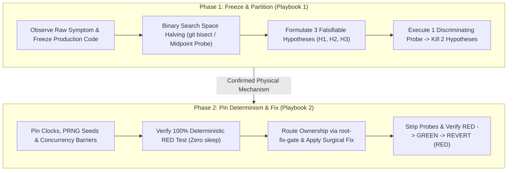

# Surgical Debugging & Scientific Fault Isolation Playbook Suite

The Surgical Debugging & Scientific Fault Isolation Playbook Suite enforces Microsoft and Meta root-cause investigation standards across production incidents, intermittent race conditions, flaky CI suites, and deep multi-layer regressions.

---

## 1. Playbook Directory Architecture

```
skills/scientific-fault-isolation/playbooks/
├── README.md                                  # Central Map of Content & Orchestration Index
├── differential-diagnosis-playbook.md         # Playbook 1: Microsoft / Meta 3-Hypothesis Differential Diagnosis & Bisect
└── deterministic-concurrency-playbook.md      # Playbook 2: Determinism Pinning & Heisenbug Eradication
```

Companion Guard Engine:
- `scripts/fault_isolation_guard.py` / `npx anti-slop-engineering fault-isolation audit`

---

## 2. Navigation Matrix

| Document | Primary Persona & Focus | Core Invariants | Canonical Artifact |
| --- | --- | --- | --- |
| **[Microsoft / Meta Differential Diagnosis Playbook](differential-diagnosis-playbook.md)** | Principal Diagnostics & Escalation Engineer: 3-hypothesis matrices, single discriminating probes, automated `git bisect`, Delta Debugging (`ddmin`) | Zero production edits before probe, $\ge 3$ falsifiable hypotheses, $\ge 2$ killed by 1 probe, $O(\log N)$ fault-space halving | Fault Isolation Record (`references/fault-isolation-record-contract.md`) |
| **[Deterministic Concurrency & Heisenbug Playbook](deterministic-concurrency-playbook.md)** | Staff Concurrency & Runtime Systems Engineer: Rendezvous barriers, virtualized clocks, PRNG seed pinning, Red-Green-Revert falsification | Zero `sleep()` band-aids, 100% deterministic red test before fix, Red-Green-Revert proof | Deterministic Race Reproducer (`examples/deterministic-race-reproducer.ts`) |

---

## 3. End-to-End Surgical Debugging Workflow



---

## 4. Automated Fault Isolation Guard Integration

The suite includes a zero-dependency validator (`scripts/fault_isolation_guard.py`) that audits both structured fault-isolation records and source/test diffs for shotgun debugging anti-patterns:

```bash
# Audit a fault isolation record:
npx anti-slop-engineering fault-isolation audit skills/scientific-fault-isolation/examples/scientific-fault-isolation-record.json --json

# Audit both the record AND scan a test/source file for sleep() band-aids or leftover debug probes:
python3 scripts/fault_isolation_guard.py audit record.json --source tests/checkout_race.test.ts --json
```

---

## 5. Non-Negotiable Standards of Engagement

1. **Zero Speculative Edits:** Never mutate production logic to see if a test turns green.
2. **Three Falsifiable Hypotheses Minimum:** Every investigation must explicitly Pit $H_1$, $H_2$, and $H_3$ against a single discriminating probe.
3. **Logarithmic Isolation ($O(\log N)$):** Always bisect commit ranges (`git bisect run` with exit code `125` safety) and multi-layer pipelines at their midpoint.
4. **100% Deterministic Reproducers:** Never rely on `sleep()` timing luck; force race collisions deterministically with rendezvous barriers and frozen clocks.
5. **Red-Green-Revert Proof:** Every fix must prove that reverting the fix immediately restores the deterministic failure.
