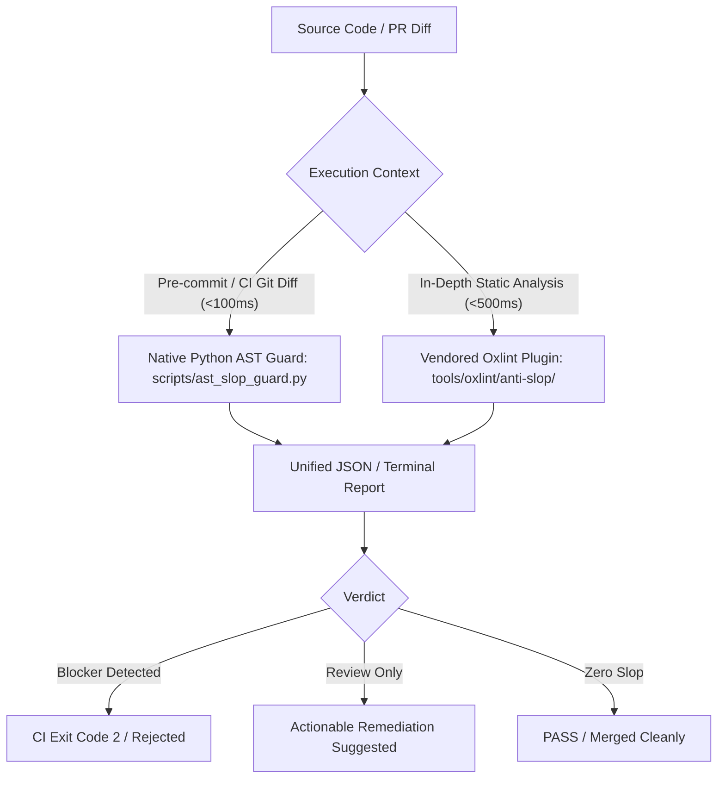

# Type-Level & AST Slop Gate

> Eliminate type-safety erosion, evidence fabrication, quadratic reductions, eager allocations, and test-oracle weakening across modern TypeScript and JavaScript codebases.

---

## 1. Executive Mission & Dual-Track Guard Architecture

AI coding assistants frequently reach for the path of least resistance when facing TypeScript compiler errors:
- Casting `as unknown as DesiredType` or `as any as DesiredType` to fabricate compliance without proving it.
- Widening known domain types to `Record<string, unknown>` or `object`, destroying compiler evidence.
- Spreading conditional empty objects `...(c ? { x } : {})`, deoptimizing V8 hidden classes.
- Chaining eager `.filter().map()` calls, generating disposable intermediate heap arrays.
- Copying accumulators in reducers via `acc.concat([item])` or `Object.assign({}, acc)`, triggering silent $O(N^2)$ quadratic latency explosions.
- Mocking entire modules (`vi.mock("./db")`), eroding test oracles into assertion theater where unit tests pass while production burns.

The **Type-Level & AST Slop Gate** operates across two complementary execution tiers:



1. **Tier 1: Universal Zero-Dependency Guard**
   `bunx anti-slop-engineering ast --base HEAD`
   Instantly audits added git diff lines with standard-library Python in <100ms. No Node/npm packages required.
2. **Tier 2: In-Depth Vendored Oxlint AST Plugin**
   `tools/oxlint/anti-slop/index.ts`
   Full ESTree AST and lexical scope resolution with 18 generic rules + 5 Effect rules, integrated into `oxlint.config.ts`.

---

## 2. Invariant Rules

### Invariant 1: No Evidence Fabrication
Chained type assertions (`as unknown as T`, `as any as T`) are strictly prohibited. You must validate unverified input at system boundaries via declarative schemas (Zod, ArkType, Effect Schema, Valibot) rather than laundering types.

### Invariant 2: Documented Invariant Justification
Every non-const type assertion (`val as UserId`) MUST be immediately preceded by a `// SAFETY: <justification>` or `// INVARIANT: <justification>` comment explaining why the type contract is guaranteed. Bare assertions are rejected.

### Invariant 3: Sublinear & Linear Reductions
Accumulators inside `.reduce()` and `.reduceRight()` callbacks must NEVER be copied using `acc.concat()`, `Object.assign({}, acc)`, `acc.slice()`, or `acc.toSpliced()`. Always mutate the fresh, locally owned accumulator in-place (`acc.push()`, `Object.assign(acc, item)`) and return it.

### Invariant 4: Lazy Iterator Pipelines
Adjacent eager `.filter().map()` or `.map().filter()` chains over arrays are banned. Use native lazy iterator helpers (`.values().filter().map().toArray()`), a single `flatMap()`, or a single mutating reducer.

### Invariant 5: Test Fidelity & Real Dependency Seams
Module mocking (`vi.mock()`, `jest.mock()`, `unstable_mockModule()`) is banned. Unit and integration tests must inject real dependency seams, in-memory verified fakes, or lightweight containers rather than mocking entire modules.

### Invariant 6: Boundary Decoding Over Ad-Hoc `typeof` Narrowing
`typeof x === "object"` or `typeof x === "string"` checks scattered across business logic are rejected. Input must be parsed into branded domain types at I/O boundaries.

### Invariant 7: Effect Architectural Purity
In Effect codebases:
- Direct `_tag` comparisons (`res._tag === "Ready"`) are banned in favor of `Match.value()` or `Predicate.isTagged()`.
- Literal `_tag` construction (`{ _tag: "Ready", value }`) is banned in favor of tagged constructors (`Ready.make({ value })`).
- Manual `_tag` branching in catch blocks is banned in favor of `Effect.catchTag()`.
- Relative `makeService` imports are banned in runtime modules in favor of yielding context from the owning Layer.

---

## 3. CLI Commands

```bash
# Audit diff against base commit
bunx anti-slop-engineering ast --base HEAD

# Audit specific directory or file directly
bunx anti-slop-engineering ast src/ --json

# Strict CI mode (exit code 2 on blockers)
bunx anti-slop-engineering ast --base origin/main --strict

# Install vendored Oxlint anti-slop plugin
bunx anti-slop-engineering install-oxlint tools/oxlint/anti-slop

# Reconcile vendored Oxlint installation with upstream (preserves local edits)
bunx anti-slop-engineering update-oxlint tools/oxlint/anti-slop --apply
```


## React ref API review

The [React 19 advisory example](examples/react-ref-advisory.mjs) accepts an exact React lock receipt and a reviewed use of the React package's `forwardRef` export wrapping a function component. Provide the exact React releases covered by the component's support matrix. Include declared React 18 peer support even when local development runs React 19. Re-exports, compatibility shims, class components, and unknown support remain outside the example's automatic assumptions.

```bash
bun skills/type-level-and-ast-slop-gate/examples/react-ref-advisory.mjs react-lock-evidence.json reviewed-usage.json
```

The receipt uses `{"status":"locked","resolved":"19.0.0","release":"stable"}` for a confirmed direct React dependency. The reviewed usage record uses `{"module":"react","export":"forwardRef","kind":"function-component","supportedVersions":["19.0.0","19.1.0"]}`. Populate these fields from dependency and source evidence. The example gives a review advisory for the documented React 19 behavior. It does not infer package identity from a function name or change code.

Read [React 19 ref-as-prop semantics](https://react.dev/blog/2024/12/05/react-19#ref-as-a-prop) and the [React v19.0.0 implementation](https://github.com/facebook/react/blob/7aa5dda3b3e4c2baa905a59b922ae7ec14734b24/packages/react/src/jsx/ReactJSXElement.js). Preserve the public ref type, callback-ref cleanup, and actual forwarding target during migration.

The same example also reviews the legacy `render` export of `react-dom`, removed in React DOM 19. The reviewed usage record uses `{"module":"react-dom","export":"render","kind":"call","supportedVersions":["19.0.0","19.1.0"]}`, and the receipt is the Bun lock evidence for `react-dom` including its `installed` block: the advisory requires the installed package to establish an exact stable React DOM 19, because the code runs against the installed package, not the lockfile alone. Missing installed evidence stays inconclusive. A support matrix that still covers React DOM 18 returns a compatibility exception instead of advice. The advisory cites the [React 19 upgrade guide](https://react.dev/blog/2024/04/25/react-19-upgrade-guide#removed-reactdomrender) and proposes `createRoot` from `react-dom/client`, keeping the returned root for teardown.

## Automated source evidence with Oxlint

Enable `anti-slop/react-forward-ref-evidence` as `"warn"` in the project's Oxlint config after [installing the plugin](../install-anti-slop/SKILL.md). It resolves the actual lexical React import for named, default, or namespace bindings. The observation applies to a direct call around an inline function or arrow. Shadowed bindings, compatibility shims, and wrappers passed by reference need separate evidence.

Enable `anti-slop/react-dom-render-evidence` the same way for the legacy render review. It resolves the actual lexical `react-dom` import for named, aliased, default, or namespace bindings and reports calls to the legacy `render` export. Bindings from `react-dom/client`, shadowed `render` parameters or locals, and references that are never called are not observations.

```bash
bunx oxlint --format=json src/MyInput.tsx > react-source.json
bun skills/type-level-and-ast-slop-gate/examples/react-ref-advisory.mjs react-lock-evidence.json react-support.json --oxlint-report react-source.json
```

Set `react-support.json` to the reviewed support matrix, for example `{"supportedVersions":["19.0.0","19.1.0"]}`. Run Oxlint with the configured rule and check that the scan succeeded. Keep the report, locked dependency receipt, and supported versions scoped to the same package. Oxlint reports the source location. The example returns a migration advisory only after the version and compatibility checks also pass.
