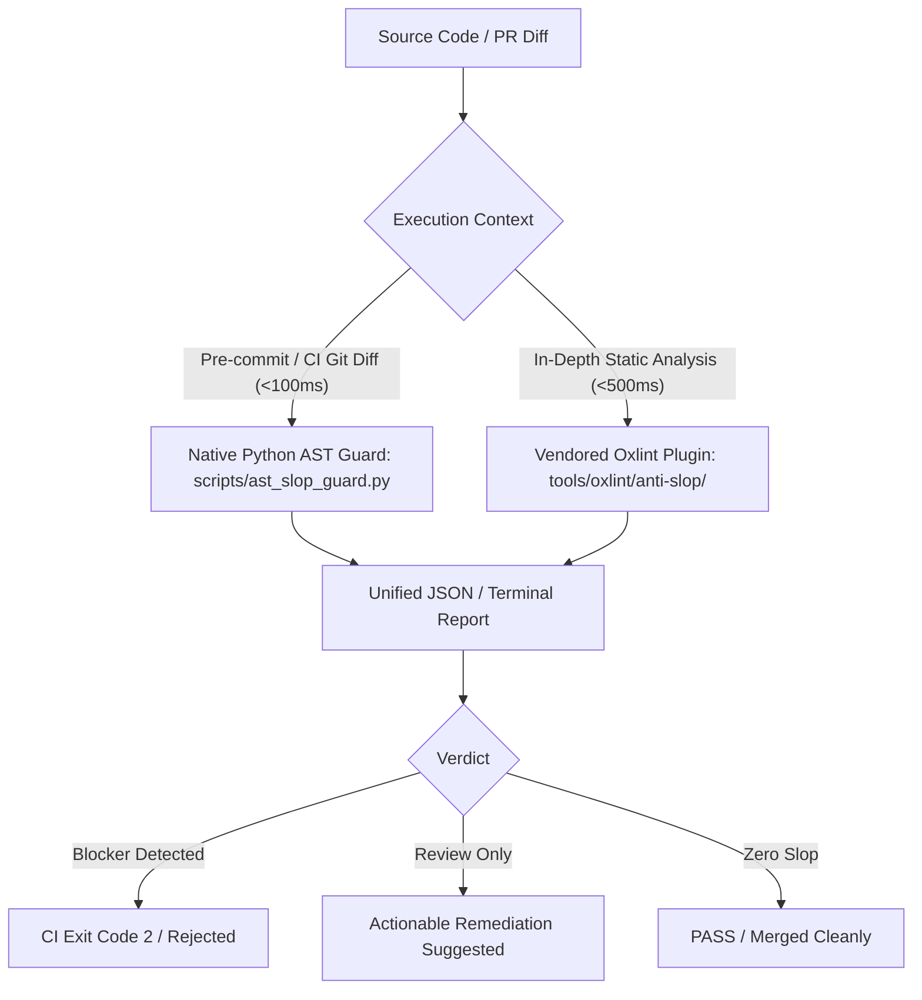

# Type-Level & AST Slop Gate

> Eliminate type-safety erosion, evidence fabrication, quadratic reductions, eager allocations, and test-oracle weakening across modern TypeScript and JavaScript codebases.

---

## 1. Executive Mission & Dual-Track Guard Architecture

AI coding assistants frequently reach for the path of least resistance when facing TypeScript compiler errors:
- Casting `as unknown as DesiredType` or `as any as DesiredType` to fabricate compliance without proving it.
- Widening known domain types to `Record<string, unknown>` or `object`, destroying compiler evidence.
- Spreading conditional empty objects `...(c ? { x } : {})`, deoptimizing V8 hidden classes.
- Chaining eager `.filter().map()` calls, generating disposable intermediate heap arrays.
- Copying accumulators in reducers via `acc.concat([item])` or `Object.assign({}, acc)`, triggering silent $O(N^2)$ quadratic latency explosions.
- Mocking entire modules (`vi.mock("./db")`), eroding test oracles into assertion theater where unit tests pass while production burns.

The **Type-Level & AST Slop Gate** operates across two complementary execution tiers:



1. **Tier 1: Universal Zero-Dependency Guard**
   `bunx anti-slop-engineering ast --base HEAD`
   Instantly audits added git diff lines with standard-library Python in <100ms. No Node/npm packages required.
2. **Tier 2: In-Depth Vendored Oxlint AST Plugin**
   `tools/oxlint/anti-slop/index.ts`
   Full ESTree AST and lexical scope resolution with 18 generic rules + 5 Effect rules, integrated into `oxlint.config.ts`.

---

## 2. Invariant Rules

### Invariant 1: No Evidence Fabrication
Chained type assertions (`as unknown as T`, `as any as T`) are strictly prohibited. You must validate unverified input at system boundaries via declarative schemas (Zod, ArkType, Effect Schema, Valibot) rather than laundering types.

### Invariant 2: Documented Invariant Justification
Every non-const type assertion (`val as UserId`) MUST be immediately preceded by a `// SAFETY: <justification>` or `// INVARIANT: <justification>` comment explaining why the type contract is guaranteed. Bare assertions are rejected.

### Invariant 3: Sublinear & Linear Reductions
Accumulators inside `.reduce()` and `.reduceRight()` callbacks must NEVER be copied using `acc.concat()`, `Object.assign({}, acc)`, `acc.slice()`, or `acc.toSpliced()`. Always mutate the fresh, locally owned accumulator in-place (`acc.push()`, `Object.assign(acc, item)`) and return it.

### Invariant 4: Lazy Iterator Pipelines
Adjacent eager `.filter().map()` or `.map().filter()` chains over arrays are banned. Use native lazy iterator helpers (`.values().filter().map().toArray()`), a single `flatMap()`, or a single mutating reducer.

### Invariant 5: Test Fidelity & Real Dependency Seams
Module mocking (`vi.mock()`, `jest.mock()`, `unstable_mockModule()`) is banned. Unit and integration tests must inject real dependency seams, in-memory verified fakes, or lightweight containers rather than mocking entire modules.

### Invariant 6: Boundary Decoding Over Ad-Hoc `typeof` Narrowing
`typeof x === "object"` or `typeof x === "string"` checks scattered across business logic are rejected. Input must be parsed into branded domain types at I/O boundaries.

### Invariant 7: Effect Architectural Purity
In Effect codebases:
- Direct `_tag` comparisons (`res._tag === "Ready"`) are banned in favor of `Match.value()` or `Predicate.isTagged()`.
- Literal `_tag` construction (`{ _tag: "Ready", value }`) is banned in favor of tagged constructors (`Ready.make({ value })`).
- Manual `_tag` branching in catch blocks is banned in favor of `Effect.catchTag()`.
- Relative `makeService` imports are banned in runtime modules in favor of yielding context from the owning Layer.

---

## 3. CLI Commands

```bash
# Audit diff against base commit
bunx anti-slop-engineering ast --base HEAD

# Audit specific directory or file directly
bunx anti-slop-engineering ast src/ --json

# Strict CI mode (exit code 2 on blockers)
bunx anti-slop-engineering ast --base origin/main --strict

# Install vendored Oxlint anti-slop plugin
bunx anti-slop-engineering install-oxlint tools/oxlint/anti-slop

# Reconcile vendored Oxlint installation with upstream (preserves local edits)
bunx anti-slop-engineering update-oxlint tools/oxlint/anti-slop --apply
```
