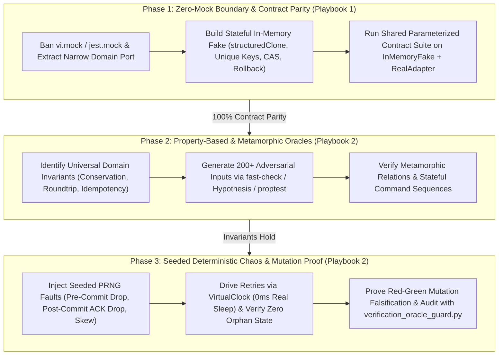

# Verification Oracle Architect Playbook Suite

The Verification Oracle Architect Playbook Suite enforces the zero-mock verification canon across AI-assisted software engineering: replacing banned module mocks (`vi.mock`, `jest.mock`, `unittest.mock.patch`) and brittle static example assertions (`2 + 2 = 4`) with Contract-Verified In-Memory Fakes (`100%` parity with production adapters), Property-Based & Metamorphic Invariant Oracles (`fast-check`, `Hypothesis`, `proptest`), and Seeded Deterministic Chaos Simulation (`Mulberry32` PRNG + `VirtualClock`).

---

## 1. Playbook Directory Architecture

```
skills/verification-oracle-architect/playbooks/
├── README.md                                               # Central Map of Content & Orchestration Index
├── verified-fakes-and-contract-suites-playbook.md          # Playbook 1: Port Interfaces, Stateful In-Memory Fakes & Shared Contract Test Suites
└── property-based-and-deterministic-chaos-playbook.md      # Playbook 2: Property-Based/Metamorphic Invariants & Seeded Deterministic Chaos Testing
```

Companion Guard Engine:
- `scripts/verification_oracle_guard.py` / `npx anti-slop-engineering verification-oracle audit`

---

## 2. Navigation Matrix

| Document | Primary Persona & Focus | Core Invariants | Canonical Artifact |
| --- | --- | --- | --- |
| **[Verified In-Memory Fakes & Shared Contract Suites Playbook](verified-fakes-and-contract-suites-playbook.md)** | Principal Test & Storage Architecture Engineer: Eliminating `vi.mock`/`jest.mock`/`unittest.mock`, designing narrow Port interfaces, building Stateful In-Memory Fakes (`structuredClone`, CAS version checks, unique constraints, rollback snapshots), and executing Parameterized Shared Contract Suites against both Fake and Real adapters | Zero module mocking, zero unverified inline stubs, 100% contract parity between `InMemoryFake` and `RealAdapter`, transactional snapshot rollback | Verification Oracle Record (`references/verification-oracle-record-contract.md`) |
| **[Property-Based, Metamorphic & Deterministic Chaos Playbook](property-based-and-deterministic-chaos-playbook.md)** | Principal Formal Verification & Distributed Systems Simulation Architect (FoundationDB / TigerBeetle / QuickCheck School): Universal algebraic invariants, metamorphic relations, stateful model command generation, seeded PRNG fault injection, and Virtual Clock time travel | Zero `2 + 2 = 4` happy-path-only suites on financial/parser/state-machine logic, zero unseeded `Math.random()`, zero wall-clock `setTimeout` sleeps, verified Pre-Commit and Post-Commit fault recovery | Verified Fake, Property & Chaos Oracle (`examples/verified-fake-property-chaos-oracle.ts`) |

---

## 3. End-to-End Verification Oracle Architecture Workflow



---

## 4. Automated Verification Oracle Guard Integration

The suite includes a zero-dependency validator (`scripts/verification_oracle_guard.py`) that audits both structured verification-oracle records and test/source files (`--source`) for banned module mocks (`vi.mock`, `jest.mock`, `sinon.stub`, `unittest.mock.patch`), unseeded `Math.random()`, wall-clock `setTimeout` sleeps, tautological assertions, missing contract parity, and missing mutation falsification:

```bash
# Audit a Verification Oracle record:
npx anti-slop-engineering verification-oracle audit skills/verification-oracle-architect/examples/verification-oracle-record.json --json

# Audit both the record AND scan a test module for mock/Determinism hazards:
python3 scripts/verification_oracle_guard.py audit record.json --source skills/verification-oracle-architect/examples/verified-fake-property-chaos-oracle.ts --json
```

---

## 5. Non-Negotiable Standards of Engagement

1. **Zero Module Mocks:** Never use `vi.mock`, `jest.mock`, `sinon.stub`, or `unittest.mock.patch` to fake domain repositories, queues, or payment gateways.
2. **Contract-Verified Fakes Only:** Every in-memory fake adapter must pass the exact same parameterized contract test suite as the real database/network adapter.
3. **Invariants Over Static Examples:** Verify financial arithmetic, parsers, codecs, and state machines with Property-Based and Metamorphic tests (`>= 100` generated runs with shrinking).
4. **Seeded Determinism & Virtual Clocks:** Inject network faults, partial drops, and clock skew via an explicit PRNG seed and Virtual Clock—never `Math.random()` or `setTimeout`.
5. **Falsify the Oracle:** Prove every test suite fails when the underlying production invariant is deliberately mutated.
