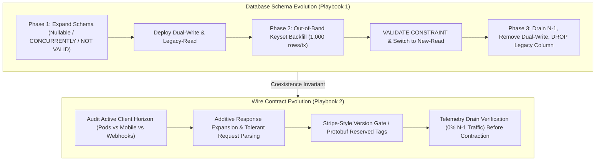

# Zero-Downtime Migration & Contract Evolution Playbook Suite

The Zero-Downtime Migration & Contract Evolution Playbook Suite governs live production schema evolution (PostgreSQL, MySQL, Google Spanner) and multi-version wire contract compatibility (JSON/REST, Protobuf/gRPC, GraphQL) across rolling deployments and long-tail client horizons.

---

## 1. Playbook Directory Architecture

```
skills/zero-downtime-migration-gate/playbooks/
├── README.md                                 # Central Map of Content & Orchestration Index
├── spanner-schema-evolution-playbook.md      # Playbook 1: Google Spanner & Lock-Free SQL Schema Evolution
└── stripe-contract-evolution-playbook.md     # Playbook 2: Stripe Wire Compatibility & API Version Gates
```

Companion Guard Engine:
- `scripts/migration_guard.py` / `npx anti-slop-engineering migration audit`

---

## 2. Navigation Matrix

| Document | Primary Persona & Focus | Core Invariants | Canonical Artifact |
| --- | --- | --- | --- |
| **[Google Spanner Schema Evolution Playbook](spanner-schema-evolution-playbook.md)** | Staff Database Reliability Engineer (DBRE): Multi-phase DDL choreography, PostgreSQL/MySQL lock tables, throttled backfills | Expand -> Migrate -> Contract, `CREATE INDEX CONCURRENTLY`, `NOT VALID` -> `VALIDATE`, explicit `lock_timeout` | 3-Phase Migration Plan & Record (`references/migration-record-contract.md`) |
| **[Stripe Wire Contract & API Evolution Playbook](stripe-contract-evolution-playbook.md)** | Principal API Platform Architect: JSON, Protobuf, and GraphQL forward/backward compatibility, version transform gates | $N$ and $N-1$ coexistence, tolerant readers, Protobuf `reserved` tags, date-pinned version upcasters/downcasters | Dual-Contract Adapters & Wire Compatibility Matrix |

---

## 3. Operational Workflow



---

## 4. Automated Migration Guard Integration

The suite provides a zero-dependency validator (`scripts/migration_guard.py`) auditing both architectural migration records and raw `.sql` migration files for table-locking DDL traps:

```bash
# Audit a zero-downtime migration record:
npx anti-slop-engineering migration audit skills/zero-downtime-migration-gate/examples/zero-downtime-migration-record.json --json

# Audit both the migration record AND verify a raw SQL file for lock hazards:
python3 scripts/migration_guard.py audit record.json --sql migrations/001_expand.sql --json
```

---

## 5. Non-Negotiable Standards of Engagement

1. **Zero Single-Shot Destructive Migrations:** Never rename or drop a live column, table, or wire field in a single deployment.
2. **Zero Unbounded Lock Waits:** Every SQL migration must begin with `SET LOCAL lock_timeout = '2s';`.
3. **Zero Blocking Index or Constraint Builds:** Always use `CONCURRENTLY` for indexes and `NOT VALID` followed by `VALIDATE CONSTRAINT` for foreign keys and check constraints.
4. **Zero Coupled Bulk Backfills:** Never run unbatched `UPDATE` statements inside DDL transactions.
5. **Strict $N$ and $N-1$ Wire Coexistence:** Old clients must read new responses without crashing, and new servers must accept old requests without failing validation.
