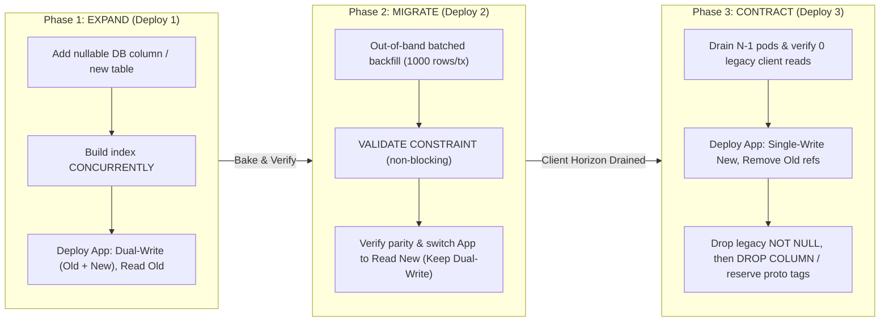

# Expand -> Migrate -> Contract Architecture (Spanner & Stripe Discipline)

## 1. Mathematical & Operational Reality of Rolling Deployments

In a distributed system with $K$ application replicas (pods/containers) and a shared relational database cluster, deployments do not happen at a single instant $t_0$. Instead, during a rolling deployment window $[t_{\text{start}}, t_{\text{end}}]$:

- At $t_{\text{start}}$, the database migration executes while 100% of pods run code **Version $N-1$**.
- At $t_{\text{mid}}$, 50% of pods run **Version $N-1$** and 50% run **Version $N$** against the exact same database schema.
- If Version $N$ exhibits a critical regression at $t_{\text{end}} + 10\text{ min}$, operators immediately roll back the binary to **Version $N-1$**, which must still function against the migrated database.
- External clients (iOS/Android apps, cached browser SPAs, third-party webhook consumers) remain on contract **Version $N-1$** (or $N-k$) for days, weeks, or months.

Therefore, any single-commit change that mutates or removes an existing database column or wire field in place violates the **Concurrent Version Coexistence Axiom**.

---

## 2. The Three-Phase State Machine



---

## 3. Canonical Recipe: Renaming or Splitting a Column

Suppose we need to evolve `users.full_name` (TEXT) into `users.given_name` (TEXT) and `users.family_name` (TEXT).

### Forbidden Slop Approach (Causes Production Outage)
```sql
-- FATAL: Breaks all running N-1 pods immediately and locks the table!
ALTER TABLE users RENAME COLUMN full_name TO given_name;
ALTER TABLE users ADD COLUMN family_name TEXT NOT NULL;
```

### Zero-Downtime 3-Phase Approach

#### Phase 1: Expand (PR #1)
1. **Migration (`001_expand_user_names.sql`):**
   ```sql
   SET LOCAL lock_timeout = '2s';
   SET LOCAL statement_timeout = '5s';

   ALTER TABLE users
     ADD COLUMN IF NOT EXISTS given_name TEXT NULL,
     ADD COLUMN IF NOT EXISTS family_name TEXT NULL;
   ```
2. **Application Code (Dual-Write, Legacy-Read):**
   - Every `INSERT` and `UPDATE` on `users` writes `full_name` AND populates `given_name` and `family_name`.
   - Every `SELECT` reads `given_name ?? splitFirst(full_name)` or continues reading `full_name`.
   - If `full_name` had a `NOT NULL` constraint, drop the `NOT NULL` constraint in Phase 1 or Phase 2 (`ALTER TABLE users ALTER COLUMN full_name DROP NOT NULL;`) so Phase 3 can stop writing to it safely.

#### Phase 2: Migrate (PR #2)
1. **Batched Backfill Worker (`backfill_user_names.ts`):**
   - Iterate in batches of 1,000 rows using primary-key cursor pagination:
     ```sql
     SELECT id, full_name FROM users
     WHERE id > $1 AND (given_name IS NULL OR family_name IS NULL)
     ORDER BY id ASC LIMIT 1000;
     ```
   - Compute `given_name` and `family_name` and update the batch.
2. **Non-Blocking Constraint Validation (`002_validate_user_names.sql`):**
   ```sql
   SET LOCAL lock_timeout = '2s';
   ALTER TABLE users
     ADD CONSTRAINT chk_users_given_name_not_null
     CHECK (given_name IS NOT NULL) NOT VALID;

   SET LOCAL statement_timeout = '0'; -- Validation scan can take minutes but does not block writes
   ALTER TABLE users
     VALIDATE CONSTRAINT chk_users_given_name_not_null;
   ```
3. **Application Cutover (Dual-Write, New-Read):**
   - Switch all application readers to read directly from `given_name` and `family_name`.
   - Keep writing to `full_name` until Phase 2 bakes without rollback.

#### Phase 3: Contract (PR #3 — after $N-1$ is 100% drained)
1. **Application Cleanup:**
   - Remove `full_name` from ORM models, `SELECT` projections, and dual-write mutations.
   - Deploy and confirm zero database queries reference `full_name`.
2. **Migration (`003_contract_user_full_name.sql`):**
   ```sql
   SET LOCAL lock_timeout = '2s';
   ALTER TABLE users DROP COLUMN IF EXISTS full_name;
   ```

---

## 4. Canonical Recipe: Changing Column Data Types (e.g. `INT` -> `BIGINT` or `VARCHAR(50)` -> `TEXT`)

In PostgreSQL, `ALTER TABLE events ALTER COLUMN id TYPE BIGINT;` acquires an `ACCESS EXCLUSIVE` lock and rewrites the entire table on disk, taking hours on a 500M-row table.

### Zero-Downtime Procedure
1. **Expand:** Add `id_v2 BIGINT NULL`. Create a `BEFORE INSERT OR UPDATE` trigger (or application dual-write) that copies `NEW.id_v2 := NEW.id`.
2. **Migrate:** Backfill `id_v2 = id` where `id_v2 IS NULL` in batches of 1,000 rows. Build a unique index concurrently:
   ```sql
   CREATE UNIQUE INDEX CONCURRENTLY idx_events_id_v2 ON events (id_v2);
   ```
   Add `CHECK (id_v2 IS NOT NULL) NOT VALID` and `VALIDATE CONSTRAINT`.
3. **Contract / Cutover:** Switch application reads/joins to `id_v2` (or in a brief maintenance window of `< 500ms` under `lock_timeout = '2s'`, promote the index and swap column names only after all indexes and constraints are pre-built).
